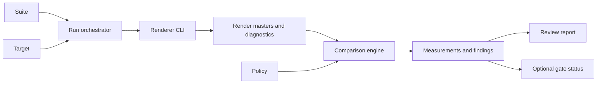

# Benchmark system design

## Boundary

`SpektraFilm` remains the renderer. `spektrafilm-bench` is an external evaluation orchestrator and artifact producer. It consumes the renderer's public CLI, machine-readable dry-run output, floating image output, and diagnostics. It does not import renderer internals or duplicate runtime parameter resolution.

The benchmark owns suite selection, target identity, dependency hashing, run isolation, comparison policy, metric execution, region selection, evidence indexing, and review artifact generation. A metric adapter owns one measurement implementation. A report builder owns presentation of an existing comparison.

The benchmark must keep rendering and evaluation separate. A run produces immutable render evidence. A comparison reads runs and produces immutable measurements. A report reads comparisons and produces review artifacts. This allows an agent to rerun only the failed stage and allows a person to inspect a report when the renderer is unavailable.

## Chosen boundary options

A renderer-integrated benchmark would avoid subprocess setup, but it would couple evaluation releases to the simulation runtime, duplicate CLI contracts, and make independent metric updates harder. A standalone Python benchmark CLI keeps the first implementation deep: it can use established image and color libraries while treating the existing renderer as a stable process boundary. The target design therefore chooses a standalone executable with a renderer adapter.

The benchmark must not add a second parameter DSL. Suite and target documents may reference the renderer's existing `--preset`, `--params`, and `--set` carriers. The benchmark validates their shape and passes them to the renderer in the renderer's defined precedence order. Benchmark-only settings use typed JSON fields and have no shell or expression evaluation.

The first implementation may use a Python package and console entry point. Its artifact and JSON contracts must remain language-neutral so a later Rust implementation can consume the same documents without changing evaluation meaning.

## Component responsibilities

### Document loader

The loader parses strict JSON, rejects duplicate keys and unknown authored fields, resolves paths relative to the containing document, and validates the schema and cross-document identities. It must not resolve environment interpolation or execute document content.

### Dependency resolver

The resolver hashes executable bytes, selected data inventory, source files, presets, sparse parameter files, masks, transforms, references, and protocol inputs. It must produce a deterministic sorted inventory. Modification times and directory traversal order must not affect identity.

### Run orchestrator

The orchestrator selects cases, applies target changes after case configuration, invokes the renderer, captures stdout and stderr separately, validates the machine result, and records the actual output and diagnostics. It must use unique artifact paths and refuse destination replacement. It must remove incomplete case artifacts or mark them incomplete.

The orchestrator must execute the real `spektrafilm` or `spektrafilm-f64` entry point. It must request a floating master suitable for the selected measurement domain and an independent lossless review image. It must not use a lossy preview as the numerical master.

The orchestrator must retain the command vector after path normalization, selected environment allowlist, process identity, renderer result, and execution diagnostics. It must identify the renderer revision when the executable exposes one and retain the executable hash regardless.

### Comparison engine

The comparison engine matches results by stable case and seed identities. It verifies protocol, dimensions, source declarations, effective parameter compatibility, and applicable reference scope before computing measurements. It must produce an explicit incompatibility result instead of silently aligning incompatible runs.

It must compute maps before summaries. Summary scalars must be derived from the retained map or curve and the declared valid mask. Automatic hotspot selection must use those same retained measurements.

### Metric adapters

Each adapter must declare input domain, required metadata, output schema, availability reasons, deterministic implementation identity, and calibration dependencies. It must not inspect human log text. It must not silently transform an input to improve a score.

The first metric set is color and signed Lab diagnostics, tone response, numeric health, LDR-FLIP, flat-field grain statistics, bright-source halation profiles, and edge response. SSIM is optional and must not be a prerequisite for the first qualified protocol.

### Policy evaluator

The evaluator applies exact selectors and fixed constraints to comparison measurements. It must evaluate protected properties separately from expected changes and reference objectives. It must retain all rule outcomes even when one failure determines the overall status.

It must not infer budgets, tune parameters, choose a more favorable reference, or rewrite an unavailable measurement. It may produce `insufficient_evidence`.

### Review builder

The review builder creates an offline report from comparison artifacts. It must not render or recalculate metrics. It must preserve artifact hashes in its manifest and use relative links. It must emit accessible full-image, A/B, locator, detail, and difference views.

## Identity and cache invariant

A render result is reusable only when its suite, case, target, renderer executable, data inventory, source input, parameter files, protocol-independent render settings, selected environment, and seed identities match. A comparison result is reusable only when its two run identities, protocol digest, policy digest, and metric implementation identities match.

The benchmark must never reuse a stale result because a path stayed the same. It must reject a changed dependency before using the cache. It must not use a partial or failed run as a qualified baseline.

## Coordinate and color invariant

Every artifact must declare its coordinate space. Renderer coordinates, transformed comparison coordinates, common-area masks, review image coordinates, and native detail coordinates must remain distinct. A local transform must never be applied to an artifact without changing its identity and recording its purpose.

Color conversion must occur at one named boundary for each metric. A map and its scalar summary must use the same converted samples and valid mask. Display clipping must not alter native numerical measurements. A report must label the display copy separately from the numerical master.

## Stochastic invariant

A fixed seed provides a repeatable realization under the same renderer conditions. It does not make unrelated seeds or precision paths equivalent. Deterministic probes must disable stochastic effects explicitly. Grain conclusions require the declared seed population and must retain per-seed observations.

## Failure and availability invariant

The pipeline must distinguish configuration failure, renderer failure, measurement unavailability, policy failure, and report publication failure. Each boundary must retain stable machine codes and relevant artifacts. An unavailable metric must never serialize as zero. A failed policy gate must not delete the completed comparison.

A comparison can complete with `insufficient_evidence`, but a qualified pass requires all required measurements, compatible conditions, calibrated policy, and successful artifact validation. Human approval can add a review decision but cannot rewrite the measured result.

## First safe implementation slice

The first implementation should support one controlled suite and one natural-scene suite, CPU f64 rendering through the existing CLI, floating masters, deterministic numeric/color/tone metrics, fixed semantic regions, automatic FLIP hotspots, JSON comparison output, and an offline report. It should use a fixed protocol identity and require explicit policies before gating.

The next slice can add multi-seed grain statistics and dedicated halation probes. Reference alignment should follow after correspondence and provenance records are available. GPU comparison, HDR metrics, and additional learned metrics must not enter the initial qualified path without a separately versioned protocol.
