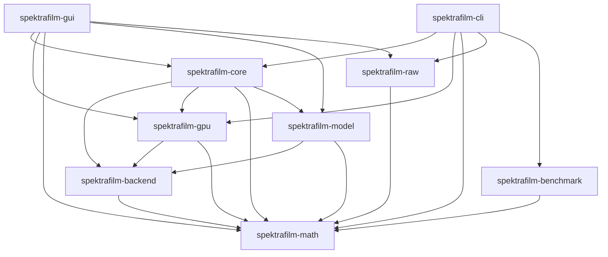

# Compute backend boundary design

## Ownership

The workspace MUST separate the compute backend abstraction from its device implementations. The abstraction owns the `ComputeBackend` trait, its default CPU implementations, and the shared observation vocabulary. A device implementation owns device resources, kernel dispatch, device error handling, and synchronization.

This separation keeps the abstraction available to domain code without pulling a device toolkit into its dependency graph.

[GPU execution](../gpu-execution/design.md) already fixes this split at the module level: the CPU implementation owns reference evaluation, and the WGPU backend owns device resources, kernel dispatch, device error handling, and synchronization. This document carries that same split down to the crate boundary, so a consumer cannot reach device code through an import that only needed the reference implementation.

The abstraction MUST NOT depend on any device toolkit. A device implementation MUST depend on the abstraction, never the reverse. Domain code that consumes the abstraction MUST NOT acquire a transitive device dependency.

[GPU execution](../gpu-execution/design.md) owns which stages run on which processor. [Telemetry](../telemetry/design.md) owns observation semantics. This document owns only where each piece of code lives and what it MAY import.

## Crate boundary

The workspace MUST contain these crates for compute:

| Crate | Owns | MUST NOT own |
|-------|------|--------------|
| `spektrafilm-math` | scalar and image primitives, color spaces | backend abstraction |
| `spektrafilm-backend` | `ComputeBackend` trait, default CPU implementations, telemetry vocabulary, timing, observation binding, device-independent parameter records | device resources, shader code, device error handling |
| `spektrafilm-gpu` | the WGPU backend, device buffers, kernels, device error handling, the fused film chain pipe | the trait definition, CPU default implementations, telemetry vocabulary, device-independent parameter records |
| `spektrafilm-core` | runtime, stage ordering, operation validation, report assembly | device resources |
| `spektrafilm-model` | film and scanner domain models | device resources, direct adapter selection |

`spektrafilm-backend` MUST be the only owner of the `ComputeBackend` trait. `spektrafilm-gpu` MUST implement that trait for its device backend and MUST NOT redefine it.

`spektrafilm-backend` MUST NOT enable a device feature by default. `spektrafilm-gpu` MUST remain the crate that enables the device toolkit. A build that selects only `spektrafilm-backend` MUST NOT compile any device code.

## Viewer ICC preparation

The viewer owns ICC profile parsing and image-independent LittleCMS preparation. `ViewerIccGpuParams` MUST carry only the content identity, a fixed representation kind, and immutable packed words. The WGPU backend MUST own the prepared device buffer and apply it with a fixed kernel.

It MUST NOT compile profile-specific shader source or evaluate source-image ICC pixels on the host.

Preparation MUST preserve the default LittleCMS RGB8-to-RGB8 Perceptual transform. A matrix-shaper representation MUST match the pinned optimizer ABI and its integer quantization. Other valid transforms, including transforms without an exposed pipeline, MUST use an exhaustive map of all 256³ RGB8 inputs.

The map MUST NOT use a coarse lattice or interpolation.

Prepared host data MUST use a bounded memory cache and a checked persistent cache. Cache identity MUST include conversion-bearing profile content, intent, pixel formats, CMM version, and preparation-format version. Disk reads MUST validate identity, kind, length, and payload checksum before reuse.

Invalid entries MUST be prepared again. Persistence failure MUST NOT invalidate a successful preparation.

Concurrent requests for one identity MUST share one preparation result. Cache lookup locks MUST NOT span disk access or LittleCMS work. At most two independent preparations MAY run at once.

The host memory cache and device buffer cache MUST each retain at most 16 entries and 96 MiB of prepared data. The persistent prepared-data cache MUST retain at most 16 entries and 128 MiB after pruning. Active callers MAY retain evicted entries until their operation completes.

## Dependency direction

Dependencies MUST point in one direction only:

`spektrafilm-benchmark` depends on `spektrafilm-math` only, so it is unaffected by the boundary.

`spektrafilm-cli` and `spektrafilm-gui` keep their direct `spektrafilm-gpu` dependency, because both select a device backend through `select_backend`.

`spektrafilm-model` MUST depend on `spektrafilm-backend` and MUST NOT depend on `spektrafilm-gpu`. This removes the inversion where domain code required a device crate only to reach the CPU reference implementation.

A test that requires a device adapter is the one permitted exception. `spektrafilm-model` keeps `spektrafilm-gpu` as a dev-dependency, because its grain parity test compares the CPU reference against the device implementation and needs an adapter to do it. Production code names no device crate; `cargo tree -e normal` is the check that matters.

`spektrafilm-core` MAY depend on both `spektrafilm-backend` and `spektrafilm-gpu`, because it owns route selection across CPU and GPU execution. A frontend that never selects a device MUST NOT require `spektrafilm-gpu`.

## What moves

These items move from `spektrafilm-gpu` to `spektrafilm-backend` without behavior change:

- the `ComputeBackend` trait and its default implementations
- `CpuBackend` and its CPU spectral implementations
- the `telemetry` module and its observation vocabulary
- the `timing` module
- `observed_backend`, `bind_backend`, and `bind_cpu_fallback`
- `FilmChainParams`, `FrontPass`, and the `*GpuParams` records
- `ProceduralGrainGpuParams`, `CpuStageFn`, and `Lut3D`
- `DyeGpuParams` and its type chain: `DyeReadoutGrid`, `DyeChannelTablesGpu`, `DyeChannelTableGpu`, and `DyeChannelParts`

`DyeGpuParams` currently lives under `wgpu_backend` but holds only plain data: channel tables, a cell size, taps, a readout grid, a seed, a correlation, and an expectation flag. No field is a device type. `spektrafilm-core` already constructs it directly.

It is a misplaced device-independent parameter record, and the trait cannot move until it does.

Its type chain is also device-free, but those types share a file with `LayerPass`, which encodes device passes. Moving them requires splitting `dye_layers.rs` so the plain records leave and the device passes stay. This split is the first concrete step of the migration, not a later cleanup.

`DyeChannelParts` and `DyeChannelTablesGpu::pack` MUST move with them. `spektrafilm-core` constructs `DyeChannelParts` in production code at `stages/grain_dye.rs` and passes it to `pack`, which converts f64 model tables to f32 device records without touching a device. Leaving either behind would keep a device import in the domain code that builds them.

Every moving item MUST be free of device references before it moves. `CpuBackend` imports only `rayon`, `spektrafilm-math`, and `blas_src`. The telemetry vocabulary imports only `serde`, `tracing`, and `parking_lot`.

`timing` imports no device crate. `observed_backend` names `DyeGpuParams` in its `dye_field` forwarder, and that reference disappears once the record moves. An item that cannot be made device-free MUST stay with the device crate and the boundary MUST be re-evaluated rather than force-moved.

These items stay in `spektrafilm-gpu`:

- `wgpu_backend` and every type under it, except the device-independent parameter records named above
- `WgpuBackend` and its `ComputeBackend` implementation
- the film chain pipe, its buffer pools, its pass assembly, and its shader code

`FilmChainParams` moves with the trait, because the trait's `try_run_film_chain` signature references it. Its field types — `FrontPass` and the `*GpuParams` records — are plain data: scalars, arrays, and borrowed slices. None is a device type.

The `Gpu` in their names describes which pass consumes them, not what they contain. Leaving them behind would force the trait to keep a device dependency for a struct of numbers.

`test_support` MUST split by device: adapter acquisition for a device backend stays with that backend, and any device-independent test helper moves to `spektrafilm-backend`.

`select_backend` MUST stay in `spektrafilm-gpu`, because it constructs a device backend when an adapter is available. Its five call sites — four in the CLI, one in the GUI — keep their behavior, but their import path changes in step 4.

`gpu_blur_supported` MUST stay in `spektrafilm-gpu`, because every caller is device pass code that asks whether a blur sigma fits the device kernel limit. The `FilmChainParams::gpu_blurs_supported` method that answers the same question for the whole parameter record stays with the record.

## Feature propagation

`spektrafilm-backend` MUST expose no device feature. `spektrafilm-gpu` MUST own the feature that enables the device toolkit and MUST keep it non-default when a consumer needs a device-free build.

A workspace member that depends on `spektrafilm-gpu` MUST state that dependency directly. Feature unification MUST NOT silently enable a device toolkit for a consumer that only requires `spektrafilm-backend`.

## Numerical and behavioral invariance

The move MUST NOT change any of the following:

- output pixels for any input
- the CPU reference implementation's arithmetic, iteration order, or precision
- telemetry observation names, fields, units, or counter definitions
- error message strings
- public function signatures beyond their module path

Every moved item keeps its name. Only its import path changes.

## Verification ownership

A build with only `spektrafilm-backend` in the dependency graph MUST compile and MUST NOT link a device toolkit.

The workspace test suite MUST pass unchanged after the move. Parity tests MUST produce identical results. Telemetry reports MUST be byte-identical for identical operations.

The dependency graph MUST be checked mechanically: no rule in this document MAY rely on review discipline alone.

## Risks

The `ComputeBackend` trait is referenced at about 93 call sites across four crates. Each site changes only its import path. A mechanical rename risk is a missed site, which the compiler catches.

`spektrafilm-core` keeps its `spektrafilm-gpu` dependency for two reasons: it constructs `FilmChainParams` for the device route, and it names `WgpuBackend` directly in `stages/grain_dye.rs`. This is correct: core owns route selection, and route selection requires knowledge of what the device can do.

The telemetry vocabulary moves, but its ownership rules do not. [Telemetry](../telemetry/design.md) keeps authority over observation semantics; this document only relocates the code.

## Migration order

The move MUST proceed in this order, because each step MUST compile before the next begins:

1. Create `spektrafilm-backend` with no device feature. Move the device-independent parameter records first — `DyeGpuParams` and its type chain, `ProceduralGrainGpuParams`, `CpuStageFn`, `Lut3D`, `FilmChainParams`, `FrontPass`, and the `*GpuParams` records — because the trait signature references them.
   Splitting `dye_layers.rs` is part of this step, since those records share a file with device pass code. `spektrafilm-gpu` re-exports them so the tree still compiles.
2. Move the `ComputeBackend` trait and its default implementations, `CpuBackend`, telemetry, timing, and observation binding into `spektrafilm-backend`. Keep the re-exports.
3. Move `spektrafilm-model` to depend on `spektrafilm-backend` only.
4. Update `spektrafilm-core`, `spektrafilm-cli`, and `spektrafilm-gui` import paths.
5. Remove the `spektrafilm-gpu` re-exports and confirm no consumer reaches a moved item through the device crate.
6. Split `test_support` and confirm a device-free build.

A dry run of steps 1 and 2 produced a compiling `spektrafilm-backend` whose dependency tree contains no device crate. That result is the evidence this order is viable; it is not a claim that later steps are equally cheap.

Re-exports exist only to keep intermediate states compiling. Step 5 MUST delete them, so the final tree has exactly one path to each moved item.
