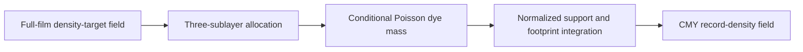

# Film grain Dye design

## Decision

Dye is a conditional, film-coordinate record-field algorithm. It consumes the developed record-density target produced by the film stage and returns formed density to the next spectral stage.

It models color dye records or an effective monochrome record. It does not reconstruct microscopic crystals, model a scanner, or add noise to an encoded image.

The algorithm has four required operations:



The conditional expectation and the stochastic realization MUST use the same allocation, formation, and readout operators. A clean-detail image MUST NOT bypass those operators. A residual representation MAY be used internally only when it is mathematically equivalent to forming the complete field.

This document specifies algorithm relationships and invariants. It does not select production values for support, event area, stock strength, sublayer scales, density floors, occupancy, channel coupling, field pitch, or numerical budgets. Those values belong to a separately versioned parameter and evidence record.

## Terms

The [Dye grain context](CONTEXT.md) defines the domain terms used here. A density target is the conditional developed CMY record response after the film curves, development, and DIR processing owned by the film stage. It is not an independent clean image.

A field cell is a numerical film region carrying aggregate conditional dye mass. It is not one visible grain, crystal, or output pixel.

An output footprint is the film rectangle represented by one output sample. Dye reads a footprint with a normalized rectangular box weight.

A reference canvas is the global discretization of the full-film conditional field. Tiles and bands are storage partitions of that canvas, not separate random fields.


A calibration record is defined in the [Dye grain context](CONTEXT.md). It is evidence for one declared condition and is not a universal physical constant.

## Processing boundary

Dye MUST consume the expected developed CMY record density at the film-density boundary. It MUST NOT resample exposure or repeat nonlinear film chemistry inside the grain algorithm.

The film stage MUST establish the target over the full source film before crop and output resampling. The target grid MUST use the source dimensions, full-film geometry, existing exposure calculation, and existing non-grain film processing. Crop bounds MUST NOT replace the film boundary.

The source target is piecewise constant over source-pixel rectangles unless a separate reconstruction contract declares another representation. Transfer to field cells MUST use conservative area overlap. It MUST preserve constant fields and integrated target mass.

Source-center interpolation followed by another box average MUST NOT be used as an implicit reconstruction step.

Dye MUST return formed CMY record density to the next spectral stage. Printing, scanner acquisition, film-base spectra, dye spectra, negative interpretation, color conversion, gamut mapping, lens blur, unsharp mask, transfer encoding, and other downstream operations remain outside the Dye model. Dye MUST NOT compose grain after encoding.

The host pipeline owns lifecycle bypasses. When it selects active Dye, it MUST run the algorithm described here. When it selects an inactive, preview, LUT, spatial-deactivation, or stochastic-deactivation path, it MUST bypass Dye before field preparation.

A bypass MUST NOT resolve Dye and then suppress its output.

## Film geometry

The caller supplies the full-film rectangle, source-pixel geometry, resolved crop, and actual output dimensions. Dye MUST NOT introduce a second film-format parameter or a stock-name format rule.

The GUI editor for `camera.film_format_mm` MUST use a 1-1000 mm usability range and MUST clamp typed values to that range. The validator MUST accept every strictly positive document value, including values outside the editor range. The [GUI workflow specification](../../gui-workflow/spec.md#numeric-editor-ranges) owns the general editor-range rule; this sentence owns the Dye geometry consequence.

Source pixels occupy declared film rectangles. The full-film origin is the global coordinate origin. Field cells are square regions with a declared pitch and signed integer indices.

Crop bounds, tile bounds, output dimensions, dispatch shape, traversal order, and thread scheduling MUST NOT redefine the origin or cell lattice.

Output dimensions MUST be resolved before readout. Each output pixel owns the exact rectangle obtained by partitioning the requested film region by the actual output dimensions. Readout MUST integrate fractional cell overlap.

It MUST NOT assume an integer field-to-output ratio or use nominal, pre-rounding dimensions.

If downstream spatial processing requires context outside the requested crop, the caller MUST evaluate Dye and that downstream operation on a full-film or proven-equivalent enclosing lattice, then extract the requested output rectangle. A bounded halo MAY be used only after its boundary equivalence is proven. A crop or tile edge MUST NOT reflect, clamp, truncate, or reseed the field.

Changing film geometry changes source and output footprint sizes. It MUST NOT silently change support, event area, field pitch, target density, or random-stream addressing. Resource checks MUST reject an unrepresentable request before allocation.

They MUST NOT silently coarsen the lattice, remove sublayers, clip a count, or substitute another grain law.

## Resolved parameter contract

The algorithm consumes these parameter classes:

| Class | Meaning | Owner |
| --- | --- | --- |
| Support | Spatial formation kernel and its width, shape, and extent | Dye algorithm calibration |
| Event area | Mass represented by one stochastic event | Dye algorithm calibration |
| Stock strength | Relative channel and stock strength factor | Film profile and Dye calibration contract |
| Sublayer response | Per-layer capacity, floor, and scale | Film profile and Dye calibration contract |
| Occupancy | Conditional event-occupancy policy | Dye algorithm calibration |
| Channel coupling | Optional shared-count law across dye records | Dye algorithm contract and calibration |
| Field resolution | Numerical discretization of the field | Numerical certification |

No parameter class MAY imply another class. Support MUST NOT be used as event area. An RMS target MUST NOT be used as a per-image normalization.

A Spektra-only particle-area or blur control MUST NOT enter Dye unless a later Dye contract explicitly adopts it.

The runtime MUST validate finiteness, positivity, nonnegativity, domain constraints, and representability before allocation. An invalid or unrepresentable value MUST produce an actionable error. The implementation MUST NOT repair it by clipping, substituting a default, dropping a layer, or changing the count law.

The implementation MUST expose no independent controls for particle count, event mass, sparsity, or measured RMS. Count rate and event mass are derived from the target, event area, occupancy policy, sublayer response, and cell geometry. RMS is a measurement result, not a formation input.

## Record layout

The resolved profile supplies an internal monochrome layout flag after development-time selection. A single-record branch makes the material realization explicit; merely admitting BW to three-record sampling would retain redundant independent fields. Three-lane storage remains shared with the existing formation and readout operators.

For BW, the model MUST require identical record tables and parameters. Source samples MUST be finite and within each lane's capacity envelope. Each source lane MUST agree with record 0 within an absolute `1e-6 D`, the existing density-envelope tolerance.

Validation MUST examine all original full-source samples before record-0 substitution, including samples outside the requested readout and its formation halo. Image-dependent GPU checks MUST execute on the selected device.

The BW branch MUST allocate record 0 on the source grid before conservative remap. For each global cell it MUST sample that record's numerical components with private stream tags `0`, `1`, and `2`, without a shared-count draw.

It MUST copy the summed absolute density to all three lanes before formation, optical response, and readout. Generating three fields and averaging them or desaturating final RGB is not equivalent.

Replicated lanes MUST use identical statistical floors. The existing floor subtraction and downstream film-base spectrum remain distinct. The color path MUST retain its arithmetic order, stream tags, and default inputs.

Saved BW material MUST retain the existing `monochrome_record_replicated` representation. Continuation MUST consume the formed field without resampling it. [GPU execution](../../gpu-execution/spec.md#computation-scope) owns the CPU-only material boundary; exact-cell and aperture persistence restrictions remain unchanged.

## Sublayer target allocation

The resolved film profile supplies three sublayer responses for each active dye record. The implementation MUST use the profile reconstructed for the actual render, not stale sampled arrays that the loader has replaced.

For record `c` and layer `l`, let `m_lc` be the nonnegative layer capacity, `f_lc` its positive capacity fraction, `b_lc` the declared density-floor share, and `M_lc = m_lc + b_lc`. Zero-capacity layers MUST be excluded from allocation and channel coupling. A target outside the summed active capacity MUST fail before count generation.

At source target `D_c`, provisional layer values MUST use the profile's declared composite-to-layer interpolation rule, including its endpoint and duplicate-knot convention. These values are relative allocation weights, not a second tone curve.

The implementation MUST use a weighted-capacity water-fill or an algebraically equivalent constrained allocator. Zero weights, endpoint targets, duplicate knots, saturated layers, and a single active layer MUST have explicit behavior and tests.

One valid canonical form is to solve for the nonnegative scale `r` and allocations `t_lc` under:

```text
t_lc = min(M_lc, r * w_lc)
sum_l t_lc = D_c + sum_l b_lc
```

where `w_lc` is the provisional weight plus the declared floor share. If all active weights are zero, the allocator MUST use active capacity fractions. The solution MUST be found by removing saturated layers and resolving the remaining proportional allocation.

It MUST preserve the target sum and report unsupported targets instead of clipping them.

## Conditional Poisson mass

For field-cell area `A`, allocated absolute layer target `t_lc`, event area `a_lc`, and occupancy factor `s_lc`, the implementation MUST derive a nonnegative Poisson rate `lambda_lc` and event mass `mass_lc` that satisfy:

```text
E[cell_absolute_density_lc] = t_lc
```

The canonical parameterization is:

```text
p_lc = t_lc / M_lc
s_lc = occupancy(p_lc)
lambda_lc = A * f_lc * p_lc / (a_lc * s_lc)
K_lc ~ Poisson(lambda_lc)
mass_lc = M_lc * a_lc * s_lc / f_lc
cell_absolute_density_lc = mass_lc * K_lc / A
```

The occupancy function MUST be declared by the algorithm revision, positive over the realizable domain, and bounded so that the formulas remain representable. At `p_lc = 0`, the implementation MUST produce zero count. At a full-capacity endpoint, it MUST still use the declared Poisson law.

The implementation MUST NOT substitute normal, Gaussian-residual, clipped-tail, fixed-count, or silently truncated laws.

### Device count law

The CPU f64 implementation is the reference for the count law. The device MUST reproduce the law decision for decision: Knuth's multiplication below the transition rate, Hörmann's PTRS above it, and the exact rejection expression.

A normal approximation, a clipped tail, a fixed count, or a silently truncated substitute MUST fail the same predeclared probability, mean, variance, and higher-moment checks over a declared rate set. A build that changes the law MUST fail those checks.

Event mass MUST NOT depend on crop, tile size, output resolution, traversal order, or thread scheduling. The local expectation MUST be `t_lc`. Count moments and the target invariant MUST be checked independently of final image similarity.

## Channel coupling

Independent per-channel counts are the default algorithm mode until a calibration record selects a joint law. If coupling is enabled, it MUST preserve every channel marginal and record the covariance it introduces.

A canonical shared-Poisson split is:

```text
lambda_shared_l = rho * min over active c of lambda_lc
lambda_independent_lc = lambda_lc - lambda_shared_l
K_lc = S_l + I_lc
S_l ~ Poisson(lambda_shared_l)
I_lc ~ Poisson(lambda_independent_lc)
```

The minimum is over active channels that realize the layer. A layer with fewer than two active channels has no shared component. The shared stream is drawn once per layer and does not replace any marginal channel stream.

A coupling value MUST be treated as an algorithm input selected by evidence, not as a scanner-noise imitation.

Random streams MUST be addressed by the full seed, fixed Dye stream tags, and global signed cell coordinates. Output coordinates, local crop indices, tile shape, dispatch shape, traversal order, and scheduling MUST NOT enter the address. Repeating one global cell with the same conditioning MUST reproduce its count.

Coordinate-domain overflow and exhausted rejection budgets MUST fail explicitly.

## Dye formation

The production support MUST be a normalized, nonnegative spatial operator with a declared finite extent or a declared convergent infinite evaluation. A truncated separable Gaussian is the initial algorithm family. Its width and truncation extent are calibration inputs, not fixed constants in this specification.

For a support kernel `g`, a source cell `S_i`, and a destination cell `C_j`, a cell-average coefficient MUST represent the area integral:

```text
H(j,i) = integral_Cj integral_Si g(x - z) dz dx / area(Cj)
```

Coefficients MUST be nonnegative and normalized over the declared support and boundary context. CDF-based integration, exact overlap tables, or an equivalent area-integrated representation MAY be used. Point-sampled taps MUST NOT silently replace the declared operator.

Formation MUST apply to the complete stochastic field and to its conditional expectation with the identical operator. The mean is not a separate clean-detail path. Formation MUST preserve a constant target in expectation and MUST NOT introduce a crop-, tile-, or field-edge-dependent gain.

The formed field MAY be accumulated per channel after summing its sublayers. This is an execution optimization only. It MUST NOT change layer-specific count generation or the resulting field.

## Readout and optical boundary

Readout MUST integrate formed cell averages over the exact output footprint with fractional overlap and divide by footprint area. It MUST handle subcell footprints, noninteger ratios, translated crops, and non-square output footprints.

The resulting CMY density is a density-domain approximation to downstream spectral readout. The independent `spektrafilm_core::dye_measurement` oracle owns transmission-first measurement outside Dye formation. It forms wavelength-dependent transmission from the film base and all CMY records, applies the declared receiver spectrum and aperture kernel, and integrates transmission before applying the receiver's density interpretation.

It MUST NOT exponentiate independent CMY coefficients as separate outputs.

The oracle's absolute total spectral density is `D_abs(lambda) = D_base(lambda) + sum_c d_c * s_c(lambda)`. It MUST be finite and nonnegative. The oracle MUST evaluate `T = 10^(-D_abs)` before aperture or spectral integration.

A negative CMY coefficient alone MUST NOT fail validation. The final receiver ratio MUST be positive and finite, but MAY exceed one when the declared reference is not a unit clear film. Its resulting receiver density MAY therefore be negative.

Total-density and transmission failures MUST identify the wavelength index. For these failures, realization reads MUST also identify the aperture sample and seed.

The production density readout MAY be accepted only after the oracle bounds its difference for the declared route, receiver, aperture, density definition, wavelength range, and viewing/output conditions. A failure MUST trigger an algorithm or boundary decision. It MUST NOT be hidden by retuning event area or applying a per-image gain.

## Deterministic comparison

The implementation MUST provide a diagnostic expectation mode that replaces each cell count with its conditional mean while retaining target preparation, layer allocation, support formation, readout, downstream settings, and precision. It is the expectation at the CMY boundary. It is not the seed-ensemble mean after nonlinear spectral or scanner operations.

Expectation mode MUST NOT mutate the user recipe or become an alternate production grain law. It exists to separate deterministic formation and detail transfer from stochastic count variation during acceptance.

## Numerical certification

Field pitch is a numerical parameter selected by certification. It MUST be anchored to film geometry and independent of source dimensions, crop size, output size, and seed. A finer pitch MAY be used when resources allow.

A coarser pitch MUST NOT be selected silently to fit resources.

Certification MUST cover constant fields, impulses, edges, narrow lines, fractional translations, subcell footprints, noninteger field-to-output ratios, film boundaries, and representative density targets. It MUST compare production formation and readout with an independent support/rectangle integration oracle that does not reuse production helpers.

Certification MUST measure expected-density error, readout RMS, spatial covariance or power spectrum, and convergence under field refinement. It MUST state numerical budgets before evaluating a candidate. A wrong support width, wrong normalization, or wrong boundary policy MUST fail even when final-image moments look plausible.

At fixed target, geometry, seed, precision, and output footprints, full-frame, crop, and tiled reads of one global field MUST agree within the declared precision budget. Band height, tile shape, and dispatch shape MUST NOT change results. Cross-canvas comparisons MUST distinguish numerical conditioning differences from same-canvas identity.

The count law MUST be tested by probability, mean, variance, and higher-moment checks over a declared rate set. A deliberately wrong-law control MUST fail the same predeclared checks. A test that checks only equal first moments or final image similarity is insufficient.

## Optical measurement and calibration

The formation algorithm MUST NOT read statistics from the current image or normalize a realization to its measured RMS. Measurement is an external operation over fixed stimuli, fixed geometry, fixed receiver and aperture, fixed density interpretation, and a declared seed population.

The optical measurement record MUST identify:

- stock or profile identity and source provenance;
- film record-density and density-to-transmission conventions;
- receiver spectrum, aperture or point-spread function, wavelength range, and sampling;
- stimulus geometry, output footprint, and viewing condition;
- seed population and realization count;
- algorithm revision, numerical precision, and executor;
- measured mean, variance/RMS, covariance or spectrum, tone bias, and color bias;
- status: `measured`, `estimated`, `proxy`, `uncalibrated`, or `rejected`.

The calibration solver MUST fit parameters against a fixed development and optical condition. It MUST use separate fit and holdout stimuli or seeds. It MUST evaluate mean density, optical RMS, spatial correlation, and relevant tone/color bias together.

It MUST reject an infeasible fit when the requested target requires an unrepresentable parameter instead of changing support, density, or target semantics.

RMS is a measurement under a declared protocol. It is not automatically a runtime control, a universal stock property, or proof of microscopic grain size. A stock-specific calibration MUST NOT be generalized to another stock, receiver, aperture, density definition, route, or format without new evidence.

### Measurement statistics and revision

The standalone oracle owns the population estimators. For `N >= 2` receiver-density readings `D_i`, it MUST compute:

```text
mean = sum_i D_i / N
C_pop = sum_i (D_i - mean) (D_i - mean)^T / N
rms_density[j] = sqrt(C_pop[j,j])
uncertainty_density[j] = sqrt(C_pop[j,j] / (N - 1))
```

`covariance` MUST retain the descriptive divisor `N`. `uncertainty_density` MUST use the sample-variance estimate of the mean's standard error under independent seed realizations. It is not an RMS error bar.

A constant population MAY produce zero estimated uncertainty; this does not establish zero systematic error. Both RMS and SEM use `D`. A comparison with granularity reported as `1000 sigma_D` MUST apply that conversion explicitly outside these fields.

The oracle MUST stamp new output records' existing `protocol.algorithm_revision` with the prefix `dye-measurement-v2:` followed by the caller's algorithm revision. This prefix identifies the passive-absorption domain, the two-realization minimum, and the SEM estimator above. An input revision already bearing this prefix MUST retain it without duplication.

The oracle's retained input protocol MUST remain unchanged. This record identity MUST NOT add a serialized field or change the measurement record's field set.

Older unprefixed records MUST deserialize without relabeling or recomputing statistics. Records from the prior implementation used `rms_density / sqrt(N)` for uncertainty and allowed a one-realization population. Their original generating revision determines their interpretation; an absent current prefix MUST NOT be treated as proof of the current estimator.


## Runtime integration and module boundaries

The implementation MUST keep these boundaries explicit:

1. **Target preparation:** full-film geometry, source reconstruction, film-stage density target, and profile resolution.
2. **Layer allocation:** profile lookup, capacity constraints, floors, and target conservation.
3. **Count realization:** event-area scaling, Poisson sampling, channel joint law, and coordinate-addressed streams.
4. **Formation:** support normalization, area-integrated cell averaging, and boundary context.
5. **Readout:** rectangular footprint integration and CMY output.
6. **Optical measurement:** independent transmission, aperture, density, and calibration records.
7. **Executor adapters:** CPU reference and GPU production implementations over the same algorithm contract.

The CPU reference and GPU production executor MUST implement the same target, allocation, formation, count-law, coordinate, and readout semantics. They MAY differ in floating-point precision and draw identity only where the executor contract explicitly permits it. GPU code MUST NOT consume a CPU-prepared image-sized stochastic field as a substitute for the algorithm.

No module MAY duplicate another module's film chemistry, optical measurement, parameter fit, or route selection. User surfaces MAY expose algorithm inputs, but they MUST NOT encode calibration evidence or infer stock calibration from an appearance label.

## Implementation gates

Implementation MUST proceed in gates:

1. Prove target preparation and layer allocation on deterministic in-memory fields, including endpoints, duplicate knots, zero weights, zero-capacity layers, and unsupported targets.
2. Prove the exact count law and coordinate-addressed streams with independent statistical checks and a deliberately wrong-law control.
3. Prove support normalization, cell-average formation, fractional readout, constant preservation, impulse and edge response, and refinement convergence against an independent oracle.
4. Prove crop, tile, band, and dispatch invariance and resource rejection without allocating an oversized request.
5. Prove the optical measurement oracle on synthetic constant and varying fields, including transmission positivity, kernel normalization, density ordering, wavelength integration, and receiver/aperture changes.
6. Produce per-stock or per-profile calibration records with fit and holdout separation. Do not change production parameters from a local experiment without a complete record.
7. Validate CPU f32/f64, usable hardware GPU, actual CLI and GUI Scan/Export paths, and photographic references only after the preceding gates pass.

Each gate MUST publish its inputs, algorithm revision, precision, seed population, output hashes or measurements, and pass/fail result. A local probe, one stock, one seed, one crop, or a software GPU adapter MUST NOT be presented as universal algorithm or photographic acceptance.

## Evidence and limits

Dye does not require microscopic crystal reconstruction, particle enumeration, multiple texture scales, encoded-RGB noise, scanner noise reduction, or a universal physical grain-diameter control. These are separate model decisions, not implicit fallbacks.

Real scans guide photographic validation. They do not define an algorithm until receiver, aperture, density, wavelength, source provenance, and processing are declared. Commercial simulation resemblance does not establish correctness or attribution.

The [product contract](spec.md#controls-and-resolved-inputs) owns the BW extension's parameter compatibility. It does not establish compatibility with earlier unsupported BW realizations or weaken the algorithm's validation gates.
