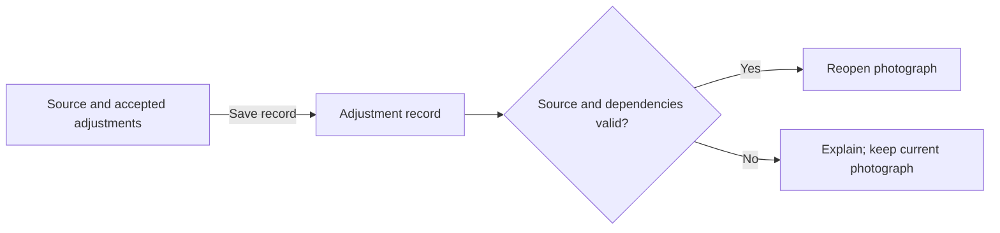
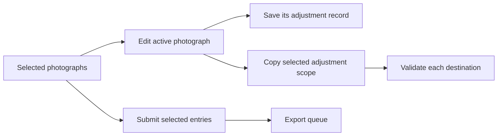
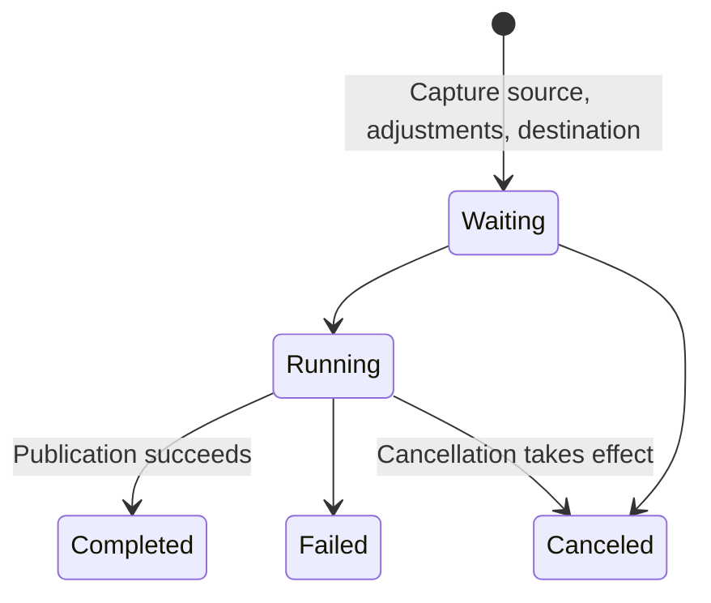

# Photograph comparison and continued work

## Authority

This target extends [GUI product design](../spec.md). It owns Original/Modified inspection, photograph adjustment records, and multi-photograph work.

[GUI workflow](../../gui-workflow/spec.md) owns edits, history, and render identity. [Presets](../../presets/spec.md) owns reusable looks. [Photo export](../../photo-export/spec.md) owns rendering and file publication.

## Original / Modified

The viewer labels **Original** (原图) and **Modified** (修改图) select the [shared domain terms](../../../CONTEXT.md#language). They are viewer selections, not captured adjustment versions or the scanner's automatic baseline.

Modified MUST remain disabled until output exists. The first accepted Preview or Scan MUST select Modified. Switching MUST share zoom and pan without rendering, editing adjustments, or adding history.

Save MUST continue to write the retained output, even while Original is selected. Export MUST render the current accepted adjustments independently. A stale retained Modified image MUST keep its ordinary stale-result indication.

Paper back MAY remain a separate presentation. The scanner's held automatic-baseline comparison MUST remain independent of Original/Modified selection.

[Image analysis](../image-analysis/spec.md#analysis-subject-and-comparison) owns how these presentations select measurements without introducing another layer selector.

## Photograph adjustment records

A **photograph adjustment record** associates a source identity with accepted input interpretation, RAW settings, geometry, photographic adjustments, and material dependencies. It is not a preset or startup default.

The GUI MUST offer explicit save and reopen actions. It MUST disclose excluded pending drafts. Records MUST exclude application preferences, undo stacks, jobs, and Export drafts.

Reopening MUST reject missing or changed dependencies before replacing the active context. Relocating a source MUST require explicit selection and identity validation. It MUST NOT silently substitute defaults or a same-named different file.

Accepted reopening follows the complete-state history boundary in [GUI workflow](../../gui-workflow/spec.md#edit-history).

A failed record write MUST preserve the previous valid record. Record saving MUST NOT modify the source or preset. Closing or replacing unsaved accepted work MUST offer Save record, Discard, and Cancel; failed saving MUST stop the transition.

Records MUST disclose external dependencies. Embedded project packages, cloud synchronization, and crash recovery are outside this target.

## Work list

A **work list** is an explicitly selected set of photographs with one active entry. It is not a media catalog.

The GUI MUST support adding, removing, and moving between entries. Each entry MUST retain its own adjustments and record-save state. Switching MUST respect the unsaved-work boundary above.

Failed loading MUST preserve the active photograph. A delayed result from another entry MUST NOT replace its output.

Removing an entry MUST NOT delete its source, record, or exported files. Single-photograph editing MUST NOT require a work list.

### Copy adjustments

Copy MUST require explicit scope and destination selection. It MUST disclose the controls replaced. Existing look, section, feature-profile, and operator-correction scopes remain authoritative.

Copy MUST preserve destination source interpretation, RAW settings, geometry, source calibration, and delivery settings. Automatic frame setup MUST use each destination, not copied prepared values. Each destination MUST commit atomically or remain unchanged, with an individual outcome.

Successful application MUST be reversible in that destination's current history.

### Export queue

Submission MUST capture each entry independently of later edits or removal. Pending RAW changes MUST remain distinct from the accepted decode being exported. Duplicate destinations MUST be resolved before submission; replacement of existing files MUST require an explicit choice.

The queue MUST expose per-entry outcomes and cancellation. Live export operation status stays in the [header](../../gui-workflow/spec.md#labels-and-surfaces), separate from viewer rendering. A failed entry MUST NOT stop unrelated work.

Canceling remaining work MUST preserve completed files. [Photo export](../../photo-export/spec.md#publication) owns individual publication guarantees; the batch is not one atomic transaction.

Retry MUST distinguish repeating the failed submission from submitting current adjustments. Sequential execution is sufficient. Restart recovery and parallel rendering are outside this target.

## Excluded scope

This target does not add ratings, smart albums, folder watching, a media database, local masks, a node editor, or new film algorithms.
