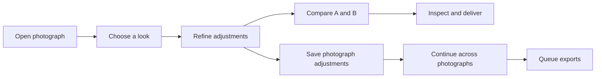

# GUI product design

## Authority and scope

This specification defines the photo-first desktop workspace and its user flows. [GUI workflow](../gui-workflow/spec.md) owns control placement, editing, history, retained output, and persistence. [GUI presentation](../gui-presentation/spec.md) owns visual tokens, component states, and the quiet photo-first presentation target.

[GUI product language](../gui-language/spec.md) owns labels and help. [The product design](design.md) defines the boundaries that implement these contracts.

The GUI MUST reduce navigation and editing effort without removing supported controls. It MUST NOT replace independent parameters with a generic effect-strength slider. Folding a module MUST change its presentation only.

This target replaces the MAIN, FILM, PRINT, ADVANCED, and CONFIG page navigation with a stage inspector and separate application settings. It does not change the film pipeline, canonical parameter paths, preset schemas, validation, or Save and Export pixel semantics.

## Capability map

The GUI MUST support this photographic work without requiring a second basic/expert control inventory:

[Result identity](../gui-workflow/spec.md#result-identity-and-delivery-guidance) owns confidence in the displayed and delivered image. [Visual hierarchy](../gui-presentation/spec.md#visual-hierarchy) owns control density. [Preset discovery aids](../presets/spec.md#preset-discovery-aids) owns reference thumbnails, favorites, and recently used looks.

[Photograph work](photo-work/spec.md) owns Original/Modified inspection, adjustment records, and multi-photograph work.

These are target capabilities, not a statement of implementation. Delivery schedules and research candidates are not product contracts.

## Workspace

The workspace MUST keep three regions: a collapsible preset browser on the left, the retained-image viewer in the center, and the adjustment inspector on the right. The image MUST remain visible while a person chooses a preset or edits a photographic parameter.

The header MUST expose Open image, Undo, Redo, application settings, and independent Export. It MUST identify the current source, material pair, and physical workflow. Material and workflow summaries outside the inspector MUST be read-only.

Status ownership follows [Labels and surfaces](../gui-workflow/spec.md#labels-and-surfaces).

Preview MUST update automatically under the [workflow contract](../gui-workflow/spec.md#contract), without a button or enablement preference. Scan and Save MUST remain reachable without opening a photographic module. Preview, Scan, Save, and Export retain their distinct operation scopes.

Delivery emphasis follows [Result identity and delivery guidance](../gui-workflow/spec.md#result-identity-and-delivery-guidance).

The inspector MUST present Input and capture, Film, Print, Scan, and Output in that order. A stage jump strip MUST reveal and scroll to the corresponding heading in the same inspector. It MUST NOT switch between mutually exclusive pages.

Several stages and modules MUST be able to remain open together.

The inspector MUST keep search and stage navigation visible while its controls scroll. The tonal-distribution readout remains collapsible above them. Preset and inspector scrolling MUST NOT move or resize the photograph.

Application settings MUST contain general application preferences, startup-state actions, display configuration, and diagnostics. General replaces the visible Session group and includes the [interface language selector](../gui-language/spec.md#interface-language). Export options MUST remain in the independent Export dialog.

Neither surface MUST become a destination for photographic controls merely because they are less common. Settings and Export MUST follow [dialog interaction](../gui-workflow/spec.md#dialog-interaction) for input isolation, explicit dismissal, focus restoration, and canonical row locating.

## User flows

### Open and establish the workflow

1. Open image MUST accept the supported RGB and RAW formats through their existing import paths. A supported drop MUST enter the same import operation.
2. A successful import MUST show the accepted source and its current workflow. Failure MUST preserve the accepted image and controls and report the error.
3. A person MUST be able to choose a complete look from the left browser or choose materials directly in their stages. Choosing a preset MUST NOT be required to edit a photograph.
4. The person can adjust exposure in Input and capture before opening other modules.

RAW decoding and reprocessing MUST remain distinguishable from simulated camera exposure. Changing a RAW setting MUST NOT imply that an accepted source has already been decoded with that setting. The reprocess action and its pending or failed state MUST be explicit.

### Choose a look or a material

A look preset selects the material pair and its owned controls under [Presets](../presets/spec.md#apply). The browser MUST support search and distinguish applied, modified, and missing states. Built-in presets remain read-only.

Choosing a film alone MUST retain the selected print material. Choosing a print material alone MUST retain the selected film. Workflow defaulting and scanner normalization MUST follow the existing [material-selection rules](../presets/spec.md#workflow-defaulting), not the browser prototype's behavior.

The header MUST identify any resulting route or scanner normalization.

A material selector MUST list only materials accepted for its role. Development-time choices MUST come from the selected material's family. A material without a selectable family MUST show its effective state without a one-choice selector.

A feature profile and a look preset MUST remain distinct operations. A feature profile MUST NOT change materials, route, enable state, or unrelated controls. Multi-photograph copying scopes follow [Photograph work](photo-work/spec.md#copy-adjustments).

### Refine the photograph

A person MUST be able to open any module without changing the route, applying a preset, or enabling an effect. An inactive module MUST retain its values and explain what makes it inactive.

Numeric controls MUST combine coarse pointer adjustment with precise entry. Every editable vector component MUST remain accessible. A linked or aggregate control MUST NOT replace independent components.

Parameter search MUST find controls across all stages, including collapsed and inactive modules. Results for application settings and Export MUST open the actual owner, not duplicate its editors. Search and Only modified MUST NOT change render parameters.

The Scan and Output stages MUST distinguish scan acquisition through the fixed product readout illuminant, scan output polarity and negative conversion, readout optics and digital sharpening, and downstream digital output.

A row MUST offer help and its unit where applicable. A module MUST offer the factory reset for its controls, and a row MUST NOT offer one of its own. Factory differences MUST remain distinct from differences against the applied preset.

A drag, reset, feature-profile selection, material selection, or preset application MUST be reversible under [Edit history](../gui-workflow/spec.md#edit-history).

### Inspect and deliver

Original, Modified, and Paper back remain viewer presentations. Zoom, pan, layer selection, reveal, interpolation, display ICC, canvas, and paper-back presentation MUST NOT change retained, saved, or exported pixels.

The viewer MUST retain the last accepted frame while work runs. It MUST identify when that frame does not represent the current controls. A delayed result MUST NOT appear to satisfy a newer edit.

Save MUST write retained output without rerendering. Export MUST capture an independent full-resolution render request. Export MUST expose format, bit depth, encoding, compression, saving color space, and backend according to the [photo-export contract](../photo-export/spec.md).

Canceling its settings MUST discard the draft; canceling an active export MUST use the existing worker cancellation path.

The GUI MUST NOT treat saving a preset, saving startup defaults, saving retained output, and exporting a photograph as interchangeable operations.

Restore factory default MUST ask for confirmation that it replaces the current configuration and removes the saved startup default. Save current as default MUST report that it replaced startup controls. Neither action MAY claim that adjustment Undo reverses the file change.

## Full controls with progressive disclosure

The [stage and surface table](../gui-workflow/spec.md#stage-and-surface-ownership) is authoritative for placement. Every supported editable control MUST have one location. There is no basic-mode inventory and no separate expert-mode inventory.

Closed module headings MUST name their contents with physical terms and expose their modified and inactive states without color alone. Enabling a module MUST NOT be required to discover its contents. Inactive values MUST remain readable.

Default disclosure MUST put the source workflow and camera exposure within reach before detailed material controls. Other modules MAY start collapsed. Folding one module MUST NOT close another.

A parameter edit, preview completion, or route change MUST NOT collapse the user's open modules or reset the inspector scroll position.

Halation MUST be a named Film module, not a hidden generic effect. It MUST retain the feature-profile action, scatter and back-reflection controls, source response, all editable RGB components, bounce controls, and normalization. A profile is a scoped starting configuration, not a substitute for these controls.

Preflash MUST be a named Print module beside the main enlarger exposure controls. Exposure, Yellow shift, and Magenta shift MUST all be available. Zero exposure disables flash and retains the filter values.

The label and help MUST distinguish linear flash exposure from camera EV and main print exposure. Photographic-paper highlight behavior and its limitations follow [Preflash](../output-mix/spec.md#preflash).

Camera diffusion belongs to Input and capture. Enlarger diffusion belongs to Print. Print viewing glare belongs to Scan.

Halation, these two diffusion stages, and viewing glare MUST NOT be combined into one Bloom or Glow module.

The grain selector MUST keep all supported engines and their full parameter sets. Their shared location MUST NOT imply a common processing domain. Unselected engine values remain discoverable and retained; actual editability follows engine and feature-profile conditions.

## Visual and accessibility constraints

The native application MUST reuse the [semantic token system](../gui-presentation/spec.md#semantic-role-vocabulary). A web prototype palette or dimension is not a new native token authority.

The image MUST have the largest uninterrupted visual area at the supported desktop layout. Panels MUST use restrained surfaces, aligned labels and values, and a warm accent for action or selection. Dense technical explanations belong in help rather than between every ordinary control.

At 1460 × 980, the toolbar, stage navigation, and numeric editors MUST remain readable and operable without overlap or clipping. A narrower supported window MUST use the [responsive preset rail](../presets/design.md#boundaries) and allow long control lists to scroll. Shrinking the window MUST NOT make a control permanently unreachable.

This specification does not require a mobile-native GUI.

All controls, module toggles, preset actions, search results, and dialogs MUST work by keyboard and pointer. Focus MUST remain visible. Numeric editing MUST NOT lose focus on each accepted value update.

Closing a dialog MUST return focus to its invoking control. Labels and state cues MUST remain meaningful without hover or color alone.

## Non-goals

This specification does not introduce new film algorithms, artistic macro parameters, parameter aliases, basic/expert modes, a second preset library, live current-photograph preset thumbnails, media cataloging, or a new GUI framework. It does not restore retired output-lightness or draft digital-response controls. Favorites and multi-photograph work follow the owners in the [capability map](#capability-map).

The HTML design reference is not an engine implementation. Its sample values, parameter count, browser storage, image assets, and disabled engine actions are not native product contracts. Native acceptance MUST use actual source images, production controls, and real render and writer operations.

## Acceptance

| Scenario | Required observable result |
| --- | --- |
| Open RGB or RAW; attempt an invalid import | The supported input reaches its real import path; failure preserves the accepted source and controls. |
| Choose a look, change exposure, undo | The look applies atomically; its modified state follows owned controls; undo restores the previous edit without rewriting the preset file. |
| Change only the film | The print selection remains; route defaulting and scanner normalization follow their owners and are reported. |
| Expand several modules; edit and wait for preview | Open state, scroll, and numeric focus remain usable; the image remains visible. |
| Search a folded or inactive control by label or canonical path | The correct owner is revealed with its current value and applicability reason; no second editor or parameter change appears. |
| Search an Export or display option | The result opens that dialog or setting; unrelated dialogs are not filtered by the inspector query. |
| Use Only modified, reset a module, then undo | Filtering uses the factory baseline; reset changes only the module's owned scope; undo restores values and edit provenance. |
| Drag a slider through several intermediate values | Its number updates consistently; the completed gesture creates one undo step. |
| Apply a Halation profile; edit an RGB component | Only the feature profile's declared scope changes; the direct edit remains available and profile identity is recomputed. |
| Set Preflash exposure and Y/M shifts; set exposure to zero | Flash stops while both filter values remain; a route without printing marks the group inactive without clearing it. |
| Switch grain engines, then return | Every engine retains its controls; conditions and domains remain explicit; no generic slider replaces model controls. |
| Save after changing viewer presentation; run independent Export | Save retains its input pixels and Export uses its captured full-resolution configuration; neither consumes a viewer raster. |
| Reject a preset or state; undo while a render runs | Rejection commits nothing; obsolete worker results cannot overwrite the restored controls' accepted output. |
| Use keyboard navigation and a narrow desktop window | All editing and preset actions remain reachable; no clipping or pointer-only action blocks the workflow. |

Control completeness MUST also satisfy the executable inventory coverage in [Complete control access](../gui-workflow/spec.md#complete-control-access). A fixed prototype count is not completeness evidence.

## Implementation status

The native GUI implements the continuous stage inspector, global control locators, preset search, and source-local adjustment history described in the [GUI guide](../../docs/gui.md). Application settings and independent Export use separate dialogs. These implemented surfaces do not by themselves establish complete native acceptance.

Acceptance MUST exercise production controls, actual source images, render workers, and file writers under the scenarios above. Specification checks and HTML interaction review do not establish native behavior or cross-platform acceptance.
