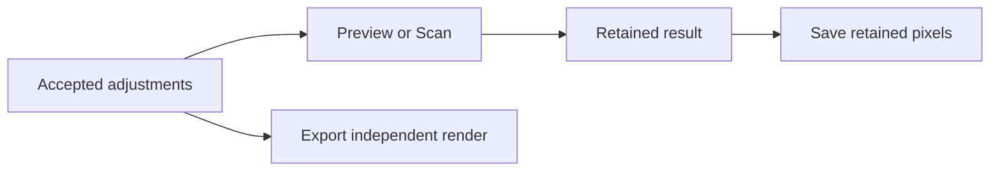

# GUI workflow
## Presentation language

The [GUI presentation specification](../gui-presentation/spec.md) owns visual hierarchy, semantic tokens, component states, layout rhythm, feedback, and accessibility presentation rules. This specification remains authoritative for workflow behavior, stage and surface ownership, control inventory, editing behavior, persisted-state behavior, and viewer semantics. Visible labels and help text follow [GUI product language](../gui-language/spec.md).

## Contract

- The GUI exposes controls for input, film, print, scanner, output, advanced color, and configuration.
- Preview renders a bounded disposable image. Scan renders the original working resolution.
- Both use the current runtime controls.
  `standard` negative-to-positive preview MUST prepare and finish the complete working frame before display reduction; its full-frame requirements follow the [scan preview contract](../film-chain/lab-scan/spec.md#exact-preview-and-prepared-baseline).
- Preview updates automatically after source acceptance and valid adjustment changes, including the preview size limit. It MUST NOT have a Preview button, an Update action, or an enablement preference.
- Accepted edits MUST use the existing debounce and wait for calibration and modal guards.
- Save writes retained output. Export re-renders through the selected backend and exposes cancellation.
- Render, saving-conversion, and viewer execution follow [GPU execution](../gpu-execution/spec.md); selecting CPU does not imply a precision different from the actual build.
- Startup controls MAY be saved and restored. Removing the startup default restores the factory profile.
- Viewer-only state, such as zoom, interpolation, reveal, and canvas presentation, MUST NOT alter saved or exported pixels.

- The Scanner controls show exactly the controls that
[Scan medium and scanner controls](../film-chain/spec.md#scan-medium-and-scanner-controls) assign to the scanned medium. For a negative film profile on the direct `input > film > scan` route or the real negative-capture `input > convert-film > scan` route, they offer `direct_scan` and `negative_to_positive`. Labels MUST follow the [scan output naming contract](../film-chain/spec.md#scan-output-naming-acceptance).

Every route shows lens blur and unsharp mask; the readout illuminant is not a control. Conversion control display names MUST follow the [conversion control naming contract](../film-chain/spec.md#conversion-control-naming-acceptance). Eligible `standard` negative scans MUST expose operator correction and its restore, copy/paste and held automatic-comparison actions under the [operator contract](../film-chain/lab-scan/spec.md#operator-correction).

Operator edits use the workspace's adjustment history, not a second local Undo/Redo owner. Comparison MUST leave retained Save pixels and correction parameters unchanged. It activates only while the primary mouse button holds its control or focused Space is held; secondary and middle presses MUST NOT start comparison or invalidate the accepted render.

A route or film profile change that makes the selected mode ineligible resets it to `direct_scan` and clears ineligible scanner controls.
- Imported states and presets MUST reject the removed mode as defined by [Scanner language](../film-chain/spec.md#scanner-language). A rejected import MUST NOT replace accepted parameters or the retained image.
- Numeric parameter fields use text editing and the default text cursor. Each original wheel event over a field changes its value by the declared step.
- Smoothed scroll residue MUST NOT repeat that change in later frames. Invalid or incomplete text MUST NOT enter runtime parameters.
- Focusing, revealing, or leaving a numeric field without editing its text MUST preserve the full stored value. Display rounding MUST NOT become an accepted edit.
- A numeric editor MUST offer a usable range and step, and MUST NOT accept a value the parameter validator rejects. [Numeric editor ranges](#numeric-editor-ranges) owns both rules.
- Preview computation and viewer composition run outside the UI thread. Queued requests retain only the latest snapshot.
- Results from older requests, input images, or parameter revisions MUST NOT replace current output.
- The viewer retains the last completed frame while new composition runs. The development animation is fixed viewer behaviour under [Viewer presentation](#viewer-presentation).
- Base workflow selection and optional CMYK ink style controls MUST follow the [CMYK ink style enablement contract](../cmyk-style/spec.md#enablement).
- The workflow selector MUST offer exactly the routes the workflow validator supports.
- Input and capture → Camera exposes `camera.capture_illuminant` as a single optional text or selector control that writes the canonical runtime leaf. Its semantics, inheritance, and validation follow the [capture illuminant contract](../image-input/spec.md#capture-illuminant).
- An unset value MUST be selectable and MUST display the inherited value — the selected film profile's `reference_illuminant` — as the effective value, so the control never hides which light the render assumes. The control MUST NOT offer a value the shared illuminant validator rejects and MUST NOT derive a value from image content or RAW metadata.
- It MUST be labeled with the product concept, for example `Capture illuminant`, and MUST be distinguished from the enlarger illuminant in Print → Enlarger and the imported-capture scan illuminant in Input and capture → Convert. The product readout illuminant remains fixed.
- A route that computes no film exposure from scene RGB MUST state that the control is inactive and retain its stored value. The control and the canonical CLI `--set` path MUST share one type, validator, and effect conditions.
- The capture illuminant control belongs to the Camera section. It MUST NOT be duplicated on another surface, and no second surface MAY edit the same leaf.
- Input and capture → Convert exposes `film_render.convert.scan_illuminant` as the imported-capture acquisition-light declaration under [Imported capture illumination](../film-chain/lab-scan/spec.md#imported-capture-illumination). It MUST offer the full shared illuminant catalog and custom `BB<kelvin>` entry through the shared validator.
- A route without convert-film inversion MUST identify the control as inactive and retain its value. It MUST NOT edit the product readout illuminant.

## Result identity and delivery guidance

The viewer status strip above the canvas MUST be the single owner of retained-result identity. It MUST identify the retained result's operation, pixel dimensions, and whether it matches current adjustments. A pending operation MUST NOT hide that identity or imply that the retained result is current.

A Preview MUST disclose that detail effects can differ from Scan under the existing rendering contract. Zoom percentage MUST NOT stand in for render quality. The interface MUST NOT describe Preview and Scan as differing only in size.

Before Save publication, the GUI MUST identify the retained dimensions and disclose any mismatch with current adjustments. Saving a stale result MUST require an explicit choice to continue. Canceling that choice MUST leave controls and output unchanged.

Save MUST NOT silently render current adjustments.

Export MUST be the primary file-delivery entry. Its submission surface MUST identify the accepted source, output dimensions, and delivery settings. This guidance MUST NOT merge Save and Export or change their [pixel contracts](../photo-export/spec.md).

## Material controls and output composition

Control placement follows [Stage and surface ownership](#stage-and-surface-ownership). Material behavior follows [Output mix and material controls](../output-mix/spec.md#user-operation). The inspector MUST NOT add Digital response panels, a Reproduction section, saturation or color-density groups, or tonal-mask controls.

Inspector stages organize access to controls; they do not change pipeline execution order or serialized preset ownership.

Print MUST expose print exposure mode, print exposure, Magenta and Yellow shifts, and preflash exposure with its independent Magenta and Yellow filter shifts. Print exposure mode MUST follow [Print exposure mode](../film-chain/spec.md#print-exposure-mode). Calibrated cyan remains part of the neutral filter pack without a new Cyan shift control.

Preflash MUST retain its existing units, defaults, bounds, and preset ownership under [Preflash](../output-mix/spec.md#preflash). Zero preflash exposure MUST disable flash without clearing its filters. A route without print exposure and development MUST identify these controls as inactive and retain their values.

Preflash help MUST explain that, on negative-to-photographic-paper printing, it can bring weak highlight exposure differences into a responsive part of the paper curve. It cannot recover detail absent from the negative. Excessive preflash can lower paper white, add fog, alter midtones, and change color.

Help MUST NOT promise fixed white or midgray, improved detail at every setting, or equivalence to digital highlight compression. Printing-film routes MUST retain their own material polarity and MUST NOT inherit a paper-highlight promise.

Film and Print MUST retain their existing chemistry and development controls. Developer exhaustion MUST keep its model-specific development meaning and capability conditions. It MUST NOT be renamed as a generic highlight or high-dynamic-range control.

Profile and route feedback MUST identify unsupported or inactive controls without clearing stored values or fabricating model support. Film-development controls are inactive when converting a real captured negative; print-development controls remain available only on admitted printing routes. The `input` workflow MUST mark material and Scanner controls inapplicable.

Material edits MUST use existing scanner calibration and inverse reconstruction semantics. The GUI MUST NOT promise creative-reference isolation or add separate baseline and effective reference controls. Module resets follow [Section reset](#section-reset).

Serialized section payloads retain their core ownership under [Preset design](../presets/design.md#sections); no response reset or preset section is added.

Output MUST expose Simulation blend as the full-result/prepared-source blend under [Output mix](../output-mix/spec.md#output-mix). Existing output gamut algorithm and chroma-knee controls remain available without duplicate editable copies. Output MUST NOT expose standalone lightness compression, an Output response section or preset, or a separate output-processing switch for the `input` workflow.

A negative-capture source MUST state that zero Simulation blend returns the prepared negative, not a positive interpretation. Input/Output viewing remains independent from rendered effect amount.

Loading retired settings MUST follow [Output boundary and retirement](../output-mix/spec.md#output-boundary-and-retirement). A rejected document MUST identify the exact offending path and leave the source document, active controls, accepted render identity, and retained output unchanged. The GUI MUST require explicit removal of a retired numeric lightness triplet without suggesting withdrawn response groups or automatically substituting preflash or chemistry.

Withdrawn draft response groups and cyan-shift paths MUST fail normal unknown-field validation without aliases or migration.

## Window layout

The window has three regions and one header.

- The viewer occupies the central region and is the primary surface.
- The viewer presents the retained input, output, or paper back under [Viewer presentation](#viewer-presentation). Its footer owns the layer selector.
- The viewer owns the optional [image-analysis workspace](../gui-product-design/image-analysis/spec.md) directly below the photograph.
- The adjustment inspector occupies the right region. It owns photographic parameter editors, stage headings and their jump strip, and control search.
- The adjustment inspector MUST NOT contain image-analysis controls or plots.
- Application settings and Export own their separate editors under [Stage and surface ownership](#stage-and-surface-ownership).
- The preset browser occupies the left region and is collapsible. Its width and expanded state follow [the preset browser design](../presets/design.md).
- The window header spans the three regions. It owns Open image, Undo, Redo, application settings, and independent Export actions.
- It shows the accepted source, current film profile, print profile, and physical workflow as read-only context. Status ownership follows [Labels and surfaces](#labels-and-surfaces).
- Scan and Save remain reachable from a persistent action area without opening an inspector module.

A region is a layout slot, not a mutually exclusive page. A control belongs to exactly one surface under [Labels and surfaces](#labels-and-surfaces). A dialog MAY edit only the values assigned to it.

## Dialog interaction

Settings and Export MUST isolate background pointer and keyboard input while open. A backdrop click MUST NOT dismiss either dialog.

Only an explicit close or Cancel action, or Escape on the topmost modal, MUST dismiss it. Closing a dialog MUST restore focus to its invoking control.

General and Display MUST start open in Settings. A control locator MUST reveal, scroll to, and focus the actual canonical row, including a fixed or inactive row. Factory-default confirmation MAY stack above Settings; Escape MUST dismiss only the topmost modal.

Export MUST keep its format, depth, saving color, encoding, compression, JPEG quality, and JPEG subsampling rows readable and canonically locatable. A fixed capability MUST show its effective value and why it is fixed, rather than a one-choice selector.

An inapplicable JPEG row MUST retain its stored preference and visibly state that it does not apply. Writer capabilities remain owned by [photo export](../photo-export/spec.md) and [saving conversion](../cli/spec.md#export-and-execution-options); presentation MUST NOT offer an unsupported combination or change writer behavior.

## Optical and grain labels

Scan → Scanner MUST distinguish Lens blur (readout optics) from Unsharp mask (digital sharpening). Tooltips MUST explain the [optical-order cutover](../film-chain/spec.md#optical-order-cutover) without offering a legacy late-blur mode.

Scan MUST expose `print_render.glare` in a module labeled Print viewing glare. Its description MUST identify readout stray light, not preflash or material density formation. Its canonical paths and `print` preset scope remain unchanged.

Preflash and Enlarger diffusion remain separate Print modules for exposure and optics.

The existing grain selector MUST retain its stable engine names and preset section. It MUST identify Spektra, Dye, and Fotufilm Film as material grain and Procedural as post-scan grain appearance. Selecting Procedural MUST describe its Film Resolution control as part of that appearance algorithm, not as scanner lens resolution.

No duplicate grain selector or automatic engine conversion is required.

### Grain control disclosure

Ordinary Grain browsing MUST place Enable grain and Engine first. It MUST show only the selected engine's effective controls. Turning grain off MUST hide numerical controls without clearing their requests.

Dye MUST expose Grain strength and Grain scale as its only numerical editors. Grain strength 0 MUST remove random grain, including residual count noise; 1 MUST keep the delivered look. Grain scale MUST be described as a film-coordinate texture scale, not a crystal diameter or scanner blur, and MUST NOT be described as an output-pixel size.

RMS granularity, channel correlation, density minimum, uniformity, and particle scale sublayers MUST remain stored recipe values without Dye editors; loads and saves MUST keep them unchanged. Their Dye applicability MUST report them inactive, and search MUST NOT present them as effective Dye controls.

The panel MUST explain the lightweight Preview bypass and direct inspection to SCAN and exact 100% zoom.

Black-and-white Spektra MUST show only record 0 for RMS or relative strength, density minimum, and uniformity. Hidden G/B requests MUST remain stored and reactivate for color material.

The three numerical-component scales MUST remain independent editors for Spektra; they are not RGB lanes.

Procedural Grain Profiles MUST appear ordinarily only for Procedural. Named profiles MUST retain the allowed Amount override. Custom-only controls MUST appear only after explicit Custom selection.

Noise MUST hide Film Resolution and Resolution Type. Film Type metadata MUST NOT appear as a creative editor.

Spektra MUST hide Dye-only RMS strength. Composite and sublayer controls MUST follow their actual sampling branches.

Missing profile layer data MUST NOT imply a composite fallback while sublayers are requested. An unsupported request MUST retain an explicit reason and the control that permits an explicit correction.

Fotufilm Film MUST preserve the constrained sublayer-share editor and read-only fourth remainder. An unsupported material selection MUST state its reason without changing the requested material or engine.

Search, Only modified, and canonical locators MUST reveal hidden stored controls at their existing owners. Inactive matches MUST retain readable values and their actual applicability reasons.

Discovery MUST NOT change the selected engine, profile, material, or enable state. Shared material leaves MUST retain one editor per canonical value.

## Stage and surface ownership

Each module has one editing owner. The inspector MUST contain these stages and modules. A less frequently used control stays with its stage; frequency MUST NOT move it to a separate Advanced page.

| Owner | Modules and controls |
| --- | --- |
| Input and capture | Workflow selector; input color space and decoding; RAW white balance, temperature, tint, lens correction, and reprocess action; crop, upscale, and source rotation; Camera exposure, metering, film format, color filter, and capture illuminant; Camera diffusion; input gamut compression; spectral reconstruction and its applicable adaptation controls; Convert imported-capture scan illuminant, exposure, base estimation, calibration, channel swaps, and calibration actions. |
| Film | Film material selector and its development-time family; Chemistry; Film base; Halation; Couplers; Grain selector, shared material-grain parameters, and every engine-specific parameter group. |
| Print | Print material selector and its development-time family; Enlarger exposure mode, exposure, exposure tracking, M/Y shifts, and illuminant; Preflash; Enlarger diffusion; print Chemistry and independent density-curve gamma; Print base. |
| Scan | Fixed product readout illuminant information; eligible scan output and conversion-style controls; operator correction, restore, copy/paste and held automatic comparison; lens blur, unsharp mask; Print viewing glare. |
| Output | Output color space and encoding where exposed by their contracts; output gamut processing; CMYK ink style; Simulation blend; retained Save color and encoding settings. |
| Application settings | General: interface language, preview limits, and rendering preferences that are not photographic controls; GUI parameters: startup state save/load/default actions; Display: display transform, ICC selection, canvas, padding, and interpolation; Diagnostics: observation and report actions. Language preference ownership follows [GUI product language](../gui-language/spec.md#selection-and-persistence), not photographic state. |
| Export dialog | Independent full-resolution export backend, format, depth, saving color and encoding, applicable codec/compression options, destination selection, and export submission. |
| Viewer footer | Original/Modified/Paper back selection; zoom, fit, reveal, crossfade, and read-only zoom state. |
| Preset browser | Look selection, browser search, library refresh/reveal, and look-preset management. |

Rotation is a source operation and MUST NOT be offered as viewer-only pan or zoom. A read-only summary or action that locates its owner MAY appear elsewhere; a second editable copy MUST NOT.

The stage jump strip MUST reveal and scroll to one heading in the continuous inspector. It MUST preserve the control-search query and Only modified filter.

It MUST NOT close other stages or change any parameter. A heading toggle MUST affect only its own open state.

Open state and scroll position MUST survive ordinary edits, render completion, and route changes.

The [preset section table](../presets/design.md#sections) remains authoritative for serialized section payloads and their primary module anchors. A visual module is not a new serialized section. Moving Print viewing glare to Scan or splitting Preflash from Enlarger MUST NOT migrate their canonical leaves or expand a preset's scope.

## Complete control access

Every supported user-editable parameter MUST have one visible editor or a named action that writes its canonical value. Coverage includes non-numeric, boolean, optional, vector, engine-specific, and currently inactive controls. A count copied from a prototype is not a coverage definition.

The application MUST maintain an inspectable inventory that maps each editable canonical path to its stage, module or dialog, label, editor or action, validation metadata, and applicability condition. Parameter discovery and existing preset-owned paths define the required set. Viewer and session-only controls MUST be identified separately from render parameters.

Each editable vector component MUST be covered. A deliberately derived component MUST be read-only and explain its derivation.

The GUI MUST expose a searchable control index that can locate each inventory entry at its real editing owner. The index MUST NOT contain parallel editors. Actions such as RAW reprocessing, calibration, feature-profile application, and file writing MUST be listed as actions, not fabricated numeric or boolean parameters.

Calibration baselines, prepared values, no-op leaves, removed parameters, and internal state MUST NOT be promoted to creative controls. The inventory MUST distinguish such exclusions from supported controls that have not yet been connected. A missing editor for a supported control is a defect, not an exclusion.

Halation MUST expose `active`, `scatter_amount`, `scatter_spatial_scale`, `halation_amount`, `halation_spatial_scale`, `source_compression`, `boost_ev`, `protect_ev`, `boost_range`, `scatter_core_um`, `scatter_tail_um`, `scatter_tail_weight`, `halation_strength`, `halation_first_sigma_um`, `halation_n_bounces`, `halation_bounce_decay`, and `halation_renormalize` under `film_render.halation`. Each editable RGB component MUST remain available. Its feature-profile selector follows [Feature profiles](../feature-profiles/spec.md#halation-profile-family); it MUST NOT add a persisted Halation profile identity or replace the individual controls.

`boost_ev`, `boost_range`, and `protect_ev` are the highlight-reconstruction option of Halation: they remain stored but apply only while Halation is enabled, and `boost_range` and `protect_ev` further require a nonzero boost.

Preflash MUST expose exactly its existing `enlarger.preflash_exposure`, `enlarger.preflash_y_filter_shift`, and `enlarger.preflash_m_filter_shift` controls. Main enlarger M/Y controls remain independent. A visual off state MUST derive from zero exposure rather than a new enable parameter.

All supported Grain engines MUST retain their independent control sets and shared selector. Shared material parameters MUST have one editing location. A named Procedural profile and Custom MUST obey [Feature profiles](../feature-profiles/spec.md#procedural-grain-profile-family), including inherited optional values.

The interface MUST NOT impose a blanket Custom-only restriction on a parameter whose owning contract allows a named-profile override.

Module disable, unsupported material capability, source type, route, and selected engine are different applicability reasons. The GUI MUST name the actual reason and retain readable values. Expanding an inactive group MUST NOT activate it.

An inactive optional subfeature MUST NOT mark its whole module inactive. A module-level notice appears only when every dependent control in that module is inactive; the module's own enable switch is not evidence of its inactivity.

A route or material change MUST preserve inactive values except for normalizations explicitly required by the owning contract and [material defaults](../presets/spec.md#material-defaults). The header MUST report route and scanner normalizations.

`settings.print_exposure_ev_tracking` belongs to Print → Enlarger because it controls exposure behavior. Its `settings` wire group MUST NOT move it to application preferences or remove its existing look ownership.

Inherited optional values MUST show both their inherited state and effective value. Entering an explicit value and returning to inheritance MUST remain distinct operations. Development-time controls MUST use the selected material's actual family rather than invented common time choices.

Modules expose resets under [Section reset](#section-reset). Control coverage acceptance MUST exercise every inventory owner and every engine branch through production GUI controls, with applicable and inapplicable states. It MUST check canonical values and component independence, not only count widgets.

## Section reset

A visible module reset MUST restore exactly that module's editable canonical paths to their reset baseline. A module reset MUST NOT reset another module because modules can share one serialized preset section.

In particular, Preflash reset MUST leave main Enlarger exposure and filtration unchanged, and Print viewing glare reset MUST leave Print chemistry unchanged. A material module reset MUST also restore its material selection and development time.

If a material reset keeps the selected stock unchanged, it MUST NOT reapply material defaults or normalize unrelated workflow and scanner controls.

The reset baseline starts from a fresh factory projection and includes runtime-only editable leaves with their types and optional states. For modules other than material selection, only [stock-derived leaves](../presets/spec.md#material-defaults) use the currently selected film's defaults.

The baseline MUST NOT incorporate live explicit edits, the last applied preset, or a saved startup default. Material selection and development time retain their factory reset targets.

Reset MUST release explicit ownership of every leaf in its scope, including when the values already equal the baseline. A metadata-only reset is a reversible edit.

Reset MUST preserve the value and optional state of preparation metadata outside that scope.

The row marker, module marker, Only modified filter, and reset action MUST use the same baseline and comparison under [GUI presentation](../gui-presentation/design.md#factory-projection-and-modified-state).

The reset action MUST name its scope and baseline. Reset and Revert to applied preset MUST remain separate actions.

A module reset MUST NOT change a preset file or startup default. It is one reversible edit; normal validation MUST complete before it changes accepted controls.

Application settings sections General and Display each offer one grouped reset over the values their section owns. General restores its preview limit. Display restores display transform, canvas, padding, and interpolation and keeps the selected ICC profile.

## Edit history

Undo and Redo apply to accepted adjustments for the current source: direct parameter edits, workflow and material selection, feature-profile and look-preset application, and module reset. Each action includes its required dependent normalizations. A rejected edit creates no history entry.

One slider drag is one history entry, even if intermediate valid values schedule previews. A completed numeric text edit is one entry. One original wheel event over a numeric field is one entry.

Incomplete or invalid text MUST NOT change accepted values or history. Escape MUST cancel the current uncommitted edit. Canceling an active drag MUST restore its pre-gesture values without an undo entry.

Undo MUST restore the preceding accepted values, profile selections, workflow, explicit-leaf ownership, applied-preset marker, and affected transient rendering state. Redo MUST restore the recorded successor, not reapply a possibly changed preset file or recompute stock defaults. A new accepted edit after Undo MUST discard the redo branch.

Reset-baseline and preset-modified indicators MUST be recomputed against their own baselines.

History MUST NOT own image buffers, viewer transforms, library files, startup defaults, diagnostics, or completed Save/Export artifacts. Library mutations and file writes MUST NOT be presented as reversible by adjustment Undo. Application settings and an unsubmitted Export draft remain outside adjustment history.

Export draft cancellation restores the draft boundary without rewriting current adjustments.

Accepting a replacement source, completing RAW reprocessing, or loading a complete GUI state MUST start a new adjustment history for that accepted context. A failed import, reprocess, or state load MUST retain the preceding history and context. Loading a GUI state MUST NOT serialize or reconstruct an old undo stack.

Undo and Redo MUST advance render revisions and use the same validation, invalidation, and automatic Preview rules as other accepted edits. They MUST NOT rewind revision counters or publish an old result as current. In-flight Export retains its captured configuration; adjustment history MUST NOT mutate it.

The header actions MUST name the next undoable or redoable operation and be disabled when unavailable. Ctrl/Cmd+Z and Ctrl/Cmd+Shift+Z MUST operate on adjustment history outside a text editor. While a text editor owns focus, its text-editing shortcuts MUST NOT unexpectedly undo a photograph adjustment.

## Film format selection

The Camera module MUST expose one **Film Format** selector with **35mm**, **120**, **4×5**, and **Custom**. These are specification labels, not numeric roll-width values. The first three choices MUST set `camera.film_format_mm` to exposed-image long edges of 36, 56, and 127 mm respectively.

The 120 choice uses a fixed representative 56 mm scale.

A specification selection MUST change only that canonical physical-scale value and its edit provenance. It MUST NOT change crop, aspect ratio, output dimensions, or other effect controls. It MUST form one undoable adjustment.

Custom MUST expose the existing numeric editor as **Frame Long Edge**, in millimeters. Revealing Custom MUST NOT change the value or create history. External values that do not exactly match a named specification MUST display as Custom.

Loading a state or preset MUST NOT round a value to a specification or migrate the existing factory value. No additional film-format field MUST be serialized.

## Numeric editor ranges

An editor range is a usability bound. It is not the parameter's document bound.

Each numeric editor MUST declare a minimum, a maximum, and a step. The parameter discovery description MUST declare the same usable range. That usable range MAY be narrower than the accepted document range.

The editor MUST accept every value inside the usable range and MUST reject values outside it.

The parameter validator owns the accepted document range. Recipes, presets, CLI parameters, and saved state MUST carry every value the validator accepts, including values outside the editor range.

An editor MUST reject input that the validator would reject, before the value enters runtime parameters. The editor MUST NOT accept a value that fails at render time.

The GUI editor reads the single declared range for `camera.film_format_mm` from the editor-range table. Recipes, presets, CLI parameters, and saved state MUST carry every strictly positive value accepted by the validator, including values outside the editor range. The [Film geometry](../film-grain/dye/design.md#film-geometry) contract owns the Dye-specific geometry consequence.

The editor range is declared once per parameter path in a single table. The GUI editor reads that table; a missing entry is a defect, not a silent default to the machine range. The same table is the source for the CLI discovery `minimum`/`maximum` output.

The editor range MUST be contained within the validator's accepted range and MUST be wide enough to reach the parameter's documented usable values. Where the validator bound is unbounded above, the editor MUST still declare a finite maximum derived from the parameter's typical operating range.

## Viewer presentation

The viewer presents the retained input, the retained output, or the paper back. Its presentation state is viewer-only under the [GUI workflow design](design.md).

The viewer presents an explicit empty state when no image is loaded. The empty state MUST name the import action and MUST NOT present a blank canvas. It is viewer-only and MUST NOT alter saved or exported pixels.

The viewer MUST have one legible status strip above the canvas, outside the image. It MUST identify the selected Original or Paper back presentation, or show the retained-result identity under [Result identity](#result-identity-and-delivery-guidance).

It MUST include the Preview detail-effects caveat when describing a retained Preview. The header and canvas MUST NOT duplicate this identity or carry a top-right rendering overlay.

The strip MUST show `Rendering…`, or `渲染中……` in Simplified Chinese, while the current update is pending. The status covers accepted edits waiting for debounce, pipeline computation, and composition until the latest viewer frame is accepted.

Superseded work MUST NOT keep the pending status visible after the current update completes. A failed request MUST end its pending status and retain the last completed image.

No source means no rendering status. The strip MUST NOT prevent zoom, pan, or pointer inspection.

The viewer footer owns the layer selector. It is the only surface that exposes it. Application settings MUST NOT repeat it.

The development animation is fixed viewer behaviour. It MUST NOT have an editor, and it MUST NOT be persisted as an editable control. Automatic updates after the first accepted output skip it; the first output and explicit Scan retain it.

The viewer MUST let the user select a display ICC profile. The selected profile applies to the disposable viewer raster only. Windows discovers the primary display profile when the user selects none.

An explicitly selected profile applies on every platform that supports LittleCMS. Without a usable profile, the encoded sRGB preview is used directly.

Display ICC conversion MUST preserve the existing LittleCMS reference behavior. Acceleration and cache reuse MUST preserve its sample domains, rendering intent, quantization, clipping, and transform order. A supported profile MUST NOT receive an approximate substitute conversion.

Opening a source, changing a display profile, and interacting with the viewer MUST remain responsive during display-transform preparation and GPU compilation. Pending or failed display work MUST retain the last accepted frame. A superseded display result MUST NOT replace the frame for a newer requested configuration.

Cache availability MUST NOT change supported profiles or displayed pixel values. Missing, invalid, stale, or unwritable caches MUST NOT prevent the viewer from preparing the correct transform.

The viewer MUST expose [image analysis](../gui-product-design/image-analysis/spec.md) as an optional workspace below the photograph. That capability owns analysis subjects, regions, display preferences, availability, and read-only measurement behavior.

## Viewer interaction

Viewer gestures act on the viewer surface. They change the retained view and MUST NOT alter saved or exported pixels. They MUST NOT edit numeric fields and MUST NOT scroll the control panel.

The explicitly armed [Select area tool](../gui-product-design/image-analysis/spec.md#area-inspection) is the only exception to the normal primary-drag gesture. Leaving that tool MUST restore the gestures below without changing photographic adjustments.

[Linked pixel inspection](../gui-product-design/image-analysis/spec.md#linked-pixel-inspection) MUST remain passive with respect to these viewer gestures. It MUST NOT introduce another photographic editing or layer-selection action.

- The wheel and pinch zoom at the pointer.
- A primary-button drag pans the view.
- A Shift or secondary-button drag selects a rectangle. Its release zooms so the selection fills the viewer and its center lands at the viewer center.
- One click zooms one step at the pointer.
- A double click resets the view to the fit zoom and the centered pan.

A gesture that arrives while a composition runs MUST keep the last completed frame until the current frame is ready.

## Experimental controls

The following controls carry an experimental marker. The marker is a presentation cue; it does not change the parameter's behavior or validation.

- `print illuminant` selector — Print → Enlarger
- Input gamut-compression algorithm selector — Input and capture → Input gamut compress
- Spektra `rms granularity` — Film → Grain
- `film_channel_swap`, `print_channel_swap` — Input and capture → Convert

The channel-swap validator MUST reject a non-permutation. A value such as `[0, 0, 0]` currently passes validation and silently duplicates one density channel while dropping the other two. The shared renderer applies the swap to `profile.data.channel_density`, so a non-permutation corrupts the profile at render time.

The validator MUST require exactly three indices in `0..2` that form a permutation of `0, 1, 2`.

The GUI MUST NOT present a selector that offers one choice. A parameter that no control can change and that no pipeline stage reads MUST NOT own a GUI section under the [preset section rule](../presets/design.md).

Every parameter carried by a look or section preset MUST have one visible GUI control or named action that writes the canonical runtime leaf; inactive conditions retain the value and explain why editing is disabled. GUI controls and canonical CLI `--set` paths MUST share the same type, validator, units, and conditions.

Calibration baselines, derived values, and internal state are not preset-owned controls.

## Control search

The inspector MUST expose one always-visible search field. Matching MUST use case-insensitive substrings of the visible control label, module title, and canonical parameter path. Search MUST cover all stages and the separately owned application, viewer, and Export controls, including collapsed and inactive entries.

Within the inspector, search MUST reveal matching rows under their owning stage and module headings. A matching module title reveals its controls. Nonmatching modules MAY be hidden while the query is active.

Matches in application settings, Export, or the viewer MUST be locator results that name and open the real owner; they MUST NOT duplicate editors or filter the destination's unrelated controls.

An inactive match MUST retain its value and explanation. Search MUST NOT change the route, selected engine, enable state, preset, or parameter value to make a match editable. A search result MAY expand and focus the owner's control without committing an edit.

The search field MUST provide a clear action and an explicit no-match state that includes the query. Search and its temporary disclosure state MUST be session-local. Clearing the query MUST restore the preceding normal open state and MUST NOT hide controls previously available without search.

Only modified is an independent, reversible view filter against the reset baseline in [Section reset](#section-reset). It combines with search by intersection. Its no-match state MUST distinguish no modified controls from no search matches.

Turning it off MUST restore the ordinary inventory. A preset's modified marker MUST NOT be used as the filter predicate.

Preset browser search is a separate operation owned by [Presets](../presets/spec.md). Neither query MAY alter the other surface's filter or selection.

## Labels and surfaces

A label MUST name the current product concept. A label MUST NOT name a removed implementation, a development tool, or a file format of a former dependency.

The viewer owns live rendering status under [Viewer presentation](#viewer-presentation). The header MUST NOT duplicate it. The header retains import, Save, independent Export, completion, and error messages.

Export reports elapsed time and cancellation there, not as viewer rendering. These messages MUST remain short under the [telemetry status rule](../telemetry/spec.md#local-surfaces).

A control that changes a persisted value MUST be reachable from the GUI. A persisted value with no control, no pipeline consumer, and no owning specification MUST be removed from the document.

Saved GUI states MUST omit the retired `simulation.auto_preview` preference. Loading an older state MUST discard that leaf without disabling automatic Preview or rejecting the state.

Two controls that edit the same persisted value MUST NOT both be editable. When two surfaces MUST show one value, one is read-only.

Two different parameters that share a label MUST carry a qualifier that distinguishes them.

## Scan state cutover

The [lab scan contract](../film-chain/lab-scan/spec.md#point-wise-consumers-and-migration) owns GUI state version 5 migration, retired scanner lamp keys, and canonical conversion style names. This cutover changes scan pixels. The GUI MUST offer only `standard` as the built-in conversion style and MUST retain fixed styles from the shared data directory catalog.
