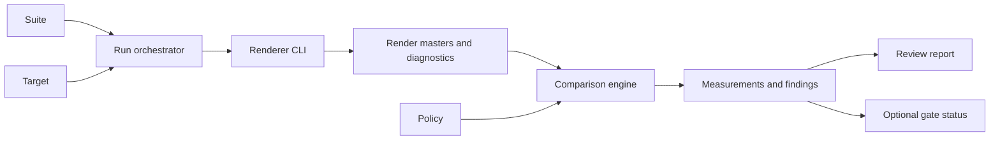

# Instrument design

## Boundary

`SpektraFilm` remains the renderer. The instrument (`spektrafilm-lab`) is an external evaluation orchestrator, artifact producer, and in-process chain measurer. It consumes the renderer's public CLI, machine-readable dry-run output, floating image output, and diagnostics, and it shares the renderer's parameter surface and chain execution for readings. It does not import renderer internals or duplicate runtime parameter resolution.

The instrument owns suite selection, target identity, dependency hashing, run isolation, comparison policy, metric execution, region selection, evidence indexing, review artifact generation, and the development measurement of an executed chain. A metric adapter owns one measurement implementation. A report builder owns presentation of an existing comparison or a prepared image manifest.

It is one binary over two libraries that stay separate: the evaluation library stays renderer-independent and depends only on the shared mathematics crate, and the command plumbing shared with the user binaries stays a library rather than forked code. A new development command lands in the instrument, not in `spektrafilm`, `spektrafilm-f64`, or the evaluation library.

The instrument must keep rendering and evaluation separate. A run produces immutable render evidence. A comparison reads runs and produces immutable measurements. A report reads a retained comparison or a prepared image manifest and produces review artifacts; the source document kind selects the builder. This allows an agent to rerun only the failed stage and allows a person to inspect a report when the renderer is unavailable.

Preflight shares renderer configuration resolution with execution and publishes a separate validation record. It never enters the render-evidence lifecycle. Target construction owns executable pinning for both local commands and fixtures. The inspection view reads validated comparison records, projects existing measurements, and leaves metric computation and policy evaluation with their current owners.

## Surfaces and stability

The instrument merges the former benchmark CLI and the lab CLI. The command grammar, the document registry, and the machine-output contract live in the [specification](spec.md); this document states the boundaries behind them.

Stability is bound to a document kind and its schema version, never to a command name. A supported command keeps its meaning across revisions; an experimental command may change. A retained record stays readable: a reader ignores unknown fields inside a supported version and fails on an unsupported version rather than guessing a default.

## Determinism and build

Instrument commands read declared inputs and write named outputs. They must not compare against budgets or emit pass/fail verdicts of their own; interpretation belongs to the caller or to a policy document. An execution must be a pure function of its inputs: identical inputs produce identical artifacts.

The binary is built at f64 reference precision through the shared `precision-f64` gate, because a chain measurement must reproduce the reference path. Release packaging is defined by [Rust delivery](../benchmark/rust-delivery/spec.md).

Release packages carry the instrument: its supported commands are the surface a release user gets, and an experimental command ships with the binary without a compatibility promise.

## Measurement boundary

A measurement shares the parameter surface and the execution path of the user binaries. It must not resolve parameters on its own, reconstruct pipeline mathematics, or walk the stages beside an observed execution. A stage walk beside the executed chain would report a different result under a stochastic stage, so the observed path is the only permitted source of readings.

The measured range is the same fact for both surfaces: `--enter` becomes the resolved `taps.inject` and the collection boundary is the chain's own `taps.collect` or the last requested reading. Nothing else decides what executes, so the retained effective document describes the execution and a re-verification reproduces it.

The executed chain is resolved per invocation. A resolved parameter document is evidence, never a declaration. A command must not accept a stored resolution as its chain input, because nothing relates that document to the profiles, the data inventory, and the executable present at run time. This applies the resolution stance of the [CLI design](../cli/design.md) to measurement: resolve before executing, and keep the resolution beside the result instead of passing it between commands.

The instrument must not own a second implementation of a metric. A color-difference, equal-lightness, or region-aggregation algorithm keeps one owner, and the measurement commands consume it.

## Reading boundary

Readings are defined only for a point-wise chain: an injected numeric sample has no neighborhood and no stochastic realization, so an operation that mixes samples, measures the whole frame, resizes it, or draws stochastic values would describe a different signal than the measured one. The command fails before executing instead of reporting those numbers; the [point-wise table](spec.md#point-wise-requirement) is the specification of that check.

Eligibility is a measured property, not a reading of a flag name: each operation carries the first stage whose values it changes, and it is listed only when it executes inside the measured range. The instrument must not widen that table by guessing that a control is spatial because its name suggests so.

A [regions document](spec.md#regions-document) is the only authority for a reading position. A command must not infer geometry from image dimensions, labels, or color similarity. A sample outside the declared source remains an error rather than a clamped value. A review grid is derived into that document by one command, so the review page's window arithmetic and the measurement windows cannot drift apart.

A guard run is a frozen measurement artifact together with the stimuli that produced it. It carries no tolerance and no verdict; a tolerance belongs to the protocol document that declares it. Frozen readings make chain drift visible, so a comparison must report an identity difference beside the value difference instead of refusing the pair.

## Artifact boundary

A record is a directory: the record document carries the declarations and the identity, its table view carries the numbers with their identities, and `evidence/` carries the stage buffers of an executed run in the form the user binaries already write. A comparison, a verification, and a later reproduction all read that same directory, so the instrument must not invent a second record format for a retained reading.

A run publishes last. The stage capture runs into a hidden staging directory beside `--out`, and the artifacts are named only when every check has passed: a failed measurement leaves neither a record nor a half-published `evidence/`, so the same destination stays usable. A reader is therefore allowed to treat the presence of a record as the presence of a complete measurement.

A retained bundle is read through its own manifest: the buffer digest is verified against the manifest before any value is attributed to the run, so damaged bytes are an error rather than a reading.

## Chosen boundary options

A renderer-integrated instrument would remove subprocess setup but would bind evaluation to the current simulation runtime. A standalone Rust CLI preserves comparisons across historical renderer executables and retained artifacts. The target design chooses the standalone CLI with the existing renderer process boundary.

The instrument must not add a second parameter DSL. Suite and target documents may reference the renderer's existing `--preset`, `--params`, and `--set` carriers. The instrument validates their shape and passes them to the renderer in the renderer's defined precedence order. Instrument-only settings use typed JSON fields and have no shell or expression evaluation.

The delivered instrument must use the Rust workspace implementation defined in [Rust delivery](../benchmark/rust-delivery/spec.md). Its public document contracts remain language-neutral. Native C and C++ metric dependencies may remain behind narrow adapters.

The single-image CLI adapter must build the existing suite and case representation and call the existing run orchestrator. It must resolve each authored dependency against its owning document before producing the retained suite. It must not add chart detection or a separate simulation-parameter vocabulary.

Externally preparing all images would keep the instrument smaller but would discard original metering and film-scale context for simulation crops. A instrument image editor would duplicate those rules. The chosen boundary accepts prepared local files, delegates simulation geometry to the renderer, and owns only completed-result measurement and detail regions. Preparation provenance remains passive evidence.

### Standard configuration ownership

The [standard configurations](../benchmark/standard-configurations/spec.md) extend fixture generation instead of adding a instrument preset kind. A special film profile would mix test conditions with material data. A look preset alone cannot own source interpretation, route, geometry, or seed populations. Existing configuration and suite documents own those settings.

The fixture generator must use one construction rule for each standard rendering purpose. It must write standalone configurations and embed equivalent values into suite cases from that rule. It must not maintain separate handwritten defaults for local-image and suite execution.

The renderer's preset export and parameter resolver remain authoritative for look fields, defaults, and profile compatibility. The instrument must not reconstruct the preset schema or scrape a human listing. Effect-specific probes must apply explicit existing parameter overlays after the exported look.

Generation must complete validation before publishing its final provenance record. Renderer export output must remain a file dependency rather than hidden generator state. Run orchestration, comparison, and report generation must consume the generated documents without a special standard-mode path.

Preset export captures the selected renderer's look at generation time. Reusing that file separates an algorithm revision from a bundled-look revision. Existing run identity must still include the renderer and selected data; a fixed preset file does not freeze material data or promise historical parameter-language compatibility.

## Component responsibilities

### Document loader

The loader parses strict JSON, rejects duplicate keys and unknown authored fields, resolves paths relative to the containing document, and validates the schema and cross-document identities. It must not resolve environment interpolation or execute document content.

### Dependency resolver

The resolver hashes executable bytes, selected data inventory, source files, presets, sparse parameter files, masks, transforms, references, and protocol inputs. It must produce a deterministic sorted inventory. Modification times and directory traversal order must not affect identity.

### Run orchestrator

The orchestrator selects cases, applies target changes after case configuration, invokes the renderer, captures stdout and stderr separately, validates the machine result, and records the actual output and diagnostics. It must use unique artifact paths and refuse destination replacement. It must remove incomplete case artifacts or mark them incomplete.

The orchestrator must execute the real `spektrafilm` or `spektrafilm-f64` entry point. It must request a floating master suitable for the selected measurement domain and an independent lossless review image. It must not use a lossy preview as the numerical master.

The orchestrator must retain the command vector after path normalization, selected environment allowlist, process identity, renderer result, and execution diagnostics. It must identify the renderer revision when the executable exposes one and retain the executable hash regardless.

The orchestrator must retain an observed floating decoded-input result for both raster and RAW cases through the renderer's input route. Source and simulation must use the same case geometry and decoding controls. Source output conversion and disabled magazine finishing must be explicit overrides; image-input and simulation behavior retain their existing owners. Source dimensions and actual result geometry must be retained independently.

Explicit native-stage capture must remain renderer-owned. The orchestrator must request the supported capture route, validate the resulting bundle, and retain its actual exposure and profile-prepared normalization. It must not infer those values from authored controls or repeat the renderer's preparation mathematics. Intermediate coordinates must remain separate from completed-image regions.

Comparison retention must reuse the run validation already performed for that run. It must not reload and rehash every case for each selected case or role. Copying requested evidence must preserve the bundle's relative dependency layout and artifact identities.

### Comparison engine

The comparison engine matches results by stable case and seed identities. It verifies protocol, dimensions, source declarations, effective parameter compatibility, and applicable reference scope before computing measurements. It must produce an explicit incompatibility result instead of silently aligning incompatible runs.

It must compute maps before summaries. Summary scalars must be derived from the retained map or curve and the declared valid mask. Automatic hotspot selection must use those same retained measurements.

Single-run comparison must consume source and simulation masters from one run. It must reuse existing measurement adapters for input/simulation and existing reference evaluation for reference/simulation, without synthesizing a second simulation run or measuring a self-comparison as a substitute. Each pair owns its roles, measurement availability, maps, hotspots, and review artifacts. Reference processing and correspondence limits must apply before metric selection. The report builder must consume these pair records without assigning reference images baseline status.

Comparison owns regional color coordinates and native-stage aggregates. It must reuse the existing color transforms, resolved region populations, and regional medians. Per-region aggregation must decode each captured stage buffer at most once per run role. Inspection and report consumers must project these retained records without recalculation. The report must keep the two color-center estimators and native-stage domains visibly separate.

### Metric adapters

Each adapter must declare input domain, required metadata, output schema, availability reasons, deterministic implementation identity, and calibration dependencies. It must not inspect human log text. It must not silently transform an input to improve a score.

The first metric set is color and signed Lab diagnostics, tone response, numeric health, LDR-FLIP, flat-field grain statistics, bright-source halation profiles, and edge response. SSIM is optional and must not be a prerequisite for the first qualified protocol.

### Policy evaluator

The evaluator applies exact selectors and fixed constraints to comparison measurements. It must evaluate protected properties separately from expected changes and reference objectives. It must retain all rule outcomes even when one failure determines the overall status.

It must not infer budgets, tune parameters, choose a more favorable reference, or rewrite an unavailable measurement. It may produce `insufficient_evidence`.

### Review builder

The review builder creates an offline report from comparison artifacts. It must not render or recalculate metrics. It must preserve artifact hashes and relative paths referenced by the immutable comparison snapshot. Permitted indexed dependencies must remain locally resolvable after the original comparison is removed; redistribution restrictions and unavailable artifacts must remain explicit. It must emit accessible full-image, A/B, locator, detail, and difference views.

Case navigation must preserve request order. Pair selection must change the complete evidence panel, including labels, scalar summary, difference artifacts, regions, and native detail. Pixel-aligned pairs use synchronized viewers; regional and visual pairs use separately identified native images and corresponding regions where supplied.

Report fragment navigation identifies case, seed, pair, and region by retained semantic identities. Internal DOM ordering must not define public location identity. Accessible disclosure controls and direct links belong to the review builder; neither navigation nor inspection may recalculate a measurement.

Region inspection must not become a second evaluation pipeline; it must use retained measurements. A selected visual pair without measured evidence must remain visually inspectable with an explicit unavailable numeric state. Native detail and numerical artifacts retain their existing owners.

### Prepared image review builder

The prepared review builder imports explicitly declared raster images instead of synthesizing instrument runs or comparison records. Its authored manifest owns sets, patch or region geometry, captions, and the initial pair. A set declares either a shared grid or explicit per-image regions; the builder must not infer correspondence from dimensions, labels, or similar colors. It does not own rendering, reference qualification, or measurement algorithms.

A photographic pair without a declared shared layout must use explicit regions rather than a synthetic grid. A declared grid must remain the single geometry source for its review windows and their derived measurement regions: derivation is a deterministic document transformation that shares the review window arithmetic and reads the set's declared measurement intent, and review geometry enters a measured protocol only through a case or reference document.

The builder must reuse strict document loading, dependency path resolution, destination publication, and image display conversion. It must snapshot authored image dependencies before decoding so an undeclared neighboring sidecar cannot override the explicit color declaration. It must retain each image's source identity, observed dimensions, and generated display artifact. The terminal report manifest must be written after all assets succeed.

The browser must select pairs from one ordered image inventory. Each input needs one display image, not a precomputed image for every possible pair. Patch inspection must use windows into those display images. The browser must not add another color conversion or encode canvas copies. Embedded data and local image paths must support direct offline opening without fetching a manifest.

The builder must bundle its viewer script as a local asset and embed non-executable view data in the HTML. Direct file opening and static HTTP hosting must both work without permitting inline JavaScript; the viewer must not depend on network-hosted libraries.

## Identity and cache invariant

A render result is reusable only when its suite, case, target, renderer executable, data inventory, source input, parameter files, protocol-independent render settings, selected environment, and seed identities match. A comparison result is reusable only when its two run identities, protocol digest, policy digest, and metric implementation identities match.

The instrument implementation identity must cover local workspace dependencies that implement measurements, including shared color and Lab mathematics. A path dependency without a lockfile change must not escape this identity. Capture selection must be retained separately from image settings so observed stage availability is never inferred from a previously rendered image alone.

The instrument must never reuse a stale result because a path stayed the same. It must reject a changed dependency before using the cache. It must not use a partial or failed run as a qualified baseline.

## Coordinate and color invariant

Every artifact must declare its coordinate space. Renderer coordinates, transformed comparison coordinates, common-area masks, review image coordinates, and native detail coordinates must remain distinct. A local transform must never be applied to an artifact without changing its identity and recording its purpose.

Color conversion must occur at one named boundary for each metric. A map and its scalar summary must use the same converted samples and valid mask. Display clipping must not alter native numerical measurements. A report must label the display copy separately from the numerical master.

## Stochastic invariant

A fixed seed provides a repeatable realization under the same renderer conditions. It does not make unrelated seeds or precision paths equivalent. Deterministic probes must disable stochastic effects explicitly. Grain conclusions require the declared seed population and must retain per-seed observations.

## Failure and availability invariant

The pipeline must distinguish configuration failure, renderer failure, measurement unavailability, policy failure, and report publication failure. Each boundary must retain stable machine codes and relevant artifacts. An unavailable metric must never serialize as zero. A failed policy gate must not delete the completed comparison.

A comparison can complete with `insufficient_evidence`, but a qualified pass requires all required measurements, compatible conditions, calibrated policy, and successful artifact validation. Human approval can add a review decision but cannot rewrite the measured result.

## Delivery

[Rust delivery](../benchmark/rust-delivery/spec.md) defines the delivered implementation's scope, distribution, workspace and execution boundary, numerical implementation, and protocol identity. The delivered implementation is the Rust workspace crate.
