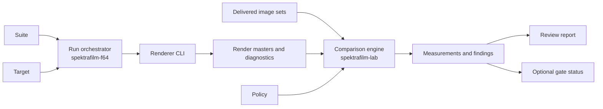

# Instrument design

## Boundary

- `SpektraFilm` remains the renderer.
- `spektrafilm-f64` is the research renderer: it executes a declaration and publishes retained evidence.
- `spektrafilm-lab` measures delivered images and retained evidence, and publishes comparisons and reports. The lab never renders.
- `spektrafilm-lab` also applies evaluation policies and builds the two visual reports.
- The research renderer consumes the renderer's public CLI, machine-readable dry-run output, floating image output, and diagnostics, and it shares the renderer's parameter surface and chain execution for readings. It does not import renderer internals or duplicate runtime parameter resolution.

- The renderer owns rendering; the lab owns measurement, reading, and reporting; `spektrafilm-f64` owns the development measurement of an executed chain.
- The lab owns image decoding under an explicit declaration, region sampling, metric execution, comparison joins, condition differences, native-stage statistics, and offline reporting over a retained comparison. A metric adapter owns one measurement implementation.
- The report builder owns presentation of an existing comparison only. The prepared-image viewer owns its own inventory and never reads a retained comparison.

The lab's measurement library stays renderer-independent and depends only on the shared mathematics crate. The command plumbing shared with the user binaries stays a library rather than forked code. A development command lands in `spektrafilm-f64` when it renders, and in `spektrafilm-lab` when it measures.

Ordinary rendering MUST NOT offer optional native capture. The measurement endpoint owns research observation. Human debug diagnostics and resumable film/print artifacts remain separate contracts.

- The laboratory MUST keep rendering and measurement separate. A run produces immutable render evidence.
- A comparison reads runs, delivered images, or retained readings and produces immutable measurements; a report reads a retained comparison and produces review artifacts; the retained comparison selects the builder. This allows an agent to rerun only the failed stage and allows a person to inspect a report when the renderer is unavailable.
- Preflight shares renderer configuration resolution with execution and publishes a separate validation record. It never enters the render-evidence lifecycle.
- The inspection view reads validated comparison records, projects existing measurements, and leaves metric computation with its current owner.
- The lab's dependency set MUST NOT contain the renderer's crates. Independence is a build property and is checked by dependency inspection, not by convention.



## Surfaces and stability

The command grammar, the document registry, and the machine-output contract live in the [specification](spec.md); this document states the boundaries behind them.

- Stability is bound to a document kind and its schema version, never to a command name.
- A supported command keeps its meaning across revisions; an experimental command MAY change, but its results MUST still satisfy the document, artifact, and machine-output contracts below. A retained record stays readable: a reader ignores unknown fields inside a supported version and fails on an unsupported version rather than guessing a default.

## Unix-style boundary

- The instrument is a collection of smart endpoints, not a research workflow manager. Pipes, files, and retained directories carry bytes and identities without interpreting domain meaning.
- The endpoint at each boundary owns parsing, validation, metric semantics, and publication. An endpoint MUST NOT call a downstream endpoint or consume human-readable output from another process.

The stable composition is:

```text
authored declaration → run → retained evidence → sample → retained readings → compare → inspect/report
```

The result of one endpoint is a valid input to the next, but no endpoint requires a particular caller. A Python script, shell command, or another implementation MAY replace any edge if it preserves the declared document or retained-record contract. This is the research extensibility boundary; it is not a reason to add a generic plugin or expression language.

The instrument MUST keep stdout, stderr, and named artifacts independent. stdout is one machine-readable result object; stderr contains progress, human diagnostics, and child-process text; named files contain evidence. A command MUST NOT use terminal detection to change the machine contract, and it MUST NOT parse another command's stderr.

## DSL boundary

The renderer's `--preset`, `--params`, and `--set` language is the only parameter DSL. Instrument documents MAY carry the same typed process options and source ordering, but they do not add aliases, arithmetic, units, includes, environment interpolation, expressions, shell commands, conditionals, loops, wildcard selectors, or optimizer instructions. The loader produces a semantic declaration before execution; parser output is not the execution model.

Instrument-only facts stay outside the renderer language: case and region identities, stage selection, seed identity, source declarations, artifact destinations, protocol selection, and retained-record roles. They are typed endpoint inputs, not runtime parameter paths.

- An experiment document is a durable declaration for one experiment endpoint. It is not a job graph, sweep language, optimizer program, or complete process job file.
- It MAY select one case, carry process sources, identify input bytes, and declare the evidence that one endpoint MUST publish. It MUST NOT acquire a second way to express renderer parameters.

## Batch boundary

- Repeated research trials belong to an outer producer and the existing endpoints. A future batch endpoint MAY accept a finite list of already-authored experiment declarations and execute them independently, publishing one retained record per item plus an index.
- It MUST NOT generate parameter variants, evaluate objectives, choose a best item, branch on measurements, or invoke shell commands. Candidate generation and optimization remain outside the instrument.

The first implementation slice MUST NOT add batch, parallelism, cache, or optimizer semantics. It MUST make the existing single-endpoint pipe usable from retained run records, then add a finite declaration-list carrier only after seed and record identity semantics are correct.

## Endpoint options

- Two designs were considered for experiment research automation. A workflow DSL could express variants, dependencies, and selection in one document, but would duplicate shell orchestration, add a second parameter language, and make provenance depend on hidden control flow.
- A finite declaration-list endpoint keeps each experiment independently reproducible and leaves control flow to the caller. The latter is selected because it preserves dumb pipes and smart endpoints.

## Record and failure boundaries

- Each endpoint publishes at most one terminal record for its destination. The record is the completion token; its presence means the referenced artifacts have been finalized, hashed, and validated for the supported schema.
- A failed operation MUST NOT publish a successful terminal record. A partial staging directory MAY remain only when it is explicitly marked incomplete and cannot be consumed as a completed input.

The pipe distinguishes these boundaries:

| Boundary | Meaning | Downstream behavior |
|---|---|---|
| argument syntax | the invocation cannot be parsed | no endpoint work; exit `2` |
| declaration validation | authored input or local dependency is invalid | no renderer or metric execution; exit `1` |
| execution failure | renderer or computation failed | failed result MAY retain structured partial evidence; never a completed record |
| measurement unavailable | the record is valid but a metric has no eligible observation | comparison MAY complete with reason; never a zero value |
| publication failure | final artifact cannot be committed | no success result; source records remain unchanged |

- An endpoint MUST validate the input kind before reading a shape-specific payload. A retained `kind` and schema version are authoritative.
- Consumers MAY ignore unknown fields inside a supported version, but they MUST NOT infer a different kind from field presence. A record that names a downstream artifact MUST retain its relative path, digest, media/layout declaration, and producer identity so an external tool can replace the next endpoint without losing provenance.

The command result and the retained record have different roles. stdout identifies the command outcome and terminal artifact; the retained record carries the full evidence. A command MUST NOT serialize a large buffer, progress stream, or human explanation into stdout as an undocumented side channel.

## Delivery sequence

The implementation keeps one handler per endpoint, so no endpoint's meaning is
read from the shape of an input document.

- **Explicit grammar.** The semantic subcommands are the grammar; a flat form is
  accepted only as a compatibility alias with identical behavior.
- **Terminal result metadata.** Command results carry complete artifact identity
  without introducing workflow control fields or changing endpoint ownership.

The smallest complete pipe is therefore declaration, measurement, retained
comparison, inspection, and report. A caller that wants more chains those
endpoints by paths; the instrument does not own that control flow.

## Determinism and build

Instrument commands read declared inputs and write named outputs. They MUST NOT compare against budgets or emit pass/fail verdicts of their own; interpretation belongs to the caller. An execution MUST be a pure function of its inputs: identical inputs produce identical artifacts.

- The binary is built at f64 reference precision through the shared `precision-f64` gate, because a measurement MUST reproduce the reference path.
- They do not drive research capture through `process` flags or a duplicate stage walk; their records identify the owning replayable instrument invocation, dependencies, and actual observer configuration, not invented process argv. Image-domain comparison reads delivered images and never invokes a renderer.


## Measurement boundary

A measurement reads delivered pixels. It MUST NOT render, reconstruct pipeline mathematics, or infer an interpretation the caller did not declare: the read is the only permitted source of a reading.

The instrument MUST NOT own a second implementation of a metric. A color-difference, equal-lightness, or region-aggregation algorithm keeps one owner, and the measurement commands consume it.

## Reading boundary

- A [regions document](spec.md#regions-document) is the only authority for a reading position. `regions` expands one finite grid into that document without reading images or producing a report.
- A command MUST NOT infer geometry from image dimensions, labels, color similarity, or a removed review manifest. A sample outside the declared source remains an error rather than a clamped value.

## Artifact boundary

- A record is a directory: the record document carries declarations and identity, and its table view carries numbers with their identities.
- Comparison, inspection, and reporting read that same directory; there is no second retained-reading format.

- A run publishes last.
- A measurement runs into a hidden staging directory beside `--out`, and the artifacts are named only when every check has passed: a failed measurement leaves no record, so the same destination stays usable. A reader is therefore allowed to treat the presence of a record as the presence of a complete measurement.

A retained bundle is read through its own manifest: the buffer digest is verified against the manifest before any value is attributed to the run, so damaged bytes are an error rather than a reading.

## Chosen boundary options

- A renderer-integrated evaluation system would remove subprocess setup but bind historical image evaluation to the current runtime. A standalone instrument preserves image comparisons across renderer executables and retained artifacts.
- The selected boundary therefore keeps ordinary rendering behind the real renderer CLI while point-wise measurement uses the shared core observer in-process. Ownership is explicit rather than a process capture option: instrument research owns retention, and the core owns executed values.

- The instrument MUST NOT add a second parameter DSL.
- The instrument validates their shape and passes them to the renderer in the renderer's defined precedence order. Instrument-only settings use typed JSON fields and have no shell or expression evaluation.

The delivered instrument MUST use the Rust workspace implementation. Its public document contracts remain language-neutral. Native C and C++ metric dependencies MAY remain behind narrow adapters.

The renderer's preset export and parameter resolver remain authoritative for preset fields, defaults, and profile compatibility. The instrument MUST NOT reconstruct the preset schema or scrape a human listing. Effect-specific probes MUST apply explicit existing parameter overlays after the exported preset.

Generation MUST complete validation before publishing its final provenance record. Renderer export output MUST remain a file dependency rather than hidden generator state. Run orchestration, comparison, and report generation MUST consume the generated documents without a special standard-mode path.

Preset export captures the selected renderer's preset at generation time. Reusing that file separates an algorithm revision from a bundled-preset revision. Existing run identity MUST still include the renderer and selected data; a fixed preset file does not freeze material data or promise historical parameter-language compatibility.


## Component responsibilities

### Document loader

The loader parses strict JSON, rejects duplicate keys and unknown authored fields, resolves paths relative to the containing document, and validates the schema and cross-document identities. It MUST NOT resolve environment interpolation or execute document content.

### Dependency resolver

The resolver hashes the delivered rasters, masks, and protocol inputs a record names. It MUST produce a deterministic sorted inventory. Modification times and directory traversal order MUST NOT affect identity.

## Failure and availability invariant

- The pipeline MUST distinguish configuration failure, measurement unavailability, and report publication failure. Each boundary MUST retain stable machine codes and relevant artifacts.
- An unavailable metric MUST never serialize as zero.

A comparison can complete with unavailable rows; it never reports a pass, a ranking, or a verdict. A reader MAY add a review decision but cannot rewrite the measured result.

## Delivery

The delivered implementation is the Rust workspace crate.
