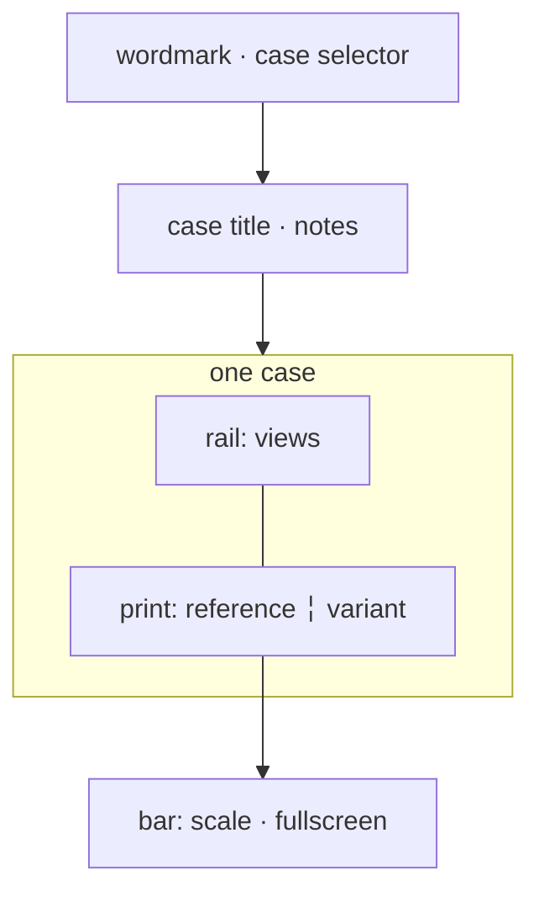

# Lab report

## Authority

This document owns the human reading surface of a lab comparison: what the page shows, how a reader moves through it, and what it refuses to display.

The record is lab-owned too; [the lab specification](../spec.md) owns its content. [The research machine interface](../../instrument/spec.md) defines the `report comparison` endpoint that emits this page. The page reads retained evidence; it never measures.

## Terms

A **case** is one comparison on the page: one reference image, the variants compared against it, and the views declared for it. It is not the lab's case, which is one source within one invocation.

A **view** is a named window onto the reference image. A view is a rectangle, not a derived file.

A **variant** is an image compared against the case's reference.

## Behavior

The report MUST work offline with relative local artifact links. Report generation MUST NOT render images or recompute comparison measurements.

The page exists so a person can look at photographs. It shows images and the names the record gave them.

It MUST NOT compute, score, rank, or explain, and it MUST NOT print measurements, statuses, reasons, coordinates, selection methods, rendering configuration, or difference-map captions. Those remain in the comparison record and `report.json`.

The page manifest is the only input to the page. It carries one `reference` image, the `variants` compared against it, and `views` that name windows onto the same image. A view's `crop` is a window, not a derived asset; the page MUST NOT cut or resample crops.

A case MUST show one view at a time. The rail selects the view, the divider wipes between reference and variant, and the bar holds the scale readout and full-screen control. Controls MUST NOT be drawn over the print.

Pixel-aligned reference and variant MUST share one transform. The viewer MUST provide pointer-anchored zoom, drag pan, a fit view, and native magnification where one source pixel maps to one device pixel. A fit view MUST NOT be labeled 100%.

The divider MUST be draggable and keyboard operable with arrows, Home, and End. Space MUST show the other side while held. Switching a view or a variant MUST preserve the divider position and MUST NOT move the rail.

A location MUST name a case and a view, restore them on reload, and support browser history. A malformed or unknown location MUST NOT display an unrelated comparison.

A variant picker MUST appear only when more than one variant exists. An unaligned reference MUST use two independent surfaces without a divider. A view whose window does not differ from the full frame MUST NOT draw a locator; every other window MUST show where it sits in the reference.

The visual system is part of the contract. It uses a neutral dark surround (R=G=B) that does not tint the photographs, one accent reserved for marking position (selection, seam, locator, focus), a four-pixel spacing rhythm, a type scale of 12/13/22, and an eleven-pixel text floor.

Every control shares one height (32 pixels) and one radius (4 pixels); the print is squared at 2 pixels, thumbnails at 3. Controls sit under the print, never over it. Interactive targets MUST be at least 32 pixels on desktop and 44 pixels on touch; the divider's pointer strip MUST be at least 24 pixels wide.

A control appears only where it can act: the case switcher is the case title when more than one case exists, and plain text when it does not.

A rendered control MUST come from the page's own component base, never from the operating system: the case switcher is a dropdown the page styles, because a native select opens a system menu that escapes the visual system.

A view thumbnail MUST be the same window as the view, scaled to whatever box it is given rather than to a fixed pixel size. Narrow layouts MUST NOT introduce horizontal page overflow; the rail scrolls inside its own column.

Labels, titles, and notes MUST come from the page manifest. The page MUST NOT invent vocabulary, describe a direction as better, or state a quality conclusion.

Display copies MUST use 16-bit RGB sRGB PNG without quantization dither. Fit previews MUST be derived from floating display samples with Lanczos resampling in encoded sRGB to a maximum edge of 1600 pixels before 16-bit quantization. The report MUST retain lossless full-size images.

Artifacts MUST record bit depth, source dimensions, resampling, quantization, and display role. Native zoom MUST use the lossless full-size image. Browser and display precision MUST NOT be presented as guaranteed 16-bit output.

Source attribution and redistribution restrictions MUST accompany external reference artifacts. Local research access MUST NOT imply permission to publish originals or derivatives.

## Acceptance

1. Build a report from a retained comparison with the original inputs and the renderer unavailable. Open it, switch cases, and read the same photographs on desktop and narrow layouts.
2. Open a report location for a case and view. Reload, use browser history, and operate the rail, divider, and scale controls by keyboard.
3. Publish a report from a comparison. It refuses a prepared-image manifest and records no manifest source kind.
