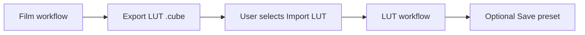

# LUT workflow design

The [product contract](spec.md) owns the simple export/import workflow. This document owns the boundary between LUT file export, LUT file import, LUT presets, and the render dispatcher.

## Ownership

| Boundary | Owner |
| --- | --- |
| Spectral LUT bake and `.cube` publication | [LUT delivery](../lut-delivery/spec.md) |
| LUT declaration, validation, and render graph | [LUT look](../lut-look/spec.md) |
| LUT preset kind, name, library writes, browser, thumbnails | [Presets](../presets/spec.md) plus this capability |
| Film look and section document kinds | [Presets](../presets/spec.md) |
| Workflow selection and surface ownership | [GUI workflow](../gui-workflow/spec.md) |
| Canonical leaves and preset selection | [CLI](../cli/spec.md) |
| Film materials, print, and scan | [Film chain](../film-chain/spec.md) |
| Grade response | [Tone and color](../finishing/spec.md) |

The implementation MUST NOT add a second LUT reader, a second spectral baker, a second preset resolver, or a second renderer. Export calls the existing `BundleBuilder`; import uses the existing LUT look parser and evaluator; the preset kind extends the existing library.

## Mode boundary



`RenderMode` is a top-level runtime dispatch:

```rust
pub enum RenderMode {
    Film,
    Lut,
}
```

The canonical parameter path SHOULD be `workflow.mode` with values `film` and `lut`. `lut_look` is an optional group. A complete document without `lut_look` resolves to `film`.

`workflow.route` remains the spectral route and is inactive in LUT mode. The existing `debug.lut_mode` is a bake/debug switch and MUST NOT be used as the user LUT workflow mode.

Mode dispatch selects one graph. `Film` executes the spectral pipeline and its route. `Lut` executes input decode and geometry followed by the LUT look graph.

There MUST NOT be per-stage mode flags. Inactive values remain stored but MUST NOT trigger material preparation, profile reads, LUT reads, or validation of the inactive declaration.

## Export LUT

Export is a file operation. It MUST NOT mutate the active render, create a preset, switch workflow, or load the exported file.

### Target

The simple export writes one complete `.cube` with `Topology::One` semantics: input RGB to output RGB. The builder rejects before writing when any of these is true:

- the source cannot produce a completed positive reading;
- the selected print target is unresolved;
- output mix amount is not exactly 1;
- `scanner.experimental_setup` is active;
- the requested input or output encoding is not a LUT look encoding;
- the pointwise transform would silently omit a required operation.

The default encodings are display-encoded sRGB input and output. Linear sRGB and Display P3 remain selectable. The film workflow's current source encoding is not copied by default.

The existing `BundleBuilder` supplies the lattice. The product writes a single `.cube` and reports the encodings plus neutralized operations to the user. The `.cube` does not carry the application's preset or workflow metadata.

### Neutralization

LUT delivery neutralizes optical diffusion, stochastic grain, and source-dependent operations. The simple export reuses those rules and exposes the result:

- active optical diffusion, halation, or grain is neutralized and named;
- output mix below 1 rejects the simple export;
- active frame-dependent setup rejects the export;
- eligible Tone & Color is evaluated once at the existing delivery boundary.

The export is not an import and does not create a LUT look or a preset.

### Failure

A failed export preserves the current image, controls, workflow, and preset library. Publication MUST be atomic, and no partial `.cube` MUST remain at the destination.

## Import LUT

The import path is:

```text
LUT_3D_SIZE / DOMAIN_MIN / DOMAIN_MAX / data
  -> LutDocument
  -> explicit LutSpec declaration
  -> LUT look graph
```

The importer MUST use the existing `.cube` reader. It MUST NOT infer a color space from the filename, profile, bundle, or image content. The declaration supplies input/output encodings, domain policy, shaper, and strength.

A newly imported LUT starts at strength one with all LUT-specific effects and grade disabled. Importing does not save a preset. The neutral gray ramp and color checker use the production LUT graph and display path.

The import surface separates primary photographic decisions from declaration evidence. Input/output spaces, domain policy, and strength remain visible.

The hash, per-axis domain values, and shaper declaration MAY be grouped as advanced evidence. The form states that the cube carries no color-space metadata and that sRGB is an assumption.

The domain policy defaults to clamp for a new import and for a replacement. Fail remains an explicit strict choice. The form explains that clamp reports its clipped fraction and that fail stops the render.

**Replace cube** changes only the external cube declaration. It retains strength, grade enablement, grade values, and effect settings. Starting a new LUT look is a separate action that resets those values.

The importer validates the file and declaration before replacing the active LUT look. A missing file, malformed carrier, unsupported encoding, invalid domain, or out-of-range strength fails before the LUT workflow becomes active.

## LUT preset

A LUT preset is a user-owned whole-look preset. It references an external LUT file by path and SHA-256 and carries the LUT declaration, effects, and optional grade. It does not embed LUT pixels or copy the file into an application-owned store.

### Document

LUT presets use preset schema version 8. Film look and section documents retain schema 7. The library distinguishes the kinds before applying version-specific parsing.

The root contains:

```text
schema_version
name
author? / description?
lut: path, sha256, input_space, output_space, domain_min, domain_max,
     domain_policy, shaper, strength
effects?: halation, diffusion, grain
grade?: finishing group
provenance: implementation_version, model_version
```

The document MUST NOT contain film/print profile references, spectral parameter groups, a route, a workflow field, LUT pixels, or an embedded image.

The path is stored exactly as selected. The runtime resolves it without searching for a similarly named file.

The hash is validated before rendering. A changed or missing file is a validation failure.

### Apply transaction

One core resolver call validates the LUT preset and its file, then returns a candidate containing:

```text
mode = Lut
lut declaration
effects
grade
stored film look retained unchanged
```

The GUI commits the candidate only after resolution. The transaction includes the mode switch, the LUT look replacement, the applied identity, and dependent render invalidation. A failure leaves the preceding workflow, controls, identity, and retained image intact.

A manual workflow switch is a separate transaction. It preserves both control sets and clears the applied identity because no preset describes the new active workflow. Applying a preset restores identity and MAY switch workflow in the same transaction.

A film look preset still switches to Film and preserves the stored LUT look. A section preset remains film-only and MUST be rejected while LUT mode is active.

### Save and export

In LUT mode, **Save preset…** captures the current LUT file path, hash, declaration, effects, and grade. It requires a validated imported LUT. It MUST NOT capture film/print profiles, inactive spectral controls, image data, or a render result.

Preset export and import are document-only. The LUT file is not included. The UI MUST identify the external dependency; a missing file remains a validation failure.

Deleting or renaming a LUT preset MUST NOT delete or modify the LUT file.

## Browser and thumbnails

The browser remains one library and two groups. It presents film look and LUT documents in one list without a workflow-type category, cue, or filter. Search includes the LUT file name, title, and path; the derived kind remains a resolver fact.

Candidate preparation branches before material resolution:

- Film candidate: existing whole-look resolver, profile preparation, spectral graph.
- LUT candidate: LUT file hash validation and LUT graph; no film/print preparation.
- LUT candidate with a missing file: unavailable state, no render attempt, no fallback.

Candidate identity includes the workflow kind, LUT file hash, declaration, effects, grade, source generation, execution backend/precision, and presentation dependencies. Film and LUT candidate identities are never interchangeable.

LUT thumbnails use the production LUT graph and the same display path. They MUST NOT prepare spectral materials. Film thumbnails MUST NOT load a LUT.

## CLI

The CLI reuses the same preset resolver and LUT file references.

- A LUT preset in `--preset` selects LUT mode and requires no film or print selector.
- A LUT preset mixed with a film look or section preset is rejected.
- `--film`, `--paper`, `--route`, and `--scan-film` conflict with a LUT preset.
- `lut build` retains its existing export contract. It does not create or save a preset.
- `preset list` reports the kind and LUT file status; `preset show` validates the path and hash and prints the declaration, not LUT pixels.
- LUT preset export and import move only the preset document; the LUT file remains external.
- `process --lut PATH` builds one temporary LUT preset from the cube declaration in the same resolver path, reading the path, title, domain, shaper declaration, and content hash from the file. It uses display-encoded sRGB input and output and clamp by default; `--set` MAY override those declarations and effects.
- `--lut` conflicts with preset selection and with the film and spectral route selectors so one invocation cannot mix workflows.
- Dry-run reports the resolved mode. In LUT mode, film-stage and film-grain reports are inactive or omitted from text.
- `--set workflow.mode=lut` and the LUT canonical leaves remain available for parameter-only invocations.

## Validation and failure

Validation is mode-specific:

| Condition | Decision |
| --- | --- |
| Mode `lut` without a LUT declaration | Reject |
| Mode `film` with a stored LUT declaration | Ignore the LUT; do not read its file |
| LUT preset without a path or hash | Reject |
| Missing file or hash mismatch | Reject; preserve the preceding output |
| LUT preset with film/print references | Reject |
| Film preset with a LUT group | Reject |
| Simple export with unresolved print target | Reject before writing |
| Simple export with output mix below 1 | Reject before writing |
| Simple export with frame-dependent setup | Reject before writing |
| Unsupported input/output encoding | Reject |
| Inactive mode invalid declaration | Do not validate for the active render; retain it |

A failed export, preset write, or preset application MUST NOT publish a partial file/preset or replace the preceding accepted image.

## Implementation dependencies

The simple export writes one 3D `.cube`. Import uses the same `.cube` carrier and the LUT look's optional 1D shaper; no second carrier is added.

The following MUST be pinned before implementation crosses its owning boundary:

- canonical parameter path and serialization for `workflow.mode` and `lut_look`;
- exact LUT preset field spellings and the migration table for schema 8;
- effect parameter defaults and validation ranges under the LUT look design;
- CPU/GPU parity for tetrahedral lookup and spatial effects;
- clipped-fraction reporting for the explicit clamp policy.

These are implementation dependencies, not alternative product workflows.
