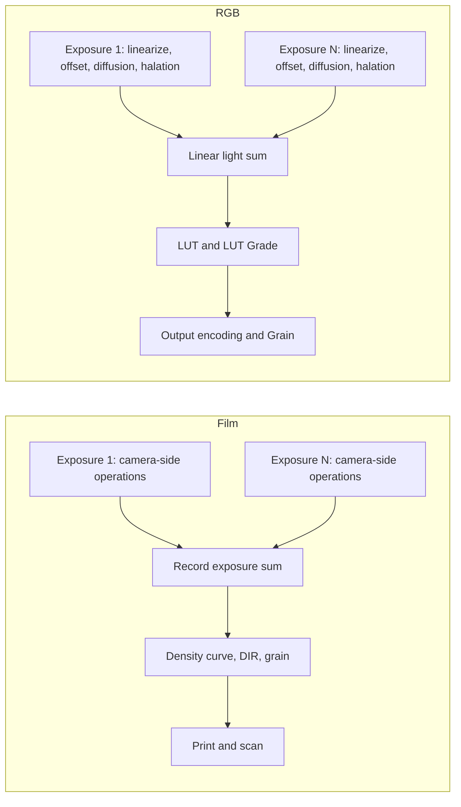

# Multiple exposure design

## Authority

The [product contract](spec.md) owns observable behavior.
This document owns the method boundary, composition points, and invariants.

## Method boundary

Film adds record exposure; RGB adds linear light.
Neither scheme adds density or encoded values.
The schemes do not share a blend law.

## Film composition

Each exposure passes the camera-side operations before the sum.
The sum is record exposure, not density.
Development, DIR, material grain, print, and scan run after the sum.

The [Film chain](../film-chain/spec.md) owns the camera-side operations.
The stack owns their per-exposure order.

## RGB composition

Each exposure is decoded, offset, clamped to nonnegative light, and passed through the active pre-LUT effects.
Diffusion precedes RGB Halation under the [LUT transform](../lut-transform/spec.md#color-order) order.
The sum is linear light.

The LUT, LUT Grade, output encoding, and Grain run after the sum.
Per-shot effects are required because RGB Halation is not linear in scene light.
A composite-then-halation order would make the halo depend on the sum instead of each exposure.

## Invariants

1. Film composition adds record exposure; it never adds density.
2. RGB composition adds linear light; it never adds density, log exposure, or encoded values.
3. RGB Diffusion and RGB Halation run per exposure; the LUT, LUT Grade, output encoding, and Grain run once.
4. RGB per-exposure offsets apply after decoding and before spatial effects.
5. A stack has one method; method groups do not mix.
6. No per-exposure transform or preset exists.
7. CPU and GPU use the same composition semantics.

## Memory and streaming

The stack may stream exposures into one accumulator.
The accumulator holds the method's composed state, not a second full frame per exposure.
A failed memory check publishes no output.

## Non-goals

- A multiple-exposure GUI inspector.
- Per-exposure transforms.
- Per-exposure presets.
- RGB Off-mode stacking.
- RGB film metering or camera light leak.
- Film density composition.
