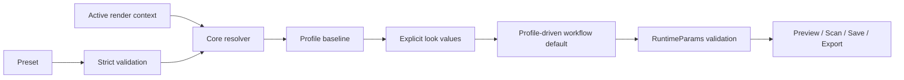

# Presets

## Contract

A **preset** is a named, reusable set of film and print profile selections and visual simulation controls. Reusable combinations of controls that are already preset-owned belong in the existing look or section preset. A preset is not a complete GUI state, an input image, a viewer state, an export configuration, a LUT, a calibration profile, or a workflow selection.

A preset is either **built-in** or **user-owned**.

A preset document is a **look preset** or a **section preset**. A look preset carries both profile references and every required look-owned group. Its optional camera group follows the [file format rules](#file-formats).

A section preset carries exactly one section of the look and no profile reference; a section is a named set of look-owned parameter paths, defined by the [preset design](design.md). The kind is derived from the carried scope, never declared by a field, and a document that carries neither a whole look nor exactly one section MUST be rejected.

Built-in look presets MUST enable the selected film profile's Hanatos2025 adaptation surface. The surface coefficients belong to the film profile. The user MAY turn the surface off after applying the preset.

A preset **name** is its identity: the document `name`, the document file stem, and the selector used by the GUI and the CLI. A name MUST be unique inside its group and MAY repeat across groups. The groups are `Built-in` and `My Presets`.

The [preset design](design.md) owns the name rules, file locations, discovery, conflicts, and writes.

The GUI provides a Presets browser for look presets in a collapsible panel on the left of the window, and one preset menu per section for section presets. The browser shows the two groups. Each row shows the preset name and its film and print references.

The active row is marked. A modified marker appears while the active look controls differ from the applied document. The inspector MUST NOT repeat the browser list.

User presets MUST NOT be implemented by reusing complete `GuiState`.

A section preset MUST appear only in the menu of its own section, never in the browser. Every section of the section table MUST carry one menu at its named primary module anchor in the [preset design](design.md#sections). A section that spans modules or stages MUST NOT gain duplicate menus or split payloads.

Its menu MUST identify the full carried scope, not just the controls under its anchor. Save as lives in that menu: an empty list MUST offer to save the section's current controls and MUST state that a preset file can also be placed in the library. A section menu MUST report the issues of the documents it would carry.

A section menu MUST show the name of the section preset whose controls match the section and `custom` otherwise. That match MUST be derived from the section's controls and MUST NOT be stored as separate state.

Browser rows and section menus MUST be ordered by name, case-insensitively, with a deterministic tie-break, so one library always presents one order. User-selectable sorting is outside this contract.

### Browser search

The browser MUST offer a transient search field. It MUST filter look presets by a case-insensitive substring match against the preset name or either referenced film or print stock's name or identifier. An empty query MUST show all look presets.

Search MUST NOT change discovery, exact name resolution, preset identity, group membership, or the deterministic order within each group.

Filtering MUST preserve the `Built-in` and `My Presets` groups and their identities. The applied group and name, modified state, and missing-document state MUST remain visible as context even when the applied row does not match. Search MUST NOT apply a preset or clear that context.

Library faults MUST remain visible and MUST NOT be mistaken for unmatched presets.

The browser MUST distinguish a library with no look presets from a search with no matches. The no-match state MUST offer to clear the query. The empty-library state MUST retain the save guidance.

The query MUST NOT persist across restarts or enter GUI-state files or preset documents. This browser search is separate from [control search](../gui-workflow/spec.md#control-search).

### Preset discovery aids

The browser MUST offer Favorites and Recently used filters within the existing library. Both MUST retain group identity, deterministic row ordering, and the applied or missing context under [Browser search](#browser-search). Recent membership MUST record successful look application, not browsing or failed application.

It MUST contain the latest ten distinct applied look identities.

Favorites and recent membership MUST persist as application browsing preferences, separately from presets and photographic state. Toggling a favorite or changing a filter MUST NOT apply a look or render a photograph. Application-owned rename MUST carry these references to the new name; missing entries MUST NOT bind to another group with the same name.

Built-in looks MUST offer thumbnails rendered from one fixed reference photograph. Each thumbnail MUST identify that reference and MUST NOT imply that it previews the active photograph. It MUST represent its preset and material versions; a missing or outdated image MUST show unavailable rather than a misleading substitute.

User looks MAY have no reference image and MUST remain fully usable.

Reference images MUST retain visible preset and material names. Opening the browser MUST NOT start a render of the current photograph for every preset. Reference-image rights MUST permit distribution with the application.

## User library

A user preset is a valid preset document in the preset library directory. Placing such a document in that directory makes it available to the GUI browser and to preset name resolution. The browser and the CLI MUST use the same discovery and name rules.

The GUI MUST support these library operations for look presets:

- **Save as**: capture the active look controls as a new look preset under a name the user edits.
- **Update**: replace the stored document of the active user preset with the active look controls.
- **Revert**: restore the look controls of the applied document and clear the modified marker.
- **Rename**: rename the document file and its name together, and preserve its look values.
- **Duplicate**: copy a built-in or user preset into `My Presets` under a new name.
- **Delete**: remove a user preset document after confirmation.
- **Import**: copy an external document into `My Presets` as a new preset. An existing name in `My Presets` MUST NOT be replaced; a conflicting import MUST offer a renamed copy.
- **Export**: write the selected document to a chosen path.
- **Show file**: reveal the document path of a user preset. A built-in preset has no path, so this action MUST be unavailable for it.

A section menu MUST offer the same operations for the section presets it lists: **Save as** captures that section's controls, and Rename, Duplicate, Delete, Export, and Show file act on that section's documents. Both kinds MUST share one discovery, write, and validation implementation.

The remembered applied document is always a look preset; a section application is an edit and never becomes the applied preset. The GUI writes look presets through Save as and Update, and a section preset is authored as a file or through a section menu until an arbitrary scope-capture action exists.

A name that exists in both groups MUST remain reachable in both. Editing look controls after an application MUST mark the active preset modified and MUST NOT rewrite any document. Built-in presets MUST remain immutable.

The browser MUST list, with its path, every document that cannot be read, parsed, or accepted. An issue MUST NOT hide the remaining library. An empty library MUST state how to save the current look.

The browser MUST remember the applied preset group and name across restarts. A remembered preset whose document is absent MUST be shown as missing. The modified state MUST NOT persist across restarts.

Restoring GUI state MUST restore its stored controls and MUST NOT re-apply the remembered preset document.

Ordinary startup MUST restore the browser metadata independently of the configured startup controls. An explicitly loaded GUI state MUST supply its own browser metadata and MUST NOT inherit the remembered selection. Remembering a browser selection MUST NOT save current controls as the startup default.

Renaming or deleting the applied user preset MUST update the marker: a rename follows the new name, and a delete leaves the look controls untouched and shows the remembered name as missing.

Browser rows MUST show the preset name, the film reference, and the print reference. [Preset discovery aids](#preset-discovery-aids) owns reference-image requirements and browsing filters. Live current-photograph thumbnails, user-selectable sorting, collections, per-scope preset memory, and arbitrary scope capture are outside this contract.

Multi-photograph application follows [Photograph work](../gui-product-design/photo-work/spec.md#copy-adjustments).

### Apply

- Selecting a preset validates the document, or the section it carries, before changing active controls.
- A look preset identifies both film and print profiles. The resolver validates film=`support=film, stage=filming` and print=`support=paper, stage=printing`.
- A preset does not store or directly apply a workflow. A look preset selects the corresponding workflow default: negative film selects `input > film > print > scan`, and positive film selects `input > film > scan`.
- The user MAY then choose another supported workflow manually. A section preset carries no film reference and MUST NOT change the workflow.
- Applying a look preset replaces all carried look-owned controls together, including the controls of every carried section, so a section preset MUST be applied after a look change to take effect. An omitted camera group preserves the active virtual film exposure and metering controls.
- Application clears transient Scan-for-print state, invalidates dependent render state, and schedules automatic Preview.
- Applying a look preset normalizes the scanner output: when the resolved film is positive or the selected workflow route is not a film-scan route, the output becomes the direct-scan mode. A route the caller already declared as `input > film > scan` or `input > convert-film > scan` is preserved, so a document that selects the negative conversion keeps that selection on those routes.
- `core` owns that rule once for the GUI and the CLI.
- Applying a look preset does not change recorded explicit-leaf ownership. Only a section preset or a sparse parameter source marks its own leaves explicit, and those marks survive a later look application.
- Applying a section preset replaces exactly the controls of its section, and those values count as explicit. Every other control retains its value, including explicit values from an earlier preset or parameter source, so the result does not re-derive them from stock defaults.
- It clears transient Scan-for-print state, invalidates dependent render state, and schedules automatic Preview.
- Applying a section preset that would introduce a scanner-output, workflow-route, scan-film, film-profile, or grain-engine combination the pipeline rejects MUST fail without changing any control. A state that already fails that check MAY still receive an unrelated section edit.
- Applying a section preset MUST NOT replace the remembered applied preset. It is an edit, so an applied look preset becomes modified.
- Each successful look or section preset application MUST create one undo transaction under [Edit history](../gui-workflow/spec.md#edit-history), including explicit-leaf provenance and dependent normalization. A failed application MUST NOT create a history entry.
- Undo and Redo MUST NOT reverse preset-file or library writes.
- Applying a preset preserves loaded image and metadata, RAW/source settings, source exposure correction, input color interpretation, crop, resize, rotation, viewer/display state, Save settings, and Export settings.
- Built-in presets are immutable. Editing controls after an apply never rewrites the built-in definition.

### Workflow defaulting

Changing a film profile selects the corresponding workflow default while the workflow remains user-editable:

A profile change MUST NOT apply hidden stock-specific look values. The workflow selector remains editable until the next film profile change. The positive path does not execute print stages; its explicit print profile remains part of the portable pair.

A serialized `route` or `workflow` field is unknown and rejected.

### Look ownership

A look preset owns film and print selection plus explicit film, print, enlarger, diffusion, halation, coupler, grain, base, chemistry, scanner, CMYK ink style, and output-mix controls. The scanner controls it owns are `scanner.scan_output`, `scanner.conversion_style`, `scanner.lens_blur`, and `scanner.unsharp_mask`. Viewing glare ownership is limited to effective `print_render.glare`; the non-effective `film_render.glare` group is not preset-owned.

Neutral enlarger filter anchors are calibration baselines, not look controls, and are not preset-owned. Existing material controls and `output_mix` follow [Output mix and material controls](../output-mix/spec.md). A section preset owns exactly the controls of its section.

Virtual film exposure compensation and metering belong to the look through the optional `parameters.camera` group. Other camera controls remain outside this group; camera diffusion remains a separate look-owned group.

The assumed scene light belongs to the look through the optional `camera.capture_illuminant` leaf under the [capture illuminant contract](../image-input/spec.md#capture-illuminant):

- An omitted leaf keeps the selected film profile's `reference_illuminant`.
- An explicit catalog name or `BB<kelvin>` token overrides it for the camera-side conversion into film exposure only.
- A generic look MUST NOT hard-code one stock's tungsten or daylight reference.

A look also owns look-relevant processing settings: hanatos2025 adaptation window/surface switches, spectral Gaussian blur, CAT16, and the print-exposure EV tracking choice (`LookSettingsParams`, a subset of `SettingsParams`).
### Surface parity

Every leaf under `parameters` that a preset carries is a user-settable parameter. A carried parameter leaf **MUST** have both of these surfaces:

- the GUI has one editable control or one named action that writes that exact canonical runtime value; an inactive condition MAY disable the surface, but MUST retain the value and explain the condition;
- the CLI accepts the same value through the canonical `--set` path and exposes that path through `describe --field` or `describe --module` with the shared type, validator, units, and conditions.

The GUI label and CLI syntax need not be identical, but they MUST edit the same runtime leaf with the same semantics. A value that can only be populated by preset capture, profile defaults, database calibration, migration, or internal state is not a preset-owned user parameter. It MUST either gain both surfaces or be removed from preset capture and validation.

Provenance, profile references, and other preset metadata are outside this leaf-parity rule.

This rule applies equally to whole-look payloads and section payloads. Capturing, importing, migrating, or exporting a preset MUST NOT create a hidden parameter surface. The section table MAY contain only sections whose carried leaves satisfy this rule and have a visible GUI owner.

### Implementation rules

- `core` owns the typed look model, strict schema validation, profile compatibility, profile-driven workflow defaulting, capture, candidate resolution, the library directory policy, discovery, name conflict rejection, and atomic document writes.
- `gui` owns browser presentation, group and row state, library actions, active and modified state, transient state, and user-editable workflow controls.
- `GuiState` remains complete GUI-state persistence and is not a look payload.
- `core` owns strict parsing, profile resolution, stock-baseline construction, explicit look-value overlay, workflow-default derivation, and `RuntimeParams` validation. Neutral print-filter anchors (`enlarger.c_filter_neutral`, `enlarger.m_filter_neutral`, and `enlarger.y_filter_neutral`) are calibration baselines supplied by the per-paper/illuminant/film database, not preset-owned leaves.
- They have no ordinary GUI/CLI look surface; explicit calibration state remains in runtime preparation and GUI-state compatibility and MUST NOT be confused with a reusable look. The non-effective `film_render.glare` group, derived `film_render.grain.monochrome`, no-op `film_render.grain.micro_sublayers`, and `enlarger.lens_blur` (zeroed by digest and applied by no upstream stage) likewise remain outside preset capture and section ownership.
- A look protects a neutral print-filter axis only when a legacy or explicit runtime source has authored that axis; an axis the look does not carry keeps the [per-paper database](../film-chain/spec.md) baseline instead of one paper's pack being reused everywhere.
- The authored-versus-baseline state persists in the parameter document so replaying a resolved document reproduces its render bit-identically; documents without the flags treat every axis as baseline.
- The exposure normalization refines baseline axes from the database's f64 values while the published parameter surface carries their f32 views. Authored axes stay exact.
- A render that consumes only the published f32 views MUST agree within 1e-8 absolute on the f64 reference values (measured 6.4e-10 in the report/render acceptance fixture).
- Existing `--params` invocations, RenderRecipe, LUT behavior, CPU f64 semantics, WGPU f32 semantics, Grain V2 algorithm, and raw profile assets MUST retain their `0.3.4` results with `output_mix.amount = 1`. Exceptions are the explicit [output lightness retirement](../output-mix/spec.md#output-boundary-and-retirement) and [optical-order cutover](../film-chain/spec.md#optical-order-cutover).
- The cutover does not change stored blur units, grain selectors, or print-glare ownership.
- The [CLI parameter language](../cli/spec.md) owns command syntax and composition rules.

The portable canonical snake-case schema contains:

- `schema_version`, `name`, optional `author` and `description`;
- `film_profile` and `print_profile`, each with stock, optional profile version, and optional `sha256-<lowercase-hex>` content identity; both are required in a look preset and absent from a section preset;

- `parameters`, the typed look-owned parameter object: every required group and the optional camera group in a look preset, the paths of its section in a section preset;
- `provenance`, the SpektraFilm implementation and model versions.

It MUST NOT contain `route`, `workflow`, image pixels/paths, RAW data, LUT pixels, viewer rasters, GUI paths, credentials, random seeds, or Dehancer-specific fields. Unknown fields are rejected. The resolved candidate is returned without mutating active GUI state; GUI commits only after successful resolution.

### File formats

TOML MUST be the default preset export format. Readers MUST accept `.toml` and `.json` files as carriers of the same typed schema. The file extension MUST select the parser.

A reader MUST NOT try another parser after a parse failure. Both carriers MUST apply the same version, ownership, profile, type, and value validation.

The preset schema version MUST be 6. The [lab scan cutover](../film-chain/lab-scan/spec.md#point-wise-consumers-and-migration) moves acquisition light from scanner lamp keys into the Convert owner in complete legacy documents, normalizes the input style alias, and validates historical scanner provenance before re-deriving it. Version 6 documents MUST reject scanner lamp keys.

The previous schema version was 5 because the negative conversion controls and the enlarger print exposure mode rename their paths, and the terminal `cmyk` group replaces the retired magazine spelling. A version 1 through version 4 document is accepted only through an explicit migration. Version 1 migration MUST discard the old `id`.

Migration of a version 1 or version 2 whole look MUST supply `output_mix.amount = 1` and retain existing material controls and M/Y shifts. Neutral enlarger filter anchors are calibration baselines rather than look values. A legacy document that carries them is rejected rather than migrated, exactly like any other not-preset-owned field.

Version 3 to version 5 migration MUST map the existing scanner and enlarger legacy paths to their canonical controls, then normalize the retired CMYK group and route only for an approved complete document. The migration MUST preserve rendered pixels and MUST NOT keep a legacy path beside its canonical path.

An older section MUST preserve sparse omission and MUST NOT acquire new leaves. Resolving, exporting, or updating a migrated whole look MUST NOT capture or replace caller `io` settings. Exporters MUST write version 6.

Legacy renamed paths and the retired CMYK group in a version 5 document MUST fail unknown-field validation. The unshipped `film_render.response`, `print_render.response`, `enlarger.c_filter_shift`, `reproduction`, and `io.finished_rgb_output_processing` fields MUST fail normal unknown-field validation in every accepted version, including draft legacy documents. The unshipped `output response` section MUST be rejected.

None has a compatibility alias, default, or migration.

A look preset MUST contain every required look-owned group. An exporter MUST write every non-optional editable look control so a newly captured preset does not depend on implicit defaults. Readers MUST retain the existing omitted-field and JSON null decoding rules of the typed model, subject to the camera group rule below.

Readers MUST materialize other omitted controls before resolution or re-export. TOML absence MUST represent an unset optional control; an exporter MUST omit unset optional controls in TOML. The two carriers MUST NOT introduce a separate schema version or field vocabulary.

A future change to accepted omitted-field behavior MUST use an explicit schema migration rather than silently rejecting existing documents.

`parameters.camera` is an additive optional group in schema version 3. When present, it MUST contain exactly three required fields: `exposure_compensation_ev` (f32), `auto_exposure` (boolean), and `auto_exposure_method` (string). Readers MUST reject a partial group, a null group, and unknown fields within it.

Look presets in any accepted schema version that omit the group MUST retain its absence during migration, reading, and re-export. Applying such a document MUST preserve the active values of all three controls. Look matching and the modified marker MUST ignore these controls when the applied document omits the group.

A new look capture MUST emit the complete group with the three active values. A version 1 or version 2 document that carries the group MUST be rejected as a schema violation rather than migrated, because the field has no legacy vocabulary.

`auto_exposure_method` MUST satisfy the same vocabulary as a sparse parameter source, and that validation MUST apply before resolution so a whole look cannot admit a value the metering dispatcher does not implement.

`camera.capture_illuminant` is a fourth optional leaf inside that group, governed by the [capture illuminant contract](../image-input/spec.md#capture-illuminant). TOML absence MUST mean the leaf is unset, an exporter MUST omit it when unset, and an unset leaf MUST resolve to the selected film profile's `reference_illuminant` rather than to a stored default.

A JSON `null` clears it to the same unset state. It MUST satisfy the shared illuminant vocabulary before resolution, so a whole look cannot admit a light source the spectral service does not provide. The three required fields above remain the required set; this leaf is optional and its unset state is meaningful.

A new look capture MUST emit the leaf's active state alongside the three active values. It MUST record the explicit illuminant name or `BB<kelvin>` token when set, and an explicit unset value otherwise. Re-applying the capture MUST restore the captured state instead of silently inheriting.

Look matching and the modified marker MUST compare the leaf's presence and value exactly as they do for the three required fields.

A section preset MUST carry exactly the parameter paths of its section and MUST NOT carry a profile reference.

Its payload MUST follow the leaf-merge rules of a parameter-file source in the [CLI parameter language](../cli/spec.md), including the rejection of unknown fields, duplicate keys, and omitted values acquired by default-filled deserialization. An exporter MUST write exactly what it carries rather than filling omitted controls.

Both kinds use the same schema version, the same name rules, and the same profile and value validation for what they carry.

Export and reload MUST preserve the represented finite f32 and f64 values. Export MUST NOT reduce numeric precision for shorter text. Readers MUST accept TOML comments.

Re-export need not preserve comments or source formatting.

Readers MUST reject non-finite numeric controls and numeric values that overflow their declared f32 or f64 type. TOML `nan`, `inf`, date/time values, and numbers that become non-finite during typed conversion MUST NOT reach the resolver. Readers MUST NOT convert unsupported carrier types to strings.

This rule MUST apply before runtime validation so JSON and TOML cannot admit different numeric domains.

Preset files MUST NOT support includes, inheritance, expressions, environment interpolation, or references to GUI state files.

### GUI state compatibility

GUI state MUST retain its JSON contract. Loading a GUI state MUST NOT interpret it as a preset. Importing a preset MUST NOT interpret it as a complete GUI state.

Saving state after applying or editing a preset MUST store the actual controls and the calibration policy needed to restore them. Restoring that state MUST preserve explicit neutral filters through runtime preparation. The saved state MUST NOT depend on the preset file or built-in definition remaining available or unchanged.

Any new Rust-owned state metadata MUST use the existing versioned Rust extension and MUST preserve existing Python state normalization.

Complete GUI states, render recipes, and presets that carry a versioned complete runtime document MUST migrate the retired `magazine_print_color` group and route only at their own legacy boundary. A current preset schema 4 document MUST reject the retired group; the preset schema bump required for canonical `cmyk` MUST be recorded separately from the parameter-document bump.

Successful migration MUST preserve omitted section leaves and MUST NOT materialize `cmyk` into a section preset that did not carry the feature. Their versioned legacy complete-document migration MUST apply the [output lightness retirement rule](../output-mix/spec.md#output-boundary-and-retirement): allow an absent or null `io.output_gamut_compress.lightness_compression`, but reject every explicit numeric triplet even when the old gamut algorithm ignored it.

The error MUST identify that exact path, state that no automatic replacement exists, and require explicit removal. It MUST NOT suggest a deleted response group. Other caller `io` settings MUST remain intact.

Current complete documents, sparse sources, and inline assignments MUST reject the retired leaf even when null. New writers MUST never emit it. The unshipped response and Cyan-shift fields MUST fail normal unknown-field validation rather than gain defaults or migration support.

A migration failure MUST preserve the source document, active state, and existing output.

Capturing a preset from the GUI MUST use the active look controls. Applying it MUST preserve the excluded context defined in [Look ownership](#look-ownership). A captured section MUST carry an unset optional control as an explicit null, so re-applying the capture restores the captured unset value; a capture that carries explicit nulls uses the JSON carrier.

### Resolution flow

The preset and active render context are separate inputs to the same runtime:

The resolver MUST preserve image/source, geometry, viewer, display, Save, Export,
debug, precision, backend, and random-seed context. The GUI commits the returned
candidate only after resolution succeeds.

### Transaction and stale results

Applying a preset validates and resolves first, commits its carried controls together, preserves excluded context, clears transient Scan-for-print, increments a parameter revision, invalidates caches, and marks the render dirty. A look application also commits film and print selections and the profile-derived workflow default under [Apply](#apply). A section application MUST preserve profile selections and the workflow.

Render workers carry the parameter revision and stale results cannot replace a newer preset result.

The GUI MUST commit the application as the single edit-history transaction defined under [Apply](#apply). Parameter revisions MUST continue to reject stale render results after Undo or Redo.

A failed application MUST preserve active controls, the applied marker, transient Scan-for-print state, and the parameter revision. Only the error status MAY change.

CLI preset selection MUST use the same core resolver and name rules as GUI preset application. The [CLI parameter language](../cli/spec.md) defines selection, sparse parameter files, and command compatibility.

The version 5 scanner cutover MUST NOT reopen older retired-field migrations. A version 5 document that carries the retired CMYK spelling or legacy conversion fields MUST still fail. A sparse scanner section MUST normalize `neutral` to `standard` without acquiring omitted leaves.

The readout cutover intentionally changes negative scan appearance; it does not promise historical pixels for the migrated built-in style.
