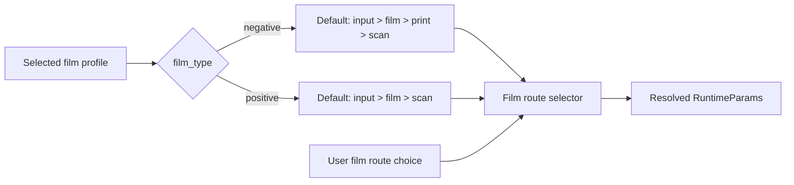
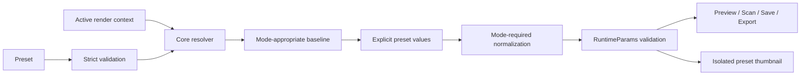

# Presets

This specification defines the implementation target for the compact, current-photograph preset browser. The [native cutover boundary](design.md#implementation-boundary) separates required behavior from the existing implementation and the HTML review.

## Contract

A **preset** is a named, reusable set of photographic controls.

A **film preset** selects film and print profiles and their visual simulation controls. A **LUT preset** selects a LUT transform and its external LUT file reference. An **Effects preset** selects Off mode and its Effects values.

A **section preset** carries exactly one film-preset section. Reusable combinations of controls that are already preset-owned belong in the existing film, LUT, Effects, or section preset. A preset is not a complete GUI state, an input image, a viewer state, an export configuration, a LUT pixel payload, a calibration profile, or an arbitrary film route.

A preset is either **built-in** or **user-owned**.

A preset document is a **film preset**, a **LUT preset**, an **Effects preset**, or a **section preset**. A film preset carries both profile references and every required preset-owned group. Its optional camera group follows the [file format rules](#file-formats).

A LUT preset carries an external LUT file path and hash, the LUT declaration, Effects, and optional LUT Grade, with no film or print profile references.

It is a complete preset and is governed by the [LUT workflow](../lut-workflow/spec.md#lut-presets).

An Effects preset carries Effects and no LUT declaration, LUT Grade, or film or print profile reference. It is a complete preset for Off mode.

A section preset carries exactly one section of the film preset and no profile reference. A section is a named set of preset-owned parameter paths, defined by the [preset design](design.md).

The kind is derived from the carried shape, never declared by a field. A document that carries neither a complete Film preset, a LUT transform, an Effects payload, nor exactly one film-preset section MUST be rejected. LUT and Effects section presets are outside this contract.

A Film preset or section preset MUST NOT carry `lut`, `effects`, or `grade`. A LUT or Effects preset MUST NOT carry `finishing`, `output_mix`, `cmyk`, or a material or scanner group.

The derived kind is an internal dispatch fact. It selects the document schema, resolver, render mode, and thumbnail preparation for a preset. It MUST NOT become a separate browser category, library, or mode-type filter.

Built-in film presets MUST enable the selected film profile's Hanatos2025 adaptation surface, except `Classic Neg Inspired`, which MUST disable it to preserve its authored color response. The surface coefficients belong to the film profile. The user MAY change the surface switch after applying a preset.

A preset **name** is its identity: the document `name`, the document file stem, and the selector used by the GUI and the CLI. A name MUST be unique inside its group and MAY repeat across groups. The groups are `Built-in` and `My Presets`.

The [preset design](design.md) owns the name rules, file locations, discovery, conflicts, and writes.

The GUI MUST provide one collapsible Presets panel beside the photograph, with `Built-in` and `My Presets` groups. It presents Film, LUT, and Effects complete presets in one list and MUST NOT separate them into mode categories or offer a mode-type filter.

Cards MUST show a current-photograph thumbnail, the preset name, and a non-color applied-state cue. They MUST identify the preset by its name and its carried material, LUT file, or Effects context.

A mode-type badge MUST NOT identify a card.

Film and print references MUST remain available in accessible card descriptions and the current-preset inspector, without a repeated material paragraph on every card. A LUT preset's accessible description MUST expose its LUT file name and title; those names MUST NOT be presented as active material selections. An Effects preset's accessible description MUST identify its active effects.

The inspector MUST NOT repeat the preset list.

A material summary MUST distinguish a stored print reference from an active paper stage. A direct-film route MUST NOT imply that its stored print material contributes to the displayed result.

User presets MUST NOT be implemented by reusing complete `GuiState`.

The GUI presents complete presets only. It MUST NOT offer a section-preset menu, section capture, section management, or section import, and a section document MUST NOT appear in the browser or be applicable from it.

A section document remains a valid library document for `core`, the CLI, and scoped photograph copying under [Photograph work](../gui-product-design/photo-work/spec.md#copy-adjustments). The GUI MUST NOT rewrite, migrate, or delete it because no GUI surface lists it.

Browser rows MUST be ordered by name, case-insensitively, with a deterministic tie-break, so one library always presents one order. User-selectable sorting is outside this contract.

### LUT presets

A LUT preset is a complete preset for LUT mode. It carries an external LUT file path, its SHA-256 content hash, the LUT declaration, Effects, optional LUT Grade, and required strength. It carries no film or print profile references, no spectral parameter groups, and no LUT pixels.

Missing Effects groups mean all effects off; missing LUT Grade means neutral. A newly imported unsaved LUT defaults to strength one; a saved LUT preset MUST carry its strength.

A LUT preset uses preset schema version 8. Film presets and section presets retain schema version 7. Effects presets use schema version 9.

A reader identifies a LUT preset by its `lut` root group and MUST NOT interpret schema version 8 as a film-preset migration.

A version 8 document without a valid `lut` group is invalid. Mixing a LUT group with film or print references MUST fail.

The path and hash are required. The LUT file is not copied into an application-owned library. The runtime resolves exactly the stored path and validates the hash; a missing file or mismatch MUST fail validation while the preset is applied.

The product MUST NOT substitute a similarly named file, a default LUT, a film preset, or a neutral transform.

LUT presets are user-owned. Built-in LUT presets are outside this contract; built-in film presets remain unchanged.

Applying a LUT preset MUST switch to LUT mode, replace the LUT transform, Effects, and LUT Grade groups, preserve stored film, print, scanner, and route values, and create one undoable transaction. Applying a Film preset MUST switch to Film mode and preserve the stored LUT transform, Effects, and LUT Grade.

A manual mode switch preserves every payload but clears the active applied-preset identity.

The browser presents Film, LUT, and Effects presets in one list under the same groups. It MUST NOT add a separate mode category or mode-type filter. Search MUST include a LUT preset's file name, title, and path, and a film preset's film or print identity.

A LUT preset thumbnail MUST render the production LUT graph and MUST NOT prepare spectral materials.

In LUT mode, **Save preset…** captures a LUT preset. It requires a validated imported LUT and MUST NOT capture film or print profiles, inactive spectral controls, image data, or a render result. A LUT preset deletion or rename MUST NOT delete or modify its LUT file.

Preset export and import move only the preset document; the LUT file is external and is not included. The UI MUST identify that external dependency. Import MUST NOT copy the LUT file into an application-owned library.

### Effects presets

An Effects preset is a complete preset for Off mode. It carries the `effects` root and its Diffusion, Halation, and Grain groups. It carries no LUT declaration, LUT Grade, or film or print profile reference.

An Effects preset uses preset schema version 9. A version 9 document without an `effects` group or with a `lut`, `grade`, film, or print reference MUST be rejected.

Effects presets are user-owned. Built-in Effects presets are outside this contract.

Missing effect groups mean all effects off. A saved Effects preset MUST carry every effect group's effective values.

Applying an Effects preset MUST switch to Off mode, replace the Effects groups, preserve stored film, LUT, LUT Grade, scanner, and route values, and create one undoable transaction. It MUST NOT read a LUT file or prepare spectral materials.

In Off mode, **Save preset…** captures an Effects preset. It MUST NOT require a LUT and MUST NOT capture film or print profiles, LUT Grade, inactive spectral controls, image data, or a render result.

The browser presents Effects presets in the same list and groups. Search MUST match their name and active effect names. An Effects thumbnail MUST use Off mode and MUST NOT prepare spectral materials or load a LUT.

### Browser interaction

Single pointer activation or Enter on a focused card MUST apply its preset through [Apply](#apply). Arrow keys MUST move focus without applying; hover, search, disclosure, and scrolling MUST NOT edit the photograph or schedule its main render.

The browser MUST NOT introduce a selected-but-not-applied preset, an Apply button, or hover audition. Thumbnail rendering is read-only work, not an application transaction.

Focus MUST remain visible and scroll into view. Thumbnail completion MUST NOT steal focus, change search text, move scroll position, or submit an uncommitted edit.

Activating the applied card again MUST reapply the stored document through the same undoable transaction. It MUST NOT act as a factory reset or rewrite that document; separate Update and Revert controls MUST NOT appear in the browser.

The viewer MUST remain visible while the browser is open. Applied identity MUST follow accepted controls immediately, while viewer status MUST identify a pending or stale main result until matching pixels arrive.

Normal presentation MUST retain names, state, and necessary actions without explanatory paragraphs beside the photograph. Help and rendering limitations MUST remain available on demand; validation, failures, and destructive confirmations MUST remain explicit where the action occurs.

### Browser search

The browser MUST offer a transient search field. It MUST filter presets by a case-insensitive substring match against the preset name. A film preset MUST also match either referenced film or print stock's name or identifier.

A LUT preset MUST also match its LUT file name, title, and path. An Effects preset MUST also match its active effect names. An empty query MUST show all presets.

Search MUST NOT change discovery, exact name resolution, preset identity, group membership, or the deterministic order within each group.

Filtering MUST preserve the `Built-in` and `My Presets` groups and their identities. The applied group and name, modified state, and missing-document state MUST remain visible as context even when the applied row does not match. Search MUST NOT apply a preset or clear that context.

Library faults MUST remain visible and MUST NOT be mistaken for unmatched presets.

The browser MUST distinguish a library with no presets from a search with no matches. The no-match state MUST offer to clear the query.

The empty-library state MUST retain the save guidance. A LUT preset with a missing LUT file is a library fault, not an empty result.

An empty `My Presets` group MUST retain access to the same Save preset entry rather than introduce another capture workflow.

The query MUST NOT persist across restarts or enter GUI-state files or preset documents. This browser search is separate from [control search](../gui-workflow/spec.md#control-search).

### Current-photograph thumbnails

Every valid built-in and user preset MUST use the same [preset thumbnail](../../CONTEXT.md#language) rules. A LUT preset thumbnail MUST use LUT mode; a Film preset thumbnail MUST use Film mode; an Effects preset thumbnail MUST use Off mode. No kind MAY load another kind's inactive materials or LUT file.

Thumbnails MUST depict the accepted current photograph with its input interpretation, orientation, and crop, without an additional composition-changing crop.

Each candidate MUST resolve against the same accepted photographic context through the production complete preset resolver. A Film preset candidate MUST retain that resolver's replace/preserve scope, material preparation, film route defaulting, and scanner normalization under [Apply](#apply).

A LUT preset candidate MUST use LUT mode and MUST NOT prepare film or print materials. An Effects preset candidate MUST use Off mode and MUST NOT prepare film, print, or LUT data.

No candidate MAY prepare a mode other than its own.

Thumbnails MUST use real candidate renders and the production display-transform path. They MUST NOT substitute a fixed photograph, an earlier source, a CSS-like color approximation, or per-preset exposure normalization.

| Condition | Thumbnail presentation | Application |
| --- | --- | --- |
| No accepted photograph | No image; concise Open photograph guidance | The named preset remains applicable to controls. |
| Waiting for the current result | Explicit pending state; no stale image labeled current | The preset remains applicable. |
| Matching result ready | Current photograph rendered with this candidate | Card activation applies the preset. |
| Candidate preview failed or is unavailable | Explicit unavailable state with an accessible cause | The preview failure alone does not disable an otherwise valid preset. |

A source change MUST remove images from the preceding photograph before they can appear as current previews. An unsuccessful or cancelled import MUST leave the preceding accepted photographic context authoritative.

Changes to preserved input or adjustment context, candidate contents, or referenced materials MUST invalidate affected previews. Late results MUST NOT restore a stale thumbnail; [thumbnail execution](design.md#thumbnail-execution) owns request identity and cache reuse.

Thumbnail demand MUST follow visible cards and search results, not the entire library. Scrolling and search MAY request newly visible thumbnails without applying a preset or starting a main render.

Main Preview, Scan, and independent Export MUST take priority over thumbnail work. Thumbnail generation MUST NOT block interaction or require the entire library to finish before a card can be used.

Preparing or rendering a thumbnail MUST NOT change accepted controls, source, applied identity, history, calibration decisions, retained output, Save input, or Export input. It MUST NOT advance the main render's latest-request identity.

Small previews MUST follow the existing Preview and [complete-working-frame scan requirements](../film-chain/lab-scan/spec.md#exact-preview-and-prepared-baseline). They MUST NOT claim full Scan equivalence for grain, halation, blur, or other spatial effects.

The browser MUST NOT offer Favorites or Recently used filters in this target. It MUST NOT upload photographs, persist thumbnail attachments in preset documents, or introduce another library or cache database.

## User library

A user preset is a valid preset document in the preset library directory. Placing such a document in that directory makes it available to the GUI browser and to preset name resolution. The browser and the CLI MUST use the same discovery and name rules.

### Saving and replacing

The browser MUST expose one labeled **Save preset…** entry. It MUST capture the current complete preset through core capture, not a thumbnail or a complete GUI state.

The dialog MUST ask for a name in `My Presets`, with a default that proposes an available new copy. It MUST NOT ask for a scope, format, schema version, material pair, or library directory.

A name unused in `My Presets` MUST create a new user document. A same-named built-in document MUST remain unchanged and independently reachable through the existing group-qualified resolver.

An existing user name MUST show the conflict and an explicitly named **Replace “name”** action instead of an ordinary Save action. Enter in the name field or committing IME composition MUST NOT replace a document.

Replacement MUST revalidate the target under the existing library mutation lock at publication. It MUST reject a section document, invalid document, or conflicting carrier owner without changing that file.

Replacement MUST retain the target's canonical name and file stem, even when the typed collision differs in case. It MUST preserve the target's author, description, and provenance and follow existing carrier-selection rules.

All writes MUST retain core validation, name ownership, and atomic publication under [Writes](design.md#writes). A failed write MUST preserve the preceding document, dialog text, accepted controls, and applied identity.

Only successful publication MAY associate the captured preset with its saved name. Saving or replacing a preset MUST NOT schedule a render, add an adjustment-history entry, or make Undo reverse the library write.

### Browser state and library actions

The current-preset summary MUST retain group and name independently of search. Its state MUST distinguish no applied preset, a matching applied preset, preset-owned adjustments, and a missing library document.

An adjusted preset MUST mean differences against the applied document, not unsaved photograph work or differences against factory defaults. A film preset uses the existing omitted-camera and preset-ownership matching semantics; a LUT preset compares its LUT file path and hash, declaration, effects, and grade. Neither compares entire GUI states or prepared runtime trees.

Applied identity MUST travel with explicit GUI-state restoration, photograph adjustment records, and history. Restoring controls MUST NOT reapply a document or depend on it remaining available.

Global browser preferences MUST restore layout only, not a last-used preset name. Automatic loading of startup defaults, including a missing browser carrier's fallback, MUST NOT attach an old applied identity to unrelated controls.

An old global carrier MAY supply its width and expanded preference while its applied-name field is ignored. Explicit GUI-state and photograph carriers MUST retain their existing applied group/name fields without a schema-version change.

The library menu MUST offer Import preset, Open preset folder, and Refresh presets. The resolved directory path MUST remain available there rather than occupy a permanent list row.

A row menu MUST offer Duplicate and Export for its stored document, without applying it or substituting current adjustments. A user row MUST also offer Rename, Show file, and confirmed Delete; built-in rows MUST NOT expose unavailable mutation actions.

Import MUST reject a section document without writing or editing. Duplicate, import, rename, and export into the library MUST use a new user name; a library conflict MUST offer another name, not silently replace a document.

Successful additions MUST reveal the affected row without applying it, clearing transient search when necessary. Renaming the applied user preset MUST follow the new name; deleting it MUST preserve controls and show its remembered identity as missing.

Invalid or unreadable documents MUST remain discoverable through one compact issue summary independent of search. Details MUST identify the filename, cause, and path without hiding healthy entries.

The remembered applied document MUST remain a complete preset. Section documents remain valid for core, CLI, and scoped photograph copying; the GUI MUST NOT rewrite or delete one because it is absent from this browser.

Multi-photograph application follows [Photograph work](../gui-product-design/photo-work/spec.md#copy-adjustments). Collections, user-selectable sorting, inheritance, per-scope preset memory, and arbitrary GUI scope capture remain outside this contract.

### Apply

- Selecting a preset validates the document, or the section it carries, before changing active controls. Its carried runtime values MUST follow [shared value validity](../cli/spec.md#parameter-value-validity) after the preset's existing versioned migration, without filling omitted section leaves.
- A LUT preset validates its LUT file path, hash, and declaration, then applies under [LUT presets](#lut-presets). It switches to LUT mode, replaces the LUT transform, Effects, and LUT Grade, and preserves stored film, print, scanner, and route values.
- An Effects preset validates its Effects groups, switches to Off mode, and preserves stored film, LUT, LUT Grade, scanner, and route values.
- A LUT preset does not use a film route default.
- The film-specific profile, scanner-normalization, and material-default rules below apply to film presets and section presets, not to LUT or Effects presets.
- A film preset identifies both film and print profiles. The resolver validates film=`support=film, stage=filming` and print=`support=paper, stage=printing`.
- A film preset or section preset does not store or directly apply a film route. A film preset selects the corresponding film route default: negative film selects `input > film > print > scan`, and positive film selects `input > film > scan`.
- The user MAY then choose another supported film route manually. A section preset carries no film reference and MUST NOT change the film route.
- A section preset MUST NOT be applied while LUT or Off mode is active; the command or GUI MUST require an explicit switch to Film mode first.
- Applying a film preset replaces all carried preset-owned controls together, including the controls of every carried section, so a section preset MUST be applied after a preset change to take effect. An omitted camera group preserves the active virtual film exposure and metering controls.
- A film preset owns and replaces [Tone & Color](../finishing/spec.md#persistence-and-replay), independently of its optional camera group. A LUT preset owns the corresponding LUT Grade group.
- Sparse omission MUST NOT edit finishing values.
- Application invalidates dependent render state and schedules automatic Preview.
- A film preset normalizes the scanner output to direct scan unless the resolved film is negative and the selected film route remains a film scan. A caller-declared film-scan route is preserved only for positive film or an explicit `negative_to_positive` configuration; otherwise a direct-scan negative configuration selects print, and the scan-film flag follows the route.
- `core` owns that rule once for the GUI and the CLI.
- A film preset does not change recorded explicit-leaf ownership. Section presets and sparse parameter sources mark their supplied leaves explicit; those marks survive a later preset application.
- Applying a section preset replaces exactly the controls of its section, and those values count as explicit. Every other control retains its value, including explicit values from an earlier preset or parameter source, so the result does not re-derive them from stock defaults.
- It invalidates dependent render state and schedules automatic Preview.
- Applying a section preset that would introduce a scanner-output, film-route, scan-film, film-profile, or grain-engine combination the pipeline rejects MUST fail without changing any control. A state that already fails that check MAY still receive an unrelated section edit.
- Applying a section preset MUST NOT replace the remembered applied preset. It is an edit, so an applied preset becomes modified.
- Each successful GUI application of a Film, LUT, Effects, or section payload MUST create one undo transaction under [Edit history](../gui-workflow/spec.md#edit-history), including explicit-leaf provenance, mode selection, and dependent normalization. A failed application MUST NOT create a history entry.
- Undo and Redo MUST NOT reverse preset-file or library writes.
- Applying a preset preserves loaded image and metadata, RAW/source settings, source exposure correction, input color interpretation, crop, resize, rotation, viewer/display state, Save settings, and Export settings.
- Built-in presets are immutable. Editing controls after an apply never rewrites the built-in definition.

### Film route defaulting

Changing a film profile selects the corresponding film route default while the film route remains user-editable:

Film selection refreshes unowned stock-derived controls under [Material defaults](#material-defaults). It MUST NOT apply other hidden stock-specific preset values. The film route selector remains editable until the next film profile change.

The positive path does not execute print stages; its explicit print profile remains part of the portable pair.

A serialized `route` or `workflow` field is unknown and rejected.

### Material defaults

Selecting a film MUST refresh unowned stock-derived leaves from the selected film's defaults. Fresh GUI and CLI initialization MUST use the same stock defaults for the same film.

| Group | Stock-derived leaves |
| --- | --- |
| Grain | `rms_granularity`, `density_min`, `uniformity`, `particle_scale_sublayers` |
| DIR couplers | `gamma_samelayer_rgb`, `gamma_interlayer_r_to_gb`, `gamma_interlayer_g_to_rb`, `gamma_interlayer_b_to_rg` |
| Halation | `halation_first_sigma_um`, `halation_strength` |

Explicitly owned leaves MUST retain their values, even when equal to the previous film's default. Each vector is one atomic leaf; ownership MUST NOT be inferred separately for its components.

Selection MUST preserve enable switches, intensity, unrelated controls, and existing explicit ownership. Material defaults MUST retain the applicable stock, cine, and class/polarity lookup precedence under [Preset design](design.md#material-defaults).

When that lookup provides no applicable value for a stock-derived leaf, its schema default MUST replace the previous stock's value.

Ordinary rendering, complete GUI-state or photograph restoration, and history replay MUST NOT reapply material defaults. They MUST preserve the restored or accepted controls exactly.

Legacy baseline preparation MUST retain its existing initialization policy under [CLI composition](../cli/spec.md#composition) and [compatibility](../cli/spec.md#compatibility). Legacy values MUST NOT acquire new explicit ownership to preserve that policy.

### Preset ownership

This section describes film preset and section ownership. LUT preset ownership follows [LUT presets](#lut-presets).

A film preset owns film and print selection plus explicit film, print, enlarger, diffusion, halation, coupler, grain, base, chemistry, scanner, CMYK ink style, and output-mix controls. The scanner controls it owns are `scanner.scan_output`, `scanner.white_reference`, `scanner.conversion_style`, `scanner.experimental_setup`, `scanner.operator`, `scanner.lens_blur`, and `scanner.unsharp_mask`. Viewing glare ownership is limited to effective `print_render.glare`; the non-effective `film_render.glare` group is not preset-owned.

Neutral enlarger filter anchors are calibration baselines, not preset controls, and are not preset-owned. Existing material controls and `output_mix` follow [Output mix and material controls](../output-mix/spec.md). A section preset owns exactly the controls of its section.

Tone & Color is an independent preset-owned section for film presets under [Preset design](design.md#sections). Its controls MUST NOT belong to the optional camera group. LUT Grade is a separate LUT-stage group and is not this film section.

Virtual film exposure compensation and metering belong to the film preset through the optional `parameters.camera` group. Other camera controls remain outside this group; camera diffusion remains a separate preset-owned group.

The assumed scene light belongs to the film preset through the optional `camera.capture_illuminant` leaf under the [capture illuminant contract](../image-input/spec.md#capture-illuminant):

- An omitted leaf keeps the selected film profile's `reference_illuminant`.
- An explicit catalog name or `BB<kelvin>` token overrides it for the camera-side conversion into film exposure only.
- A generic film preset MUST NOT hard-code one stock's tungsten or daylight reference.

A film preset also owns preset-relevant processing settings: hanatos2025 adaptation window/surface switches, spectral Gaussian blur, CAT16, and the print-exposure EV tracking choice (`FilmPresetSettingsParams`, a subset of `SettingsParams`).
### Surface parity

Every leaf under `parameters` that a preset carries is a user-settable parameter. A carried parameter leaf **MUST** have both of these surfaces:

- the GUI has one editable control or one named action that writes that exact canonical runtime value; an inactive condition MAY disable the surface, but MUST retain the value and explain the condition;
- the CLI accepts the same value through the canonical `--set` path and exposes that path through `describe --field` or `describe --module` with the shared type, validator, units, and conditions.

The GUI label and CLI syntax need not be identical, but they MUST edit the same runtime leaf with the same semantics. A value that can only be populated by preset capture, profile defaults, database calibration, migration, or internal state is not a preset-owned user parameter. It MUST either gain both surfaces or be removed from preset capture and validation.

Provenance, profile references, and other preset metadata are outside this leaf-parity rule.

This rule applies equally to complete preset payloads and section payloads. Capturing, importing, migrating, or exporting a preset MUST NOT create a hidden parameter surface. The section table MAY contain only sections whose carried leaves satisfy this rule and have a visible GUI owner.

### Implementation rules

- `core` owns the typed film preset model, strict schema validation, profile compatibility, profile-driven film route defaulting, capture, candidate resolution, the library directory policy, discovery, name conflict rejection, and atomic document writes.
- `gui` owns browser presentation, group and row state, library actions, active and modified state, transient state, and user-editable film route controls.
- `GuiState` remains complete GUI-state persistence and is not a preset payload.
- `core` owns strict parsing, profile resolution, stock-baseline construction, explicit preset-value overlay, film route default derivation, and `RuntimeParams` validation.
- Neutral print-filter anchors (`enlarger.c_filter_neutral`, `enlarger.m_filter_neutral`, and `enlarger.y_filter_neutral`) are calibration baselines supplied by the per-paper/illuminant/film database, not preset-owned leaves.
- They have no ordinary GUI/CLI preset surface. Explicit calibration state remains in runtime preparation and GUI-state compatibility and MUST NOT be confused with a reusable preset.
- The non-effective `film_render.glare` group, derived `film_render.grain.monochrome`, no-op `film_render.grain.micro_sublayers`, and `enlarger.lens_blur` (zeroed by digest and applied by no upstream stage) likewise remain outside preset capture and section ownership.
- A film preset protects a neutral print-filter axis only when a legacy or explicit runtime source has authored that axis. An axis the preset does not carry keeps the [per-paper database](../film-chain/spec.md) baseline instead of one paper's pack being reused everywhere.
- The authored-versus-baseline state persists in the parameter document so replaying a resolved document reproduces its render bit-identically; documents without the flags treat every axis as baseline.
- The exposure normalization refines baseline axes from the database's f64 values while the published parameter surface carries their f32 views. Authored axes stay exact.
- A render that consumes only the published f32 views MUST agree within 1e-8 absolute on the f64 reference values (measured 6.4e-10 in the report/render acceptance fixture).
- Existing `--params` invocations and consumers MUST retain their `0.3.4` results with `output_mix.amount = 1` and neutral [Tone & Color](../finishing/spec.md#controls). Exceptions remain the explicit [output lightness retirement](../output-mix/spec.md#output-boundary-and-retirement) and [optical-order cutover](../film-chain/spec.md#optical-order-cutover).
- The cutover does not change stored blur units, grain selectors, or print-glare ownership.
- The [CLI parameter language](../cli/spec.md) owns command syntax and composition rules.

The portable canonical snake-case schema for film preset and section documents contains:

- `schema_version`, `name`, optional `author` and `description`;
- `film_profile` and `print_profile`, each with stock, optional profile version, and optional `sha256-<lowercase-hex>` content identity; both are required in a film preset and absent from a section preset;
- `parameters`, the typed preset-owned parameter object: every required group and the optional camera group in a film preset, or the paths of its section in a section preset;
- `provenance`, the SpektraFilm implementation and model versions.

The LUT preset schema adds `lut`, `effects`, and `grade` and omits the film profile and `parameters` groups under [LUT presets](#lut-presets). The Effects preset schema carries `effects` and omits profiles, `lut`, and `grade` under [Effects presets](#effects-presets).

It MUST NOT contain `route`, `workflow`, image pixels/paths, RAW data, LUT pixels, viewer rasters, GUI paths, credentials, random seeds, or Dehancer-specific fields. Unknown fields are rejected. The resolved candidate is returned without mutating active GUI state; GUI commits only after successful resolution.

### File formats

TOML MUST be the default preset export format. Readers MUST accept `.toml` and `.json` files as carriers of the same typed schema. The file extension MUST select the parser.

A reader MUST NOT try another parser after a parse failure. Both carriers MUST apply the same version, ownership, profile, type, and value validation.

The film preset and section preset schema version MUST be 7. LUT presets use schema version 8. Effects presets use schema version 9.

The versions coexist by document kind.

The [lab scan cutover](../film-chain/lab-scan/spec.md#point-wise-consumers-and-migration) retains its acquisition-light and scanner-provenance migration rules; version 6 and later film documents MUST reject scanner lamp keys.

The previous film-preset schema version was 5. Negative conversion controls and the enlarger print exposure mode renamed their paths, and the terminal `cmyk` group replaced the retired magazine spelling.

A version 1 through version 4 document is accepted only through an explicit migration. Version 1 migration MUST discard the old `id`.

Migration of a version 1 or version 2 complete preset MUST supply `output_mix.amount = 1` and retain existing material controls and M/Y shifts. Neutral enlarger filter anchors are calibration baselines rather than preset values. A legacy document that carries them is rejected rather than migrated, exactly like any other not-preset-owned field.

Version 3 to version 5 migration MUST map the existing scanner and enlarger legacy paths to their canonical controls, then normalize the retired CMYK group and route only for an approved complete document. The migration MUST preserve rendered pixels and MUST NOT keep a legacy path beside its canonical path.

An older section MUST preserve sparse omission and MUST NOT acquire new leaves. Resolving, exporting, or updating a migrated complete preset MUST NOT capture or replace caller `io` settings. Film preset and section exporters MUST write version 7; LUT preset exporters MUST write version 8; Effects preset exporters MUST write version 9.

Legacy renamed paths and the retired CMYK group in a version 5 document MUST fail unknown-field validation. The unshipped `film_render.response`, `print_render.response`, `enlarger.c_filter_shift`, `reproduction`, and `io.finished_rgb_output_processing` fields MUST fail normal unknown-field validation in every accepted version, including draft legacy documents. The unshipped `output response` section MUST be rejected.

None has a compatibility alias, default, or migration.

A Film preset MUST contain every required preset-owned group. A LUT preset MUST contain its LUT declaration and MUST NOT contain film preset-owned groups. An Effects preset MUST contain its Effects groups and MUST NOT contain profiles, a LUT declaration, or LUT Grade.

An exporter MUST write every non-optional editable preset control so a newly captured preset does not depend on implicit defaults.

Readers MUST retain the existing omitted-field and JSON null decoding rules of the typed model, subject to the camera group rule below.

Readers MUST materialize other omitted controls before resolution or re-export. TOML absence MUST represent an unset optional control; an exporter MUST omit unset optional controls in TOML. The two carriers MUST NOT introduce a separate schema version or field vocabulary.

A change to accepted omitted-field behavior MUST use an explicit schema migration rather than silently rejecting existing documents. A change that makes a new preset-owned group required MUST use an explicit schema-version migration.

Version 1 through 6 complete presets MUST gain neutral finishing during migration to version 7. Those versions MUST reject authored finishing fields; version 7 complete presets MUST require the complete group under [finishing compatibility](../finishing/design.md#wire-and-compatibility).

`parameters.camera` is an additive optional group in schema version 3. When present, it MUST contain exactly three required fields: `exposure_compensation_ev` (f32), `auto_exposure` (boolean), and `auto_exposure_method` (string). Readers MUST reject a partial group, a null group, and unknown fields within it.

Film presets in any accepted schema version that omit the group MUST retain its absence during migration, reading, and re-export. Applying such a document MUST preserve the active values of all three controls. Film preset matching and the modified marker MUST ignore these controls when the applied document omits the group.

A new film preset capture MUST emit the complete group with the three active values. A version 1 or version 2 document that carries the group MUST be rejected as a schema violation rather than migrated, because the field has no legacy vocabulary.

`auto_exposure_method` MUST satisfy the same vocabulary as a sparse parameter source, and that validation MUST apply before resolution so a complete preset cannot admit a value the metering dispatcher does not implement.

`camera.capture_illuminant` is a fourth optional leaf inside that group, governed by the [capture illuminant contract](../image-input/spec.md#capture-illuminant). TOML absence MUST mean the leaf is unset, an exporter MUST omit it when unset, and an unset leaf MUST resolve to the selected film profile's `reference_illuminant` rather than to a stored default.

A JSON `null` clears it to the same unset state. It MUST satisfy the shared illuminant vocabulary before resolution, so a complete preset cannot admit a light source the spectral service does not provide. The three required fields above remain the required set; this leaf is optional and its unset state is meaningful.

A new film preset capture MUST emit the leaf's active state alongside the three active values. It MUST record the explicit illuminant name or `BB<kelvin>` token when set, and an explicit unset value otherwise. Re-applying the capture MUST restore the captured state instead of silently inheriting.

Film preset matching and the modified marker MUST compare the leaf's presence and value exactly as they do for the three required fields.

A section preset MUST carry exactly the parameter paths of its section and MUST NOT carry a profile reference.

Its payload MUST follow the leaf-merge rules of a parameter-file source in the [CLI parameter language](../cli/spec.md), including the rejection of unknown fields, duplicate keys, and omitted values acquired by default-filled deserialization. An exporter MUST write exactly what it carries rather than filling omitted controls.

Film preset and section kinds use the same schema version, the same name rules, and the same profile and value validation for what they carry. LUT presets share the name and library rules but use schema 8 and LUT value validation. Effects presets use schema 9 and Effects validation.

Export and reload MUST preserve the represented finite f32 and f64 values. Export MUST NOT reduce numeric precision for shorter text. Readers MUST accept TOML comments.

Re-export need not preserve comments or source formatting.

Readers MUST reject non-finite numeric controls and numeric values that overflow their declared f32 or f64 type. TOML `nan`, `inf`, date/time values, and numbers that become non-finite during typed conversion MUST NOT reach the resolver. Readers MUST NOT convert unsupported carrier types to strings.

This rule MUST apply before runtime validation so JSON and TOML cannot admit different numeric domains.

Preset files MUST NOT support includes, inheritance, expressions, environment interpolation, or references to GUI state files.

### GUI state compatibility

GUI state MUST retain its JSON contract. Loading a GUI state MUST NOT interpret it as a preset. Importing a preset MUST NOT interpret it as a complete GUI state.

Saving state after applying or editing a preset MUST store the actual controls and the calibration policy needed to restore them. Restoring that state MUST preserve explicit neutral filters through runtime preparation. The saved state MUST NOT depend on the preset file or built-in definition remaining available or unchanged.

Any new Rust-owned state metadata MUST use the existing versioned Rust extension and MUST preserve existing Python state normalization.

GUI state version 7 MUST retain finishing through the [finishing compatibility contract](../finishing/design.md#wire-and-compatibility). State loading MUST preserve existing sparse-document semantics independently of complete-preset requirements.

Complete GUI states, render recipes, and presets that carry a versioned complete runtime document MUST migrate the retired `magazine_print_color` group and route only at their own legacy boundary. A current preset schema 4 document MUST reject the retired group; the preset schema bump required for canonical `cmyk` MUST be recorded separately from the parameter-document bump.

Successful migration MUST preserve omitted section leaves and MUST NOT materialize `cmyk` into a section preset that did not carry the feature. Their versioned legacy complete-document migration MUST apply the [output lightness retirement rule](../output-mix/spec.md#output-boundary-and-retirement): allow an absent or null `io.output_gamut_compress.lightness_compression`, but reject every explicit numeric triplet even when the old gamut algorithm ignored it.

The error MUST identify that exact path, state that no automatic replacement exists, and require explicit removal. It MUST NOT suggest a deleted response group. Other caller `io` settings MUST remain intact.

Current complete documents, sparse sources, and inline assignments MUST reject the retired leaf even when null. New writers MUST never emit it. The unshipped response and Cyan-shift fields MUST fail normal unknown-field validation rather than gain defaults or migration support.

A migration failure MUST preserve the source document, active state, and existing output.

Normalized runtime controls MUST follow [shared value validity](../cli/spec.md#parameter-value-validity). This check MUST NOT replace the GUI-state decoder, discard valid inactive settings, or infer explicit ownership from default-filled fields. Rejected canonical values retain the same transaction protection as rejected migration.

Capturing a preset from the GUI MUST use the active preset controls. Applying it MUST preserve the excluded context defined in [Preset ownership](#preset-ownership). A captured section MUST carry an unset optional control as an explicit null, so re-applying the capture restores the captured unset value; a capture that carries explicit nulls uses the JSON carrier.

### Resolution flow

The preset and active render context are separate inputs to the same runtime:

A Film preset uses the profile baseline and the profile-driven film-route default. A LUT preset resolves its LUT declaration, Effects, and LUT Grade without loading spectral materials.

An Effects preset resolves its Effects groups without a LUT or spectral preparation. A section preset edits only its section.

The resolver MUST preserve image/source, geometry, viewer, display, Save, Export,
debug, precision, backend, and random-seed context. The GUI commits the returned
candidate only for an accepted application. Thumbnail candidates remain isolated under [current-photograph thumbnails](#current-photograph-thumbnails).

### Transaction and stale results

Applying a preset validates and resolves first, commits its carried controls together, preserves excluded context, increments a parameter revision, invalidates affected main-render caches, and marks the render dirty. A LUT preset application also commits LUT mode and preserves stored film, print, scanner, and route selections.

An Effects preset application commits Off mode and preserves stored film, LUT, LUT Grade, scanner, and route selections.

A Film preset application also commits Film mode, film and print selections, and the profile-derived film route default under [Apply](#apply). A section application MUST preserve profile selections and the film route.

Main render workers carry the parameter revision, and stale main results MUST NOT replace a newer accepted result. Thumbnail reuse and stale-result rejection MUST follow their own context and candidate identity under [thumbnail execution](design.md#thumbnail-execution).

The GUI MUST commit the application as the single edit-history transaction defined under [Apply](#apply). Parameter revisions MUST continue to reject stale render results after Undo or Redo.

A failed application MUST preserve active controls, the applied marker, and the parameter revision. Only the error status MAY change.

CLI preset selection MUST use the same core resolver and name rules as GUI preset application. The [CLI parameter language](../cli/spec.md) defines selection, sparse parameter files, and command compatibility.

The version 5 scanner cutover MUST NOT reopen older retired-field migrations. A version 5 document that carries the retired CMYK spelling or legacy conversion fields MUST still fail.

A sparse scanner section MUST normalize `neutral` to `standard` without acquiring omitted leaves. The additive `scanner.white_reference` leaf follows the same rule: omission resolves to `clear_film_base` without acquiring an authored leaf or requiring a schema-version migration.

The readout cutover intentionally changes negative scan appearance; it does not promise historical pixels for the migrated built-in style.

## Acceptance

Acceptance MUST use the production native entry point and real renderer. An HTML review, copied sample images, or mocked worker echoes MUST NOT establish native thumbnail correctness or performance.

| Scenario | Required observable result |
| --- | --- |
| Compare built-in and user presets on one photograph | Every card uses that photograph and its accepted geometry; the same candidate matches an independent production Preview at the declared preview scale and display settings. |
| Render cards without activating one | Controls, preparation ownership, applied identity, history, library files, and retained output remain unchanged. |
| Change source or preserved input context with work in flight | Old-source images disappear; old generation completions cannot appear as current thumbnails. |
| Change a preset, material dependency, preview size, or display settings | Affected results are regenerated or re-presented under the new dependency identity; no stale pixels are labeled current. |
| Scroll or search a large library while applying a preset | Only visible demand is queued, work and cache memory remain bounded, and the main operation takes priority without being replaced by a thumbnail. |
| Use no photograph, pending previews, and a failed preview | Honest empty, pending, and unavailable states remain usable; no reference or prior-source substitution occurs. |
| Focus, search, activate, then Undo and Redo | Browsing creates no edits; activation is one accepted transaction, history restores controls and identity, and stale main results remain rejected. |
| Save a new preset; type an existing name; cancel, replace, or fail a write | Only explicit named replacement changes a valid intended user preset; case, metadata, old contents on failure, and unrelated files remain protected. |
| Duplicate or export a non-applied row | The resulting document represents that row, not current adjustments; section and invalid same-name files are not overwritten by GUI preset capture. |
| Restore a photograph or explicit state; launch with unrelated defaults | Restored controls and applied identity remain authoritative, while global layout preferences cannot supply a false preset origin. |
| Use long names, keyboard input, IME composition, and narrow windows | Names, application, collapse/reopen, search, and error recovery remain reachable; focus and current context survive thumbnail updates. |
| Save or Export after thumbnail completion and source replacement | Delivery consumes the proper retained or independent-render input, never a candidate thumbnail or its display raster. |
| Export a LUT file, import it, and save it as a LUT preset | The preset appears in `My Presets`, switches to LUT mode when applied, loads no film or print profiles, and creates one Undo transaction. |
| Apply a LUT preset with a missing or changed LUT file | Validation fails before output; the active mode, controls, applied identity, and retained image remain unchanged; no Film preset or other LUT is substituted. |
| Save and apply an Effects preset in Off mode | The preset appears in `My Presets`, switches Off mode when applied, preserves stored film, LUT, LUT Grade, scanner, and route values, reads no LUT file, and creates one Undo transaction. |
| Mix Film, LUT, and Effects thumbnails in one browser | Film candidates prepare Film mode; LUT candidates use LUT mode; Effects candidates use Off mode; no candidate loads another kind's inactive materials or LUT. |
