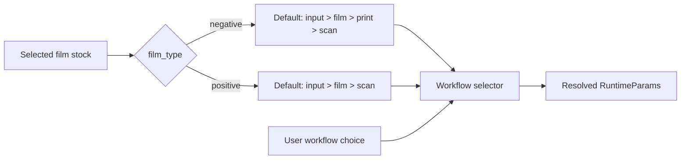
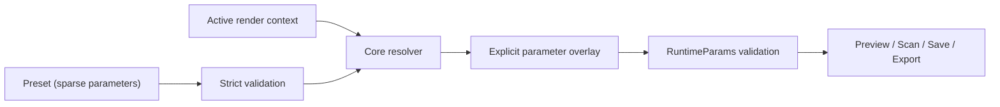

# Presets

## Contract

A **preset** is a named, reusable **parameter document**: a sparse set of canonical parameter paths and their values, plus the name that identifies it. A preset is not a complete GUI state, an input image, a viewer state, an export configuration, a LUT, a calibration profile, or a workflow selection. A preset is either **built-in** or **user-owned**.

A preset document declares no scope and no kind. The paths it supplies are its content, and every admissible subset of the [preset vocabulary](#preset-vocabulary) is a valid document. A document that supplies no path at all is rejected as empty. The withdrawn vocabulary — *look preset*, *section preset*, and the derived-kind rule — must not appear in a document, an error, or an API name.

Built-in presets that select a film profile must enable the selected film profile's Hanatos2025 adaptation surface. The surface coefficients belong to the film profile. The user may turn the surface off after applying the preset.

A preset **name** is its identity: the document `name`, the document file stem, and the selector used by the GUI and the CLI. A name must be unique inside its group and may repeat across groups. The groups are `Built-in` and `My Presets`. The [preset design](design.md) owns the name rules, file locations, discovery, conflicts, and writes.

The GUI provides a Presets browser in a collapsible panel on the left of the window, and one preset menu per control section. The browser shows the two groups. Each row shows the preset name and the film and print stocks the document supplies, and must show no reference for a stock it does not supply. The active row is marked. A modified marker appears while any path the applied document supplies differs from the active value. The MAIN control panel must not repeat the browser list. User presets must not be implemented by reusing complete `GuiState`.

A preset must appear in the browser, in the menu of each section whose paths it supplies, or in both. A section menu must report the issues of the documents it would carry. A section menu must show the name of the preset whose supplied paths equal that section and `custom` otherwise. That match must be derived from the document's supplied paths and the section's controls and must not be stored as separate state.

Browser rows and section menus must be ordered by name, case-insensitively, with a deterministic tie-break, so one library always presents one order. User-selectable sorting is outside this contract.

## Preset vocabulary

A preset document may carry any path of the **preset vocabulary** and must not carry a path outside it. The vocabulary is the look class of the canonical parameter table, and the [preset design](design.md#parameter-classes) owns that table and the class of every leaf. A path belongs to the look class when all of the following hold:

- a user control edits it;
- the render or the output reads it; and
- it describes the look rather than the source, the viewer, the export, or the runtime environment.

A path that no user control edits, that the pipeline never reads, that is module-owned, derived, retained for parity only, or that describes source interpretation, geometry, viewer/display, export destination, preview limits, cache, debug, startup, or random seed must not be preset content. Such a path remains a runtime parameter where the [CLI parameter language](../cli/spec.md) admits it, and a preset must reject it with the offending path named.

Film and print selection are ordinary parameters of the vocabulary: `film.stock` and `print.stock`, whose values are stock names. A document that supplies them selects those profiles on application; a document that omits them leaves the active selection unchanged. Profile identity — a profile version or a content hash — is not part of a preset document, and a reader must reject it as an unknown field.

An unknown path must be rejected with the offending path named. An absent path means "preserve the active value": a reader must never materialize, default-fill, or reset a path the document does not supply, and an exporter must write exactly the paths it carries.

The preset vocabulary is a subset of the runtime parameter vocabulary. A path that is preset content is also admissible in a sparse parameter source and in a command-line assignment, with the same leaf rules; a path outside the look class may still be admissible there. The two must not define separate value vocabularies or separate merge implementations.

## User library

A user preset is a valid preset document in the preset library directory. Placing such a document in that directory makes it available to the GUI browser and to preset name resolution. The browser and the CLI must use the same discovery and name rules.

The GUI must support these library operations:

- **Save as**: capture controls as a new preset under a name the user edits.
- **Update**: replace the stored document of the active user preset with the active values of the paths that document supplies.
- **Revert**: restore the paths the applied document supplies and clear the modified marker.
- **Rename**: rename the document file and its name together, and preserve its values.
- **Duplicate**: copy a built-in or user preset into `My Presets` under a new name.
- **Delete**: remove a user preset document after confirmation.
- **Import**: copy an external document into `My Presets` as a new preset. An existing name in `My Presets` must not be replaced; a conflicting import must offer a renamed copy.
- **Export**: write the selected document to a chosen path.
- **Show file**: reveal the document path of a user preset. A built-in preset has no path, so this action must be unavailable for it.

A section menu must offer the same operations for the presets it lists: **Save as** captures that section's controls, and Rename, Duplicate, Delete, Export, and Show file act on those documents. Every operation must share one discovery, write, and validation implementation for both entry points.

The remembered applied document and the library operations must work on documents of any scope. The GUI captures a whole look through the browser and a section through a section menu; an arbitrary scope-capture action remains outside this contract.

A name that exists in both groups must remain reachable in both. Editing controls after an application must mark the active preset modified and must not rewrite any document. Built-in presets must remain immutable.

The browser must list, with its path, every document that cannot be read, parsed, or accepted. An issue must not hide the remaining library. An empty library must state how to save the current look.

The browser must remember the applied preset group and name across restarts. A remembered preset whose document is absent must be shown as missing. The modified state must not persist across restarts. Restoring GUI state must restore its stored controls and must not re-apply the remembered preset document.

Ordinary startup must restore the browser metadata independently of the configured startup controls. An explicitly loaded GUI state must supply its own browser metadata and must not inherit the remembered selection. Remembering a browser selection must not save current controls as the startup default.

Renaming or deleting the applied user preset must update the marker: a rename follows the new name, and a delete leaves the controls untouched and shows the remembered name as missing.

Live thumbnails, favorites, search, sorting options, collections, per-scope preset memory, arbitrary scope capture, and batch application are outside this contract.

### Apply

- Selecting a preset validates the document before changing any control and must fail without changing any control when the document is invalid.
- Applying a preset writes exactly the paths the document supplies, in one transaction. Every other control retains its value, its explicit or derived origin, and its enabled state. An application must never reset, re-derive, or re-materialize a control the document does not supply.
- A supplied path is explicit after the application, so neither stock initialization nor database calibration rewrites it, and an application must not clear explicit values outside its supplied paths.
- A document that supplies `film.stock` or `print.stock` resolves those profiles before any control changes. The resolver validates film=`support=film, stage=filming` and print=`support=paper, stage=printing`.
- A document that supplies a film stock also selects that film's workflow default: negative film selects `input > film > print > scan`, and positive film selects `input > film > scan`. A document that supplies no film stock must not change the workflow. A preset does not store or directly apply a workflow, and the user may choose another supported workflow manually.
- A document that supplies no scanner output keeps the active scanner output; the existing scanner-output normalization applies when the application changes the film stock to a positive film or selects a workflow route that is not `input > film > scan`.
- Applying a preset that would introduce a scanner-output, workflow-route, scan-film, film-profile, scanner-correction, or grain-engine combination the pipeline rejects must fail without changing any control. A state that already fails that check may still receive an unrelated preset edit.
- Applying a preset preserves loaded image and metadata, RAW/source settings, source exposure correction, input color interpretation, crop, resize, rotation, viewer/display state, Save settings, and Export settings, because none of those paths is preset content.
- Applying a preset clears transient Scan-for-print state, invalidates dependent render state, and schedules a render according to Auto preview.
- Built-in presets are immutable. Editing controls after an apply never rewrites the built-in definition.

### Workflow defaulting

Changing a film stock selects the corresponding workflow default while the workflow remains user-editable:

A stock change must not apply hidden stock-specific look values. The workflow selector remains editable until the next film stock change. The positive path does not execute print stages; its explicit print stock remains part of the portable pair.

A serialized `route` or `workflow` field is unknown and rejected.

### Marker and capture

The modified marker compares the active value of every path the applied document supplies with the value in that document, including `film.stock` and `print.stock`. A path the document does not supply must not affect the marker, and the comparison must not read GUI state or a prepared runtime parameter tree.

Capture writes the complete look class for a whole-look capture, and the paths of its section for a section capture, so a captured document does not depend on implicit defaults and preserves the active values of every path it writes, including an unset optional value.

## Implementation rules

- `core` owns the typed parameter document, strict schema validation, profile compatibility, profile-driven workflow defaulting, capture, candidate resolution, the library directory policy, discovery, name conflict rejection, and atomic document writes.
- `gui` owns browser presentation, group and row state, library actions, active and modified state, transient state, and user-editable workflow controls.
- `GuiState` remains complete GUI-state persistence and is not a preset payload.
- `core` owns strict parsing, profile resolution, stock-baseline construction, explicit look-value overlay, workflow-default derivation, and `RuntimeParams` validation. Explicit neutral filters must survive subsequent runtime preparation without changing the user's database-calibration setting.
- One leaf-merge implementation must serve a preset document, a sparse parameter source, and a command-line assignment. A preset must not add a second merge, scope, or ownership rule.
- Existing `--params` invocations, RenderRecipe, LUT behavior, CPU f64 semantics, WGPU f32 semantics, Grain V2 algorithm, Python parity, and raw profile assets must retain their results with `output_mix.amount = 1`, except for the explicit [output lightness retirement](../output-mix/spec.md#output-boundary-and-retirement) and [optical-order cutover](../film-chain/spec.md#optical-order-cutover). The cutover does not change stored blur units, grain selectors, or print-glare ownership. The [CLI parameter language](../cli/spec.md) owns command syntax and composition rules.

The portable canonical snake-case schema contains:

- `schema_version`, `name`, optional `author` and `description`;
- `parameters`, the sparse parameter payload of the paths this document carries;
- `provenance`, the SpektraFilm implementation and model versions.

It must not contain `film_profile`, `print_profile`, `route`, `workflow`, image pixels/paths, RAW data, LUT pixels, viewer rasters, GUI paths, credentials, random seeds, or Dehancer-specific fields. Unknown fields are rejected. The resolved candidate is returned without mutating active GUI state; GUI commits only after successful resolution.

### File formats

TOML must be the default preset export format. Readers must accept `.toml` and `.json` files as carriers of the same typed schema. The file extension must select the parser. A reader must not try another parser after a parse failure. Both carriers must apply the same version, parameter, profile, type, and value validation.

The preset schema version must be 4 because the document is a parameter payload that declares no scope or profile reference. A reader must accept version 1, 2, and 3 documents through the explicit migration of the [preset design](design.md#migration), apply the same profile and value validation to the migrated result, and reject a path the migration leaves outside the vocabulary. Exporters must write version 4. The unshipped `film_render.response`, `print_render.response`, `enlarger.c_filter_shift`, `reproduction`, and `io.finished_rgb_output_processing` fields must fail normal unknown-field validation in every accepted version, including draft version 4 documents. The unshipped `output response` group must be rejected. None has a compatibility alias, default, or migration.

An exporter must write every path a capture carries. A reader must not materialize omitted paths: the document is its supplied paths, and resolution overlays them on the active values. TOML absence must represent an unset optional path; an exporter must omit an unset optional path in TOML. The two carriers must not introduce a separate schema version or field vocabulary. A future change to accepted omitted-field behavior must use an explicit schema migration rather than silently rejecting existing documents.

`parameters.camera.exposure_compensation_ev`, `parameters.camera.auto_exposure`, and `parameters.camera.auto_exposure_method` are ordinary sparse paths. A document may supply any subset of them; supplying one must not require the others. `auto_exposure_method` must satisfy the same vocabulary as a sparse parameter source, and that validation must apply before resolution so a preset cannot admit a value the metering dispatcher does not implement.

A document whose supplied path no longer exists in the vocabulary must be reported with the offending path named, and must not be silently dropped. A document that carries a numeric value outside its declared type domain, a non-finite value, or an unsupported carrier type must be rejected.

Export and reload must preserve the represented finite f32 and f64 values. Export must not reduce numeric precision for shorter text. Readers must accept TOML comments. Re-export need not preserve comments or source formatting.

Readers must reject non-finite numeric controls and numeric values that overflow their declared f32 or f64 type. TOML `nan`, `inf`, date/time values, and numbers that become non-finite during typed conversion must not reach the resolver. Readers must not convert unsupported carrier types to strings. This rule must apply before runtime validation so JSON and TOML cannot admit different numeric domains.

Preset files must not support includes, inheritance, expressions, environment interpolation, or references to GUI state files.

### Validation negative list

A reader must reject, with the offending path named:

- a path outside the preset vocabulary, including an `io`, `settings`, `debug`, or `taps` path, an `enlarger.*_filter_neutral` axis, and `film_render.glare.*`;
- an unknown field at any level, a duplicate key, and a `film_profile` or `print_profile` field;
- a value outside its declared bounds, a value that overflows its declared type, and a non-finite value;
- a document that supplies no path.

A reader must accept any subset of the vocabulary, including a single path, a section, and a whole look.

### GUI state compatibility

GUI state must retain its JSON contract. Loading a GUI state must not interpret it as a preset. Importing a preset must not interpret it as a complete GUI state.

Saving state after applying or editing a preset must store the actual controls and the calibration policy needed to restore them. Restoring that state must preserve explicit neutral filters through runtime preparation. The saved state must not depend on the preset file or built-in definition remaining available or unchanged. Any new Rust-owned state metadata must use the existing versioned Rust extension and must preserve existing Python state normalization.

Complete GUI states and render recipes must default an absent new `output_mix.amount` to 1. Their versioned legacy complete-document migration must apply the [output lightness retirement rule](../output-mix/spec.md#output-boundary-and-retirement): allow an absent or null `io.output_gamut_compress.lightness_compression`, but reject every explicit numeric triplet even when the old gamut algorithm ignored it. The error must identify that exact path, state that no automatic replacement exists, and require explicit removal. It must not suggest a deleted response group. Other caller `io` settings must remain intact. Current complete documents, sparse sources, and inline assignments must reject the retired leaf even when null. New writers must never emit it. The unshipped response and Cyan-shift fields must fail normal unknown-field validation rather than gain defaults or migration support. A migration failure must preserve the source document, active state, and existing output.

Capturing a preset from the GUI must use the active look controls. Applying it must preserve the excluded context defined in [Preset vocabulary](#preset-vocabulary). A captured section must carry an unset optional control as an explicit null, so re-applying the capture restores the captured unset value; a capture that carries explicit nulls uses the JSON carrier.

### Resolution flow

The preset and active render context are separate inputs to the same runtime:

The resolver must preserve image/source, geometry, viewer, display, Save, Export, debug, precision, backend, and random-seed context, and must derive stock baselines only for the paths the document does not supply. The GUI commits the returned candidate only after resolution succeeds.

### Transaction and stale results

Applying a preset validates and resolves first, commits the supplied parameters together with any profile selection they carry, selects the profile-derived workflow default, preserves excluded context, clears transient Scan-for-print, increments a parameter revision, invalidates caches, and marks the render dirty. Render workers carry the parameter revision and stale results cannot replace a newer preset result.

A failed application must preserve active controls, the applied marker, transient Scan-for-print state, and the parameter revision. Only the error status may change.

CLI preset selection must use the same core resolver and name rules as GUI preset application. The [CLI parameter language](../cli/spec.md) defines selection, sparse parameter files, and command compatibility.
