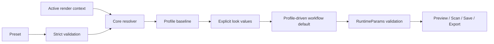

# Presets

## Contract

A **preset** is a named, reusable set of film and print profile selections and visual simulation controls. A preset is not a complete GUI state, an input image, a viewer state, an export configuration, a LUT, a calibration profile, or a workflow selection. A preset is either **built-in** or **user-owned**.

A preset document is a **look preset** or a **section preset**. A look preset carries both profile references and every look-owned group. A section preset carries exactly one section of the look and no profile reference; a section is a named set of look-owned parameter paths, defined by the [preset design](design.md). The kind is derived from the carried scope, never declared by a field, and a document that carries neither a whole look nor exactly one section must be rejected.

Built-in look presets must enable the selected film profile's Hanatos2025 adaptation surface. The surface coefficients belong to the film profile. The user may turn the surface off after applying the preset.

A preset **name** is its identity: the document `name`, the document file stem, and the selector used by the GUI and the CLI. A name must be unique inside its group and may repeat across groups. The groups are `Built-in` and `My Presets`. The [preset design](design.md) owns the name rules, file locations, discovery, conflicts, and writes.

The GUI provides a Presets browser for look presets in a collapsible panel on the left of the window, and one preset menu per section for section presets. The browser shows the two groups. Each row shows the preset name and its film and print references. The active row is marked. A modified marker appears while the active look controls differ from the applied document. The MAIN control panel must not repeat the browser list. User presets must not be implemented by reusing complete `GuiState`.

A section preset must appear only in the menu of its own section, never in the browser. Every section of the section table must carry that menu, because Save as lives there: an empty list must offer to save the section's current controls and must state that a preset file can also be placed in the library. A section menu must report the issues of the documents it would carry. A section menu must show the name of the section preset whose controls match the section and `custom` otherwise. That match must be derived from the section's controls and must not be stored as separate state.

Browser rows and section menus must be ordered by name, case-insensitively, with a deterministic tie-break, so one library always presents one order. User-selectable sorting is outside this contract.

## User library

A user preset is a valid preset document in the preset library directory. Placing such a document in that directory makes it available to the GUI browser and to preset name resolution. The browser and the CLI must use the same discovery and name rules.

The GUI must support these library operations for look presets:

- **Save as**: capture the active look controls as a new look preset under a name the user edits.
- **Update**: replace the stored document of the active user preset with the active look controls.
- **Revert**: restore the look controls of the applied document and clear the modified marker.
- **Rename**: rename the document file and its name together, and preserve its look values.
- **Duplicate**: copy a built-in or user preset into `My Presets` under a new name.
- **Delete**: remove a user preset document after confirmation.
- **Import**: copy an external document into `My Presets` as a new preset. An existing name in `My Presets` must not be replaced; a conflicting import must offer a renamed copy.
- **Export**: write the selected document to a chosen path.
- **Show file**: reveal the document path of a user preset. A built-in preset has no path, so this action must be unavailable for it.

A section menu must offer the same operations for the section presets it lists: **Save as** captures that section's controls, and Rename, Duplicate, Delete, Export, and Show file act on that section's documents. Both kinds must share one discovery, write, and validation implementation.

The remembered applied document is always a look preset; a section application is an edit and never becomes the applied preset. The GUI writes look presets through Save as and Update, and a section preset is authored as a file or through a section menu until an arbitrary scope-capture action exists.

A name that exists in both groups must remain reachable in both. Editing look controls after an application must mark the active preset modified and must not rewrite any document. Built-in presets must remain immutable.

The browser must list, with its path, every document that cannot be read, parsed, or accepted. An issue must not hide the remaining library. An empty library must state how to save the current look.

The browser must remember the applied preset group and name across restarts. A remembered preset whose document is absent must be shown as missing. The modified state must not persist across restarts. Restoring GUI state must restore its stored controls and must not re-apply the remembered preset document.

Ordinary startup must restore the browser metadata independently of the configured startup controls. An explicitly loaded GUI state must supply its own browser metadata and must not inherit the remembered selection. Remembering a browser selection must not save current controls as the startup default.

Renaming or deleting the applied user preset must update the marker: a rename follows the new name, and a delete leaves the look controls untouched and shows the remembered name as missing.

Browser rows must show the preset name, the film reference, and the print reference. Live thumbnails, favorites, search, sorting options, collections, per-scope preset memory, arbitrary scope capture, and batch application are outside this contract.

### Apply

- Selecting a preset validates the document, or the section it carries, before changing active controls.
- A look preset identifies both film and print profiles. The resolver validates film=`support=film, stage=filming` and print=`support=paper, stage=printing`.
- A preset does not store or directly apply a workflow. A look preset selects the corresponding workflow default: negative film selects `input > film > print > scan`, and positive film selects `input > film > scan`. The user may then choose another supported workflow manually. A section preset carries no film reference and must not change the workflow.
- Applying a look preset replaces all look-owned controls together, including the controls of every section, so a section preset must be applied after a look change to take effect. It clears transient Scan-for-print state, invalidates dependent render state, and schedules a render according to Auto preview.
- Applying a look preset normalizes the scanner output: when the resolved film is positive or the selected workflow route is not `input > film > scan`, the output becomes the direct-scan mode. `core` owns that rule once for the GUI and the CLI.
- Applying a look preset does not change recorded explicit-leaf ownership. Only a section preset or a sparse parameter source marks its own leaves explicit, and those marks survive a later look application.
- Applying a section preset replaces exactly the controls of its section, and those values count as explicit. Every other control retains its value, including explicit values from an earlier preset or parameter source, so the result does not re-derive them from stock defaults. It clears transient Scan-for-print state, invalidates dependent render state, and schedules a render according to Auto preview.
- Applying a section preset that would introduce a scanner-output, workflow-route, scan-film, film-profile, scanner-correction, or grain-engine combination the pipeline rejects must fail without changing any control. A state that already fails that check may still receive an unrelated section edit.
- Applying a section preset must not replace the remembered applied preset. It is an edit, so an applied look preset becomes modified.
- Applying a preset preserves loaded image and metadata, RAW/source settings, source exposure, crop, resize, rotation, viewer/display state, Save settings, and Export settings.
- Built-in presets are immutable. Editing controls after an apply never rewrites the built-in definition.

### Workflow defaulting

Changing a film profile selects the corresponding workflow default while the workflow remains user-editable:

A profile change must not apply hidden stock-specific look values. The workflow selector remains editable until the next film profile change. The positive path does not execute print stages; its explicit print profile remains part of the portable pair.

A serialized `route` or `workflow` field is unknown and rejected.

### Look ownership

A look preset owns film and print selection plus explicit film, print, enlarger, diffusion, halation, coupler, grain, glare, base, chemistry, scanner, and output-mix controls. Existing material controls and `output_mix` follow [Material controls and output composition](../material-response/spec.md). A section preset owns exactly the controls of its section. A look also owns look-relevant processing settings: hanatos2025 adaptation window/surface switches, spectral Gaussian blur, and CAT16 (`LookSettingsParams`, a subset of `SettingsParams` with the same defaults). It does not own the working wavelength grid, LUT wiring, performance toggles, or other `SettingsParams` fields. Scanner look controls include receiver, negative conversion method, finish, finish strength, and acquisition and interpretation controls exposed by the film-chain contract. A preset preserves enabled states, inactive controls, and f64 values; receiver and finish provenance remain attached. It does not own any `io` controls, including output gamut processing, or workflow, source declarations, RAW/source correction, geometry, viewer/display, export destination, preview limits, cache, debug/taps, startup state, dialog directories, or random seed. Applying a look preserves caller `io` except existing scanner-output normalization in Apply.

### Implementation rules

- `core` owns the typed look model, strict schema validation, profile compatibility, profile-driven workflow defaulting, capture, candidate resolution, the library directory policy, discovery, name conflict rejection, and atomic document writes.
- `gui` owns browser presentation, group and row state, library actions, active and modified state, transient state, and user-editable workflow controls.
- `GuiState` remains complete GUI-state persistence and is not a look payload.
- `core` owns strict parsing, profile resolution, stock-baseline construction, explicit look-value overlay, workflow-default derivation, and `RuntimeParams` validation. Explicit preset neutral filters must survive subsequent runtime preparation without changing the user's database-calibration setting.
- Existing `--params` invocations, RenderRecipe, LUT behavior, CPU f64 semantics, WGPU f32 semantics, Grain V2 algorithm, Python parity, and raw profile assets must retain their results with `output_mix.amount = 1`, except for the explicit [output lightness retirement](../material-response/spec.md#output-boundary-and-retirement) and [optical-order cutover](../film-chain/spec.md#optical-order-cutover). The cutover does not change stored blur units, grain selectors, or print-glare ownership. The [CLI parameter language](../cli-parameters/spec.md) owns command syntax and composition rules.

The portable canonical snake-case schema contains:

- `schema_version`, `name`, optional `author` and `description`;
- `film_profile` and `print_profile`, each with stock, optional profile version, and optional `sha256-<lowercase-hex>` content identity; both are required in a look preset and absent from a section preset;

- `parameters`, the typed look-owned parameter object: complete in a look preset, the paths of its section in a section preset;
- `provenance`, the SpektraFilm implementation and model versions.

It must not contain `route`, `workflow`, image pixels/paths, RAW data, LUT pixels, viewer rasters, GUI paths, credentials, random seeds, or Dehancer-specific fields. Unknown fields are rejected. The resolved candidate is returned without mutating active GUI state; GUI commits only after successful resolution.

### File formats

TOML must be the default preset export format. Readers must accept `.toml` and `.json` files as carriers of the same typed schema. The file extension must select the parser. A reader must not try another parser after a parse failure. Both carriers must apply the same version, ownership, profile, type, and value validation.

The preset schema version must be 3 because a whole look adds `output_mix`. A version 3 look must carry that group in addition to the existing look. It does not expand preset ownership into `io`; `parameters.io` remains invalid. A reader must accept version 1 and version 2 documents through an explicit migration. Version 1 migration must discard the old `id`. Migration of an older whole look must supply `output_mix.amount = 1` and retain existing material controls, enlarger neutral values, and M/Y shifts. An older section must preserve sparse omission and must not acquire new leaves. Resolving, exporting, or updating a migrated whole look must not capture or replace caller `io` settings. Exporters must write version 3. The unshipped `film_render.response`, `print_render.response`, `enlarger.c_filter_shift`, `reproduction`, and `io.finished_rgb_output_processing` fields must fail normal unknown-field validation in every accepted version, including draft version 3 documents. The unshipped `output response` section must be rejected. None has a compatibility alias, default, or migration.

A look preset must contain every look-owned group. An exporter must write every non-optional editable look control so a newly exported preset does not depend on implicit defaults. Readers must retain the existing omitted-field and JSON null decoding rules of the typed model. Readers must materialize omitted controls before resolution or re-export. TOML absence must represent an unset optional control; an exporter must omit unset optional controls in TOML. The two carriers must not introduce a separate schema version or field vocabulary. A future change to accepted omitted-field behavior must use an explicit schema migration rather than silently rejecting existing documents.

A section preset must carry exactly the parameter paths of its section and must not carry a profile reference. Its payload must follow the leaf-merge rules of a parameter-file source in the [CLI parameter language](../cli-parameters/spec.md), including the rejection of unknown fields, duplicate keys, and omitted values acquired by default-filled deserialization, and an exporter must write exactly what it carries rather than filling omitted controls. Both kinds use the same schema version, the same name rules, and the same profile and value validation for what they carry.

Export and reload must preserve the represented finite f32 and f64 values. Export must not reduce numeric precision for shorter text. Readers must accept TOML comments. Re-export need not preserve comments or source formatting.

Readers must reject non-finite numeric controls and numeric values that overflow their declared f32 or f64 type. TOML `nan`, `inf`, date/time values, and numbers that become non-finite during typed conversion must not reach the resolver. Readers must not convert unsupported carrier types to strings. This rule must apply before runtime validation so JSON and TOML cannot admit different numeric domains.

Preset files must not support includes, inheritance, expressions, environment interpolation, or references to GUI state files.

### GUI state compatibility

GUI state must retain its JSON contract. Loading a GUI state must not interpret it as a preset. Importing a preset must not interpret it as a complete GUI state.

Saving state after applying or editing a preset must store the actual controls and the calibration policy needed to restore them. Restoring that state must preserve explicit neutral filters through runtime preparation. The saved state must not depend on the preset file or built-in definition remaining available or unchanged. Any new Rust-owned state metadata must use the existing versioned Rust extension and must preserve existing Python state normalization.

Complete GUI states and render recipes must default an absent new `output_mix.amount` to 1. Their versioned legacy complete-document migration must apply the [output lightness retirement rule](../material-response/spec.md#output-boundary-and-retirement): allow an absent or null `io.output_gamut_compress.lightness_compression`, but reject every explicit numeric triplet even when the old gamut algorithm ignored it. The error must identify that exact path, state that no automatic replacement exists, and require explicit removal. It must not suggest a deleted response group. Other caller `io` settings must remain intact. Current complete documents, sparse sources, and inline assignments must reject the retired leaf even when null. New writers must never emit it. The unshipped response and Cyan-shift fields must fail normal unknown-field validation rather than gain defaults or migration support. A migration failure must preserve the source document, active state, and existing output.

Capturing a preset from the GUI must use the active look controls. Applying it must preserve the excluded context defined in [Look ownership](#look-ownership). A captured section must carry an unset optional control as an explicit null, so re-applying the capture restores the captured unset value; a capture that carries explicit nulls uses the JSON carrier.

### Resolution flow

The preset and active render context are separate inputs to the same runtime:

The resolver must preserve image/source, geometry, viewer, display, Save, Export,
debug, precision, backend, and random-seed context. The GUI commits the returned
candidate only after resolution succeeds.

### Transaction and stale results

Applying a preset validates and resolves first, commits film/print/look parameters together, selects the profile-derived workflow default, preserves excluded context, clears transient Scan-for-print, increments a parameter revision, invalidates caches, and marks the render dirty. Render workers carry the parameter revision and stale results cannot replace a newer preset result.

A failed application must preserve active controls, the applied marker, transient Scan-for-print state, and the parameter revision. Only the error status may change.

CLI preset selection must use the same core resolver and name rules as GUI preset application. The [CLI parameter language](../cli-parameters/spec.md) defines selection, sparse parameter files, and command compatibility.
